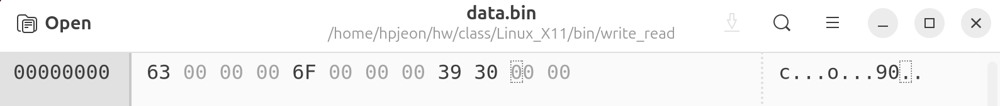
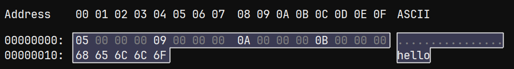

# Linux and X11
- Summary and note for operating/architecting Linux and X11 over Linux workstation/cluster
  - Updated as of Sept 2026
- X11 will be replaced with Wayland

## Systemd comand line utilities
- systemctl
- journalctl
- systemd-analyze
- systemd-run
- loginctl
- networkctl # Not found in RHEL package?
- timedatectl
- localectl
- hostnamectl
- coredumpctl
- resolvectl
 
## Run level: mode of operation that implements Unix System V-style initialization
- Ref: https://www.cyberciti.biz/tips/linux-changing-run-levels.html
- Each runlevel is configured at /etc/rc0.d, rc1.d, rc2.d, rc3.d, rc4.d, rc5.d, rc6.d
  - Each symbolic link starting with 'S*' means starting process
  - Each symbolic link starting with 'K*' means killing process
- Runlevel 0
  - `sudo init 0` # shutdown/halt
  - Systemd targets: runlevel0.target, poweroff.target
- Runlevel 1
  - `sudo init 1` # single user mode
  - Systemd targets: runlevel1.target, rescue.target
- Runlevel 2
  - `sudo init 2` # multi user without networking
  - Systemd targets: runlevel2.target, multi-user.target
- Runlevel 3
  - `sudo init 3` # multi user with networking. an alias of `sudo systemctl isolate multi-user.target`
  - Systemd targets: runlevel3.target, multi-user.target
- Runlevel 4 # user-definable
  - Systemd targets: runlevel4.target, multi-user.target
  - https://www.thegeekyway.com/runlevels-and-rc-d-scripts/
- Runlevel 5 # multiple user mode undere GUI - standard for most Linux-based system
  - Systemd targets: runlevel5.target, graphical.target
- Runlevel 6 # reboot
  - Systemd targets: runlevel6.target, reboot.target
- Related command:
```bash
$ runlevel
N 5
$ who -r
         run-level 5  2026-08-13 16:23  
$ systemctl get-default
graphical.target
```
- Installing CUDA driver after OS kernel update
  - `sudo yum update -y` # including kernel update
  - `sudo reboot`
  - When reboots, GUI will be broken
  - ssh to the server/workstation or ctrl+alt+backspace or ctrl+alt+F2 for CLI login
  - `sudo init 3` # Disable GUI
  - `sudo sh ./Nvidia-driver-XXXX.sh` # Re-install CUDA driver

## Boot target
- Types
  - graphical.target
  - multi-user.target
  - rescue.target
  - emergency.target
  - poweroff.target
  - reboot.target
- layered targets: sysinit.target -> basic.target -> multi-user.target -> graphical.target
- checking the current default target: systemctl get-default
- set to no GUI: `sudo systemctl set-default multi-user.target` # server mode
- enable GUI: `sudo systemctl set-default graphical.target`     # most of workstations
- without rebooting:
    - `sudo systemctl isolate multi-user.target`
    - `sudo systemctl isolate graphical.target`

## Nitty-gritty on X11
- Ref: https://en.wikibooks.org/wiki/Guide_to_X11/Starting_Sessions
- xinit: X window system initializer
- startx
  - Initializes an X session
  - A shell script running xinit
  - May use $HOME/.xinitrc or /etc/X11/xinit/xinitrc or /etc/X11/xinit/xserverrc
- xwd: dumps an image of an X window
- Relative system variables
```bash
$ echo $XAUTHORITY
/run/user/1000/gdm/Xauthority
$ echo $DISPLAY
:1
```
- What is seat0?
  - Ref: https://wiki.archlinux.org/title/Xorg_multiseat
```bash
$ loginctl
SESSION  UID USER   SEAT  TTY  STATE  IDLE SINCE
      2 1000 hpjeon seat0 tty2 active no   -    

1 sessions listed.
$ loginctl list-seats
SEAT 
seat0

1 seats listed.
$ loginctl seat-status seat0
seat0
Sessions: *2
 Devices: n/a
         ├─/sys/devices/pci0000:00/0000:00:02.0/drm/card1
         │ [MASTER] drm:card1
         │ ├─/sys/devices/pci0000:00/0000:00:02.0/drm/card1/card1-DP-1
         │ │ [MASTER] drm:card1-DP-1
...         
         ├─/sys/devices/virtual/input/input17
         │ input:input17 "Veikk Stylus"
         ├─/sys/devices/virtual/input/input18
         │ input:input18 "Veikk Mouse"
         ├─/sys/devices/virtual/input/input19
         │ input:input19 "Veikk Keyboard"
         ├─/sys/devices/virtual/misc/kvm
         │ misc:kvm
         └─/sys/devices/virtual/misc/rfkill
           misc:rfkill
```
- How to find the owner of the magic cookie? 
  - Find display number like :0, :1, ... from xauth list
  - `ps aux |grep :10`
- `tmp/.X11-unix/X0`
  - Unix Domain Socket (UDS) for X11 display
  - https://unix.stackexchange.com/questions/196677/what-is-tmp-x11-unix
    - `man 7 socket`
    - https://www.geeksforgeeks.org/linux-unix/understanding-unix-sockets/ 
- How xauth works?
  - Manages authorization information using **magic cookie**
  - `xauth list`
- MIT-MAGIC-COOKIE-1
  - Ref: https://community.sap.com/t5/technology-blog-posts-by-members/use-of-magic-cookies-in-linux/ba-p/13880108
  - X11 authentication, creating a random secret value called a magic cookie
  - When cooki is correct, access is granted
  - The cookie is stored at ~/.Xauthority. Check by `echo $XAUTHORITY`
    - If ~/.Xauthority doesn't exist, /run/user/XXXX/gdm/Xauthority
  - How it works?
    - GDM or display manager creates a random cookie and stores at $Xauthority
    - when xterm or xlock runs, it reads cookie and sends it to the X server
    - If cookie is not accepted, `Invalid MIT-MAGIC-COOKEY-1 key` or `can't open display`
  - to see all cookies, `xauth list`
- Enabling GUI for root in a network-connected system
  - Adding MIT-MAGIC-COOKIE-1
    - `ssh -X serverA`
    - `xterm` # runs OK
    - `sudo xterm` # not working, saying wrong authentication
    - `xauth list` #
    - `xauth add hostname/unix:0 MIT-MAGIC-COOKIE-1 123456789`
    - `sudo xterm` # not working ? (Aug 2026)
  - Another approach
    - `echo $XAUTHORITY`
    - `sudo XAUTHORITY=/run/user/1929221304/gdm/Xauthority xterm` # this runs OK. Aug 2026 at Rocky8.10
  - Another method
    - `ssh -X serverA`
    - `echo $XAUTHORITY` # this is empty but '~/.Xauthority' is found
    - `sudo XAUTHORITY=/home/foo/.Xauthority xterm` works.
- what is /tmp/.X11-unix/X1024 ?    
  - Could be a left-over from XWayland
- XDG variables
  - XDG_DATA_DIRS
  - XDG_RUNTIME_DIR
  - XDG_SESSION_TYPE # x11 or wayland
  - XDG_CONFIG_DIRS  
- References:
  - https://medium.com/@bshreyasharma1/running-gui-applications-with-sudo-on-linux-by-sharing-xauth-cookies-48ea6e4c13fc
  - https://docs.citrix.com/en-us/linux-virtual-delivery-agent/current-release/configure/administration/others/xauthority.html
  - https://superuser.com/questions/1482471/xorg-x11-how-to-provide-cookie-based-access-to-x-server-using-xauth
  - https://packages.guix.gnu.org/packages/xauth/
  - https://goteleport.com/blog/_next/image/?url=%2Fblog%2F_next%2Fstatic%2Fmedia%2Fx11-forwarding-program.537e15a0.png&w=3840&q=75&dpl=31740931110
  - https://goteleport.com/blog/x11-forwarding?source=post_page-----70c239f02a2e---------------------------------------
  - https://medium.com/@nadzeya/ssh-x-forwarding-or-how-to-open-desktop-applications-on-linux-server-c198b00a6a55
  - https://medium.com/@saicoumar/configuring-x11-forwarding-over-ssh-1a5a21fc707b


## XDG (X Desktop Group)
- XDG_RUNTIME_DIR
  - temporary file for user isolation
  - specifications.freedesktop.org/basedir/latest
    - XDG_DATA_HOME
    - XDG_CONFIG_HOME
    - XDG_STATE_HOME
    - XDG_DATA_DIRS
    - XDG_CONFIG_DIRS
    - XDG_CACHE_HOME
- xfce vs gnome vs kde
  
## what is flatpak
- universal sw packaging and deployment system for Linux
- sandboxed system. not yum nor dnf
- no sudo. rootless per-user installation
```bash
flatpak install flathub org.gimp.GIMP
flatpak search gimp
flatpak run org.gimp.GIMP
flatpak list --app
```

## From x11 to Wayland
- Since ubuntu 25
- No more xterm or xeyes
- tigervnc not working anymore
- gnome-remote-desktop as rdp in MobaXterm?
- ssh -X or ssh -Y will not work natively on wayland
  - waypipe ssh server1
  - Xwayland runs in backend of wayland
 
## RDP for Rocky8 and mobaxterm
- Steps:
  - sudo dnf install xrdp             
  - sudo systemctl start xrdp
  - sudo systemctl enable xrdp
  - sudo firewall-cmd --add-port=3389/tcp --permanent
  - sudo firewall-cmd --reload
  - At mobaXterm, make a new RDP session - it conflicts with X11 at seat0. wayland doesn't support xrdp
  - xrdp vs gnome-remote-desktop
  - Mobaxterm doesn't support native wayland yet (Sept 2026)

### What is Active Directory?
- Active directory
  - by logical components
      1. Forest
      2. Tree
      3. Domain
      4. Organization Unit (OU)
      5. Objects
  - by physical components
      1. Domain contollers (DC)
      2. Global Catalog (GC)
      3. Sites
  - Core services
      1. LDAP: query directory info, search users/groups, update attributes
      2. Kerberos: authentication, single sign-on (SSO), ticket management
      3. DNS: locating domain controllers, locating kerberos services, service discovery
  - Administrative components
      1. Group Policies (GPOs)
      2. Security Groups
- How LDAP works with Active Directory

## Using Addr2line
- addr2line -e ./a.out -s <mem_addr> # find mem_addr from from objdump
- addr2line -e ./a.out -a <mem_addr>
- addr2line -e ./a.out -p <mem_addr>
- addr2line -e ./a.out --functions --demangle 0000000000401346
- addr2line -e ./a.out -f -C -p  0000000000401346
  - main at /home/ASC.LOCAL/bxj670/HW/cpp/time3.cpp:7
  - find memory address using `nm ./a.out |grep func_name` or backtrace within gdb
  - Look for the ip (Instruction Pointer) or pc (Program Counter) address.
 
## Avahi-daemon
- Zero-configuration networking like Bonjour in Apple
- Allows the machine to connect to devices using a `.local` name instead of remembering IP address
  - Instead of `ssh xx.yy.zz.qq`, `ssh serverB.local` works

## Debugging Format
- DWARF3, DWARF4, ...
- https://dwarfstd.org/dwarf4std.html
- 2014 LLVM Developer's meeting: "Debug Info Tutorial"
  - https://youtu.be/_wqX9H2A66M?si=f5OoFizjb1HvFoMF
  - What is DWARF then?
    - Standard for how to encode program structure, line, columns, variable
    - Permissive standard with vendor extensions
  - DWARF Vaguaries
     - DWARF consumers not generalized because they've only seen output from one tool (GDB works great with GCC's DWARF output)
     - is_stmt - a line table feature "indicating that the current instruction is a recommended breakpoint location" - omitting this caused GDB to do ... strange things
  - DWARF structure
    - debug_info: source construct description (functions, types, namespaces, etc)
    - debug_line: instruction -> source line mapping
    - Use llvm-dwarfdump and similar tools to examine this data in object and executable files
    - We skip the details of debug_loc, debug_ranges, debug_string, debug_abbrev, ...
  - DWARF structure - info
    - Hierarchical tag + attribute format
    - Something like a binary XML?
    - Tab_subprogram[], AT_name(), AT_decl_file(), AT_decl_line(), AT_type(), AT_external(), ...
  - DWARF structure - line table
    - State machine & all that
    - In order to save disk space
```
Addr Line File Flags
---- ---- ---- ---------
0x00     1    1 
0x07     2    1 prologue_end
0x8e     3    1 
0x18     3    1 end_sequence
```
  - LLVM uses DIBuilder for debug_info    
- How DWARF works: Debug information entries
  - https://calabro.io/dwarf/die  

## How to use patch command
- `diff -u old.txt new.txt > patch_file`
- `patch -N -R -p0 < patch_file` # Testing patches
- `patch original_file < patch_file`
- Why we don't just over-write?
  - Only diffencs can be updated
  - Potential scenario:
    - `diff -u old new > patch_content`
    - Edit old file, adding some comments or something
    - Overwriting with new will lose those comments in old
    - `patch old < patch_content` will update the differences, keeping the comments made above

# Linux network

## Netmask in ip setup
- Netmask 255.255.255.0 vs 255.255.255.192
- 255.255.255.0 = 11111111.11111111.11111111.00000000 => /24 => 24 of 1 and left-over as zero
  - one larger netwok with 254 hosts
- 255.255.255.192 = 11111111.11111111.11111111.11000000 => /26 => 26 of 1 and left-over as zero
  - four smaller networks, each with 62 hosts
  - 192.168.1.0/26, 192.168.1.64/26, 192.168.1.128/26, 192.168.1.192/26

## Asymmetric subnetting
- 192.168.1.101 couldn't reach 192.168.1.201
  - Found that 101 vs 201 had different netmask => Asymmetric subnetting
- 192.168.1.101 has /26. When it tries to reach 201, it will send packet to default gateway as it thinks 201 is outside of subnet
- 192.168.1.201 has /24. Now it tries to respond but it thinks 101 is inside of subnet, and ARPs directly to 101. So handshake fails

# Binary/Hex Editor

## How/when to use a binary editor (from Gemini)
1. File Header Inspection & Corrupted File Repair
  - Every file format starts with specific "magic bytes" (signatures) that tell the operating system what the file is.
  - Identifying unknown files: If a file lacks an extension or won't open, opening it in GHex lets you read the first few bytes (e.g., 89 50 4E 47 for a PNG image or 25 50 44 46 for a PDF) to identify its true format.
  - Fixing corrupted headers: If a file's header gets damaged during a failed download or disk error, you can manually paste valid header bytes from a working file of the same type to make it readable again.
2. Reverse Engineering & Binary Patching
  - Software engineers and security researchers use GHex to examine compiled executables without needing the original source code.
  - Finding hardcoded strings: You can search the ASCII pane for error messages, URLs, or file paths embedded inside a compiled program.
  - Patching binaries: Developers sometimes alter specific bytes—such as changing a conditional jump instruction or tweaking a hardcoded limit—to test software behavior or bypass a broken check in legacy software.
3. Game Save Editing & Modding
  - In single-player PC gaming (especially older titles or indie games), save files are often stored as uncompressed binary data rather than plain text.
  - Modifying stats: Players open save files in GHex, search for the hexadecimal equivalent of their current in-game currency, health, or item count, and overwrite those bytes to increase the values.
  - Unlocking content: Toggling specific 00 bytes to 01 can often unlock hidden levels, characters, or debug menus.
4. Embedded Systems & Firmware Analysis
  - Hardware engineers working with microcontrollers, routers, or IoT devices use GHex to inspect raw firmware dumps and memory images.
  - Verifying memory layouts: Engineers check compiled .bin or .hex firmware files to ensure bootloaders, configuration tables, and application code sit at the exact memory offsets required by the hardware.
  - Extracting assets: You can locate and carve out embedded images, certificates, or configuration blocks stored inside monolithic firmware images.
5. Debugging Network Protocols & Custom File Formats
  - When writing software that communicates over raw TCP/UDP sockets or saves data in a custom binary format, standard logging often hides invisible characters.
  - Spotting off-by-one errors: GHex's built-in data conversion table (which translates highlighted bytes into signed/unsigned integers, floats, and binary) makes it easy to verify endianness (byte order) and catch misaligned data fields.
  - Checking control characters: It clearly displays non-printable characters like null terminators (00), carriage returns (0D), and line feeds (0A) that cause silent bugs in parsers.

## xxd
- CLI hex tool
- Ref: https://www.binarytranslator.ai/xxd-command/
```bash
$ more txt.txt 
hello world

$ xxd txt.txt 
00000000: 6865 6c6c 6f20 776f 726c 640a 0a         hello world..
```
- In hex, 68 -> h, 65 -> e, ... , 20 -> space, 0a -> line feed
- JPEG File signature : https://www.dev-toolbox.tech/tools/hex-editor/examples/jpeg-file-signature
  - JPEG magic bytes: FF D8 FF E0
  - Doesn't prove that the file is valid or safe though
```bash
$ xxd -l 16 AAA.jpg 
00000000: ffd8 ffe0 0010 4a46 4946 0001 0101 0048  ......JFIF.....H
$ xxd -l 16 XXX.jpg 
00000000: ffd8 ffe0 0010 4a46 4946 0001 0102 0076  ......JFIF.....v
--------->^^^^ ^^^^<-----------
```
- ELF (Executable and Linkable Format) magic bytes: 7F 45 4C 46
  - https://filesignature.org/elf
```bash
$ xxd -l 16 ./bin_write.o # object file from *.c
00000000: 7f45 4c46 0201 0100 0000 0000 0000 0000  .ELF............
$ xxd -l 16 ./a.out  # executable made from gcc
00000000: 7f45 4c46 0201 0100 0000 0000 0000 0000  .ELF............
--------->^^^^ ^^^^ <-------
```  

## hexdump
- Ref: https://opensource.com/article/19/8/dig-binary-files-hexdump
```bash
$ convert -size 1x1 canvas:black pixel.png
$ file pixel.png 
pixel.png: PNG image data, 1 x 1, 1-bit grayscale, non-interlaced
$ xxd pixel.png 
00000000: 8950 4e47 0d0a 1a0a 0000 000d 4948 4452  .PNG........IHDR
00000010: 0000 0001 0000 0001 0100 0000 0037 6ef9  .............7n.
00000020: 2400 0000 2063 4852 4d00 007a 2600 0080  $... cHRM..z&...
00000030: 8400 00fa 0000 0080 e800 0075 3000 00ea  ...........u0...
00000040: 6000 003a 9800 0017 709c ba51 3c00 0000  `..:....p..Q<...
00000050: 0262 4b47 4400 01dd 8a13 a400 0000 0774  .bKGD..........t
00000060: 494d 4507 ea0b 1b00 3205 16d9 d335 0000  IME.....2....5..
00000070: 000a 4944 4154 08d7 6360 0000 0002 0001  ..IDAT..c`......
00000080: e221 bc33 0000 0000 4945 4e44 ae42 6082  .!.3....IEND.B`.
$ hexdump --canonical pixel.png 
00000000  89 50 4e 47 0d 0a 1a 0a  00 00 00 0d 49 48 44 52  |.PNG........IHDR|
00000010  00 00 00 01 00 00 00 01  01 00 00 00 00 37 6e f9  |.............7n.|
00000020  24 00 00 00 20 63 48 52  4d 00 00 7a 26 00 00 80  |$... cHRM..z&...|
00000030  84 00 00 fa 00 00 00 80  e8 00 00 75 30 00 00 ea  |...........u0...|
00000040  60 00 00 3a 98 00 00 17  70 9c ba 51 3c 00 00 00  |`..:....p..Q<...|
00000050  02 62 4b 47 44 00 01 dd  8a 13 a4 00 00 00 07 74  |.bKGD..........t|
00000060  49 4d 45 07 ea 0b 1b 00  32 05 16 d9 d3 35 00 00  |IME.....2....5..|
00000070  00 0a 49 44 41 54 08 d7  63 60 00 00 00 02 00 01  |..IDAT..c`......|
00000080  e2 21 bc 33 00 00 00 00  49 45 4e 44 ae 42 60 82  |.!.3....IEND.B`.|
```
- PNG magic bytes: https://filesignature.org/png
  - 89 50 4E 47 0D 0A 1A 0A

## ghex
- writer.c
```c
#include <stdio.h>

int main(void) {
    int values[] = {10, 20, 30};
    int result[3];

    FILE *file = fopen("data.bin", "wb");
    if (file == NULL) return 1;
    fwrite(values, sizeof values[0], 3, file);
    fclose(file);
    return 0;
}
```
- reader.c
```c
#include <stdio.h>
int main(void) {
    int values[] = {10, 20, 30};
    int result[3];
    FILE *file = fopen("data.bin", "rb");
    if (file == NULL) return 1;
    size_t count = fread(result, sizeof result[0], 3, file);
    fclose(file);
    printf(" %d %d %d \n", result[0], result[1], result[2]);
    return 0;
}
```
- Demo:
```bash
$ ./writer.exe 
$ ./reader.exe 
 10 20 30 
$ hexdump --canonical data.bin
00000000  0a 00 00 00 14 00 00 00  1e 00 00 00              |............|
```
- Dex to Hex: 10-> 0xA, 20 -> 0x14, 30 -> 0x1E
- Now let's edit with ghex:
  -  Dex to Hex: 99 -> 0x63, 111 -> 0x6F, 12345 -> 0x3039



- Demo:
```bash
$ hexdump --canonical data.bin
00000000  63 00 00 00 6f 00 00 00  39 30 00 00              |c...o...90..|
0000000c
$ ./reader.exe 
 99 111 12345 
```

## ImHex
- https://github.com/WerWolv/ImHex
- Let's write a C code producing a binary file:
```c
#include <stdio.h>
#include <stdlib.h>
int main() {
  int x = 5;
  int v[3] = {9, 10, 11};
  FILE *f = fopen("test.bin","wb");
  size_t err;
  err = fwrite(&x, sizeof(int), 1, f);
  err = fwrite(v,  sizeof(int), 3, f);
  char c[5] = {'h','e','l','l','o'};
  err = fwrite(c,  sizeof(char), 5, f);
  fclose(f);
  return 0;
}  
```
- Open the test.bin using imhex or ghex:



- The value 5 is stored at 00-03. As `int` is 32bits or 4 bytes, it consumes 4 address cells. Note that 5 is stored at 00, not 03, as this is little-endian
- 09 is found at address 04
- 0A (which is 10 in decimal) at address 08
- As 4 int values (5,9,10,11) consume the first 64bit addresses, 'hello' is stored in the next address 00000010
