# Learn Bioinformatics From Scratch (Theory & Practical)
- Instructor: Naeem Mahmood Ashraf

## Section 1: Module 1 Databases

### 1. Definition of Databases
- Data storage
- Systematic storage
- Some important terms
  - Query
  - Entry (or row/record)
  - Field (or column/attribute)

### 2. Database Design
- Flat file format
  - Easy to construct
  - Slower
  - Unsuitable for large data sets
  - Lack knowledge discovery
- Relational database
  - SQL
- Object oriented database
  - Small DB

### 3. Knowledge Discovery
- Fundamental features of modern databases
- Identifying hidden linkages amon datapoints which were unknown during data acquisition

### 4. Biological Databases
- Primary database
  - Contains data directly from experiments like sequencing data, microarray expression analysis, X-ray crystallography
  - NCBI
  - PDB
  - GEO
  - ZINC
- Secondary databases
  - Contains information derived from pirmary or experimental data like translated sequences of protein
  - CATH
  - UniProt
- Specialized databases
  - contain information about one specific domain of biology
  - HIV
  - SNPs
  - HCV
  - ONIM
  - GWAS Catalog

### 5. Take Home Key Points
- Most of bioinformatics analysis begins from the retrieving information from database

### 6. Practical -1: NCBI Nucleotide Database
- What is nucleotide?
  - The basic structural building block of nucleic acids, specifically DNA and RNA
  - 3 components of nucleotide
    - A nitrogen-containing base (nucleobase): Carries genetic instructions. In DNA, the bases are adenine (A), thymine (T), guanine (G), and cytosine (C). In RNA, uracil (U) replaces thymine.
    - A five-carbon (pentose) sugar: This is deoxyribose in DNA or ribose in RNA.
    - A phosphate group: Connects to the sugar of the next nucleotide to form the backbone of the strand
- https://www.ncbi.nlm.nih.gov/
  - Primary DB: nucleotide
  - Secondary DB: OMIM
  - Specialized DB: 
- FASTA format:
  - Begins with `>`
- Downloading multiple sequences in a single download

### 7. Practical-2: Protein Databank (PDB)
- https://www.rcsb.org
- PDB ID is alpha-numeric four digit
- Experimentally, 3D structures of proteins are determined using:
  - X-ray crystallography
  - Nuclear Magnetic Resonance (NMR)
  - Cryo-Electron Microscopy (Cryo-EM)
- Structure annotation helps to understand the structure

### Quiz 1: Quiz 1

### Assignment 1: Assignment 1
- Download FASTA data of:
  - KT749721.1: 2160+57 = 2217
  - GBYX01270392.1: 660 + 53 = 713
  - KR711802.1: 2160+27 = 2187
- Find how many nucleotides are present in each gene
- No info of nucleotides length in FASTA. GenBank format shows size of nucleotides in a simple view

### 8. Recent Update About Protein Databank
- Results of Alpha fold and Rosetta fold are added as of 2022
- Experimental data in a flask symbol while computing model data in a symbol of a computer

### Role Play 1: Searching the Sequences in Databases

## Section 2: Module 2 Sequence Alignment

### 9. What is Sequence Alignment?
- The way to identify the evolutionary sequence similarities and differences is called Sequence Alignment

### 10. Some Important Terms
- Homologous sequences
  - When sequences shared enough resemblance than they are said to be homologous and this phenomenon is called "Homology"
  - Up to 40% identity, safe zone
  - B/w 20-40%, twilight zone
  - Less than 20%, mid night zone
- In case of DNA, identiy == similarities
- Identity vs similarity  

### 11. Types of Sequence Alignment
- Pair-wise sequence alignment
  - Global pairwise sequence alignment: from head to tail
    - Carried out b/w related sequences
  - Local pairwise sequence alignment: some fraction
    - B/w unrelated sequences
- Multiple sequence alignment
- How to know they are related or not?
  - Look at the length of sequences
  - Related sequences have comparable length

### 12. What is Algorithms?
- A logical way to solve problem
- Algorithms for pairwise sequence alignment
  - Dot matrix: qualitative type sequence comparison
  - Dynamic programming: quantitative sequence comparison
  - Word method: quantitative comparison but mostly used in DB searching

### 13. Dot Matrix Algorithm; How Does It Work?
- For AAAAGCTAGCT vs AAAAGCTAGCTA:
  - Draw a dot when row vs col match
  - Then draw a line along diagonal terms

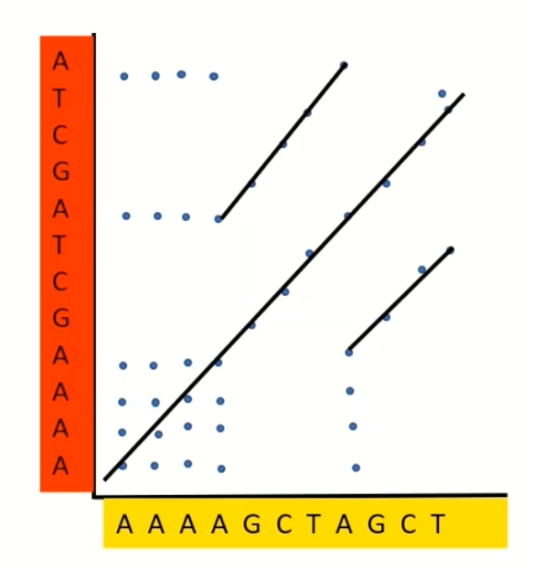

### 14. Dot Matrix Algorithm; How to Interpret The Results?
- From the diagonal lines drawn, we can find corresponding ranges
  - Diagonal lines which are biased are local sequence alignment
  - Centered diagonal lines are global sequence alignment

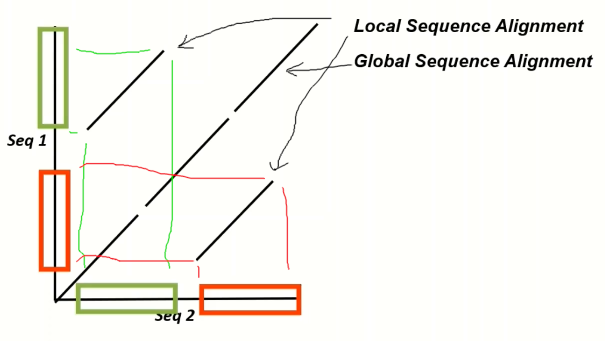

### 15. Dot Matrix Algorithm; Identification of Repeat Sequences

### 16. Dot Matrix Algorithm; Advantages Vs Disadvantages
- Pros
  - Visual analysis of sequence comparison
  - Tells us about repeat sequences
  - Local and global alignment at the same time
- Cons
  - Qualitative type of sequence comparison
  - Not depicting whole evolutionary history
    - No info of deletion and insertion

### 17. Practical-3: Dot Matcher for Qualitative Comparison of Sequences (EMBOSS Tool)
- https://www.ebi.ac.uk/jdispatcher/
  - https://www.ebi.ac.uk/jdispatcher/seqstats/emboss_dotmatcher

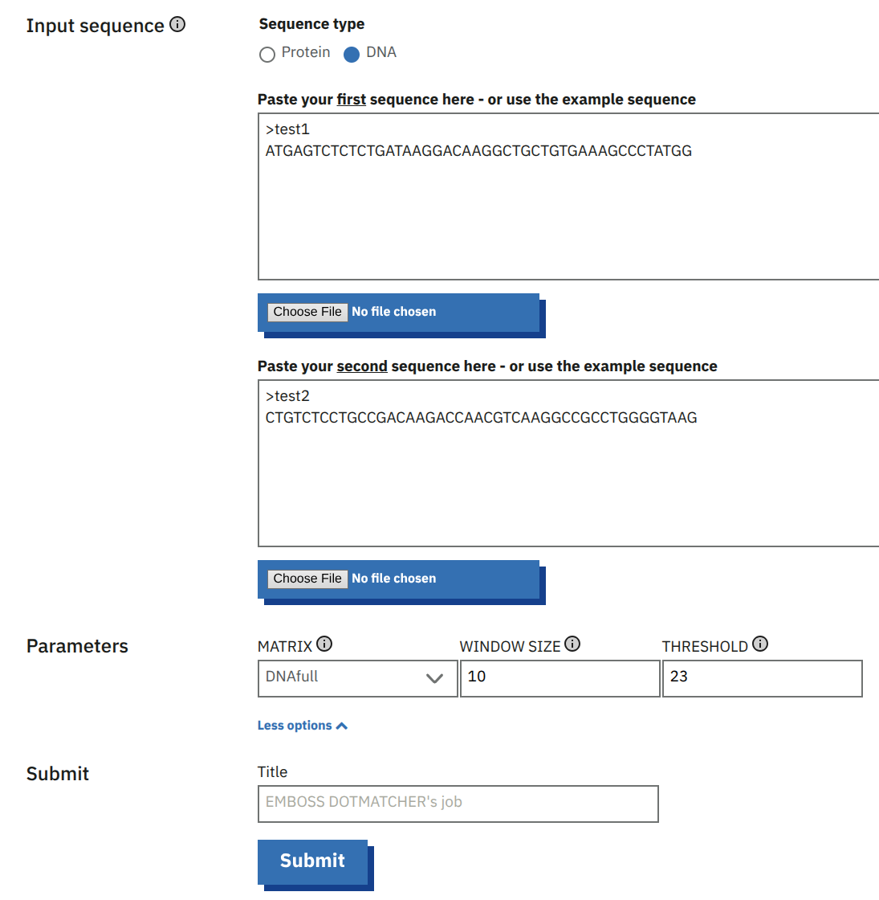

- Window size can be controlled to remove noises

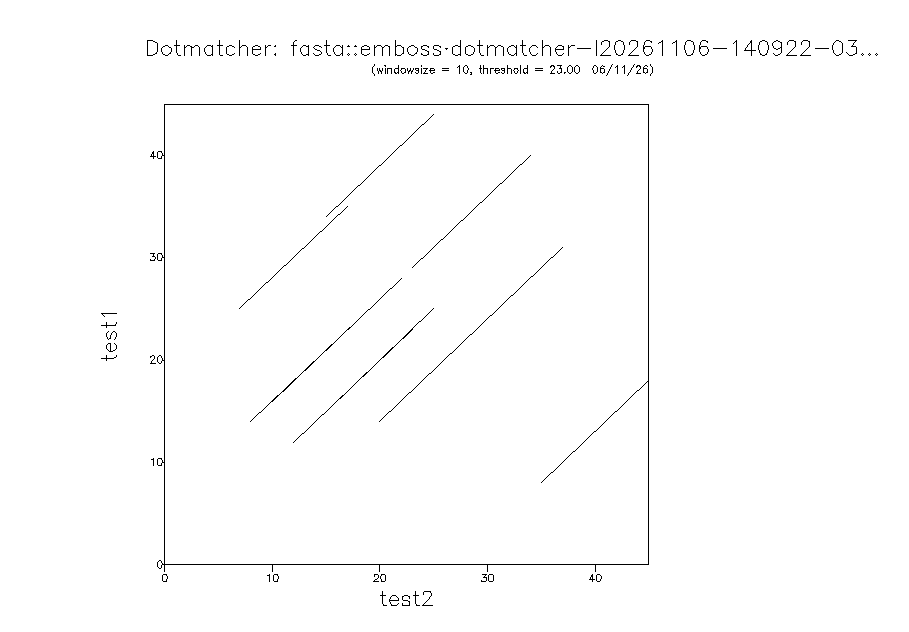

### 18. Practical-3 (Optional): DotMatcher for Qualitative Comparison of Sequence
- Dotmatcher is a qualitative technique to compare two sequences with one another
- https://emboss.bioinformatics.nl/cgi-bin/emboss/dotmatcher
- Comparison of sequences is also known as **Alignment**
- Central diagonal line is global alignment
- Continuous diagonal line indicates that more or less sequences on both axis are same
- CNGA3 Human vs CNGA3 Mouse
- Many small parallel lines

### Assignment 2: Assignment 2
- KT749721.1 vs KR711802.1 
```fasta
>KT749721.1 Neotrygon kuhlii clone NEOKU_c36860_g6_i1 cGMP-gated cation channel alpha-3 mRNA, complete cds
ATGGCTACAGTCAGCACACAGCGGTCGTATCCAGCCCTTCACAGACTCTCGGTCAGAAACAATGATGAAG
ATCTGGAAAGGATAGAAAATGGCAGCAGCAGGACCCACTCGTTGTGTGAAGACTCGTCGTCTGAGCTTCA
GGCAGTGACGTCTGCAGAACCTAAAGACCAGCATGAATCCCGGCGGAGTTCTTTCACAGGCAATGGAGCT
TTTGCCAGGCTAACTAATTTCATCATTGTGCTGAGGAACTGGGCCACCCAGCAAATCCACGATGAAGACC
AGAGACCAGATTCGTTCTTGGAGCGCTTCAGGGGACCAGACATAAAGGATGTATCAAGCCGGGAGAGCAA
CACGCAGTCAGCCGCAGGTGATCCTGAGCACCAAGGCCGGAGTAAGAAGATTCTGGCAAAGTTCAATGTC
AACAAATGCAACAACGAAGAAAACTTTTGCCCCTTGGCACAGTTCAATGTAAACAACAACAACAACACCA
ACAACAACAAGGATGGAGGCAAGGTGGAAGAAAAGAAAGACGTGAAAAAGGAGGAAAAGAAAGATGAGAA
AAAGAAGGAAGAAAAGAAAGATATATACATTATTGATCCTGCAGACAATCTTTACTATCGATGGCTGTCC
ATTATCGCAATGCCTGTGATGTACAACTGGTGTATGCTTGTGTGCAGAGCTTGTTTTGAAGAACTTCAAA
CAAAGCACCTTGCTTTATGGTTGGTGTTGGATTATGTATCAGATGCGATCTACATCGTGGATTCAATTGT
AAGGTTTCGAACAGGTTTTCTTGAACAAGGATTGCTGGTCAAAGACGGAAAGAAATTAAGAGATAATTAC
ATGAAGATGCCTCAGTTTAAGTTGGATACCCTCTCCCTTTTACCAACAGATTTAGCATACCTTACAATGG
GAATGAATTACCCTGAGGTGCGATTTAATCGTCTGTTCCGCTTCAGTCGAATGTTTGAATTCTTTGATCG
TACAGAAACCAGAACAAACTACCCTAACGTATTTCGAATTGGAAATCTTGTTTTGTATATCCTCATCATT
ATCCACTGGAATGGCTGCATTTATTATGCAATCTCCAAATCAATTGGGTTTGGCGTCGATACTTGGGTCT
ATCCAAACATATCCCACCCTGAATATGGACGACTTAGCAGAAAATACATCTATTGCCTTTACTGGTCCAC
CTTGACCTTGACCACCATTGGAGAAACCCCTCCTCCAGTAAAGGATGAGGAATTTCTGTTTGTGGTCATT
GACTTCCTGGTGGGAGTGCTTATCTTTGCAACCATTGTTGGTAATGTGGGCTCCATGATCTCGAACATGA
ATGCCTCTCGGGCCGAATTCCAATCCAAAATTGACGCCATCAAACAGTACATGCAGTTCCGTAAAGTGAG
CAAAGACCTGGAGGTCAGGATCATTAAGTGGTTTGACTACTTGTGGATCAACAAGAAGAGTATAAATGAG
AAGGAAGTCCTCAAGAGCCTACCTGACAAACTAAAGGCTGAAATTGCCATCAATGTCCACTTGGAAACAC
TAAAGAAAGTCCGAATTTTTGCAGATTGCGAAGCTGGCCTCTTAATCGAGCTGGTGCTAAAGCTGCAACC
TCAGGTATACAGCCCCGGAGACTACATCTGCCGCAAGGGAGACATTGGCAGAGAAATGTATATCATCAAA
GAGGGCAAACTGGCGGTGGTGGCTGACGATGGGGTAACACAATTTGTGGTCTTGAGTGACGGCAGCTACT
TTGGGGAAATCAGCATCTTAAACATAAAGGGCAGTAAAGCTGGGAACAGGCGAACAGCCAACATTAGAAG
TATCGGCTACTCCGATCTCTTCTGCCTCTCCAAGGTTGATCTGATGGAAGCCCTGACTGAATATCCGGAT
GCCAAGAAGATTCTGGAAGAAAAAGGACGTCAGATTCTGATGAAGGATAATTTAATCGATGAAGAAGCAG
CAAAAGAGGGGGCAGACCCGAAGGACCTGGAAGAGAAAGTGGAAAGAATGGAGGCCTCCCTGGACACTTT
GCAAACCAAGTTTGCCAGGCTCATGGCAGAGTACAAATCCACACAGCTCAAACTGAAGCAAAGGATCACA
AAGGTGGAAAATAAAGTAAAGAACTTTGGCAGTGGATACCTGTCTGATGGCTTTGACAGTGCGACTGATA
CCGAAGGAGGAAAATGA
>KR711802.1 Synthetic construct Homo sapiens clone CCSBHm_00031025 CNGA3 (CNGA3) mRNA, encodes complete protein
GTTCGTTGCAACAAATTGATGAGCAATGCTTTTTTATAATGCCAACTTTGTACAAAAAAGTTGGCACCAT
GGCCAAGATCAACACCCAATACTCCCACCCCTCCAGGACCCACCTCAAGGTAAAGACCTCAGACCGAGAT
CTCAATCGCGCTGAAAATGGCCTCAGCAGAGCCCACTCGTCAAGTGAGGAGACATCGTCAGTGCTGCAGC
CGGGGATCGCCATGGAGACCAGAGGACTGGCTGACTCCGGGCAGGGCTCCTTCACCGGCCAGGGGATCGC
CAGGCTGTCGCGCCTCATCTTCTTGCTGCGCAGGTGGGCTGCCAGGCATGTGCACCACCAGGACCAGGGA
CCGGACTCTTTTCCTGATCGTTTCCGTGGAGCCGAGCTTAAGGAGGTGTCCAGCCAAGAAAGCAATGCCC
AGGCAAATGTGGGCAGCCAGGAGCCAGCAGACAGAGGGAGAAGCGCCTGGCCCCTGGCCAAATGCAACAC
TAACACCAGCAACAACACGGAGGAGGAGAAGAAGACGAAAAAGAAGGATGCGATCGTGGTGGACCCGTCC
AGCAACCTGTACTACCGCTGGCTGACCGCCATCGCCCTGCCTGTCTTCTATAACTGGTATCTGCTTATTT
GCAGGGCCTGTTTCGATGAGCTGCAGTCCGAGTACCTGATGCTGTGGCTGGTCCTGGACTACTCGGCAGA
TGTCCTGTATGTCTTGGATGTGCTTGTACGAGCTCGGACAGGTTTTCTCGAGCAAGGCTTAATGGTCAGT
GATACCAACAGGCTGTGGCAGCATTACAAGACGACCACGCAGTTCAAGCTGGATGTGTTGTCCCTGGTCC
CCACCGACCTGGCTTACTTAAAGGTGGGCACAAACTACCCAGAAGTGAGGTTCAACCGCCTACTGAAGTT
TTCCCGGCTCTTTGAATTCTTTGACCGCACAGAGACAAGGACCAACTACCCCAATATGTTCAGGATTGGG
AACTTGGTCTTGTACATTCTCATCATCATCCACTGGAATGCCTGCATCTACTTTGCCATTTCCAAGTTCA
TTGGTTTTGGGACAGACTCCTGGGTCTACCCAAACATCTCAATCCCAGAGCATGGGCGCCTCTCCAGGAA
GTACATTTACAGTCTCTACTGGTCCACCTTGACCCTTACCACCATTGGTGAGACCCCACCCCCCGTGAAA
GATGAGGAGTATCTCTTTGTGGTCGTAGACTTCTTGGTGGGTGTTCTGATTTTTGCCACCATTGTGGGCA
ATGTGGGCTCCATGATCTCGAATATGAATGCCTCACGGGCAGAGTTCCAGGCCAAGATTGATTCCATCAA
GCAGTACATGCAGTTCCGCAAGGTCACCAAGGACTTGGAGACGCGGGTTATCCGGTGGTTTGACTACCTG
TGGGCCAACAAGAAGACGGTGGATGAGAAGGAGGTGCTCAAGAGCCTCCCAGACAAGCTGAAGGCTGAGA
TCGCCATCAACGTGCACCTGGACACGCTGAAGAAGGTTCGCATCTTCCAGGACTGTGAGGCAGGGCTGCT
GGTGGAGCTGGTGCTGAAGCTGCGACCCACTGTGTTCAGCCCTGGGGATTATATCTGCAAGAAGGGAGAT
ATTGGGAAGGAGATGTACATCATCAACGAGGGCAAGCTGGCCGTGGTGGCTGATGATGGGGTCACCCAGT
TCGTGGTCCTCAGCGATGGCAGCTACTTCGGGGAGATCAGCATTCTGAACATCAAGGGGAGCAAGTCGGG
GAACTGCAGGACGGCCAACATCCGCAGCATTGGCTACTCAGACCTGTTCTGCCTCTCAAAGGACGATCTC
ATGGAGGCCCTCACCGAGTACCCCGAAGCCAAGAAGGCCCTGGAGGAGAAAGGACGGCAGATCCTGATGA
AAGACAACCTGATCGATGAGGAGCTGGCCAGGGCGGGCGCGGACCCCAAGGACCTTGAGGAGAAAGTGGA
GCAGCTGGGGTCCTCCCTGGACACCCTGCAGACCAGGTTTGCACGCCTCCTGGCTGAGTACAACGCCACC
CAGATGAAGATGAAGCAGCGTCTCAGCCAACTGGAAAGCCAGGTGAAGGGTGGTGGGGACAAGCCCCTGG
CTGATGGGGAAGTTCCCGGGGATGCTACAAAAACAGAGGACAAACAACAGTTGCCAACTTTCTTGTACAA
AGTTGGCATTATAAGAAAGCATTGCTTATCAATTTGTTGCAACGAAC
```

- Window size = 10:

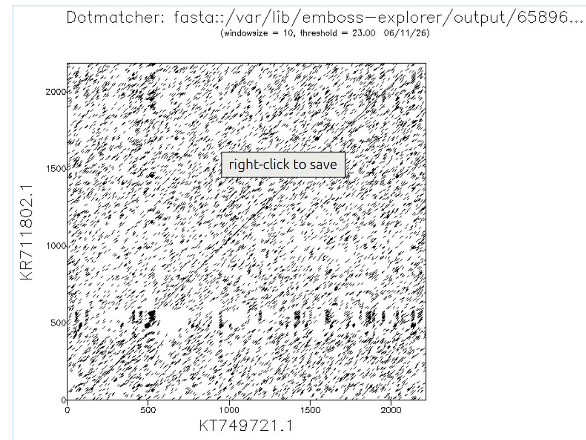

- Window size = 50:

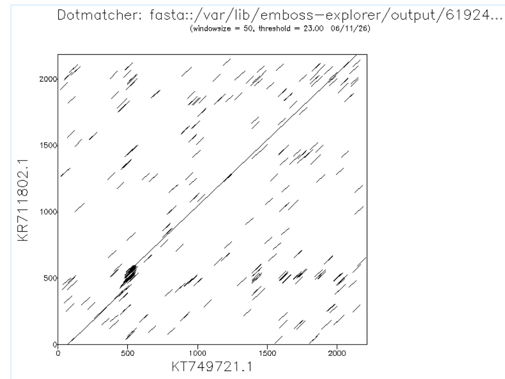

- Window size = 100:
  - There are small parallel diagonal lines along with the central diagonal line. These small parallel lines indicate the local similarities between sequences

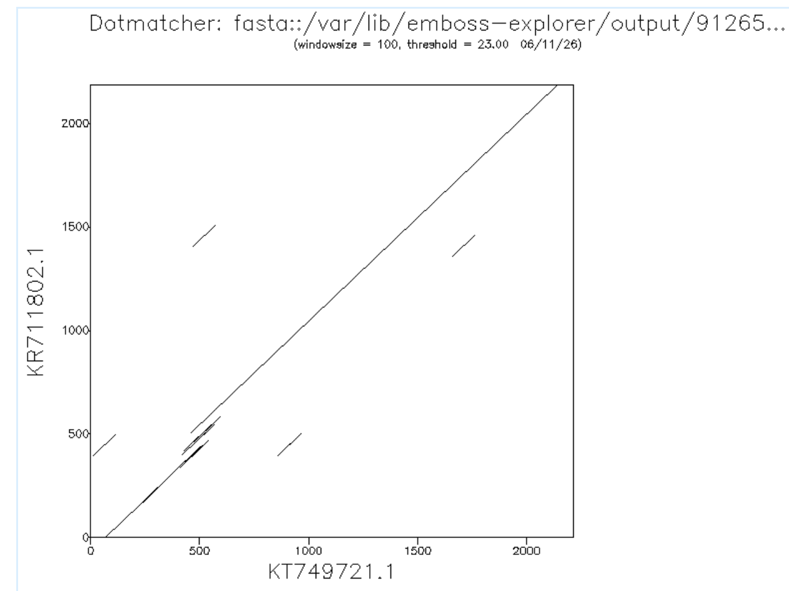

### 19. Dynamic Programming Method: How Does It Work?
- Build a matrix along the row/col using each sequence
  - Sequential analysis
    - The sequence of operation matters
  - 1 when matching, 0 otherwise
  - If neighboring cells have values, then the highest score is allocated

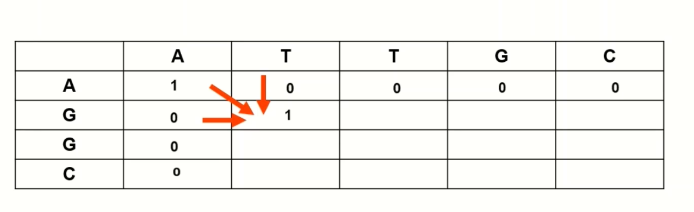

  - If neighboring cells have values and row/colum matches, then aggregate those values
    - G-G =>1 then another 1 from neighbor

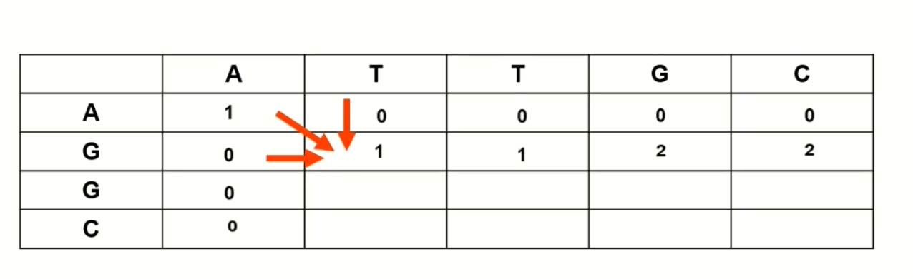

  - The final matrix:

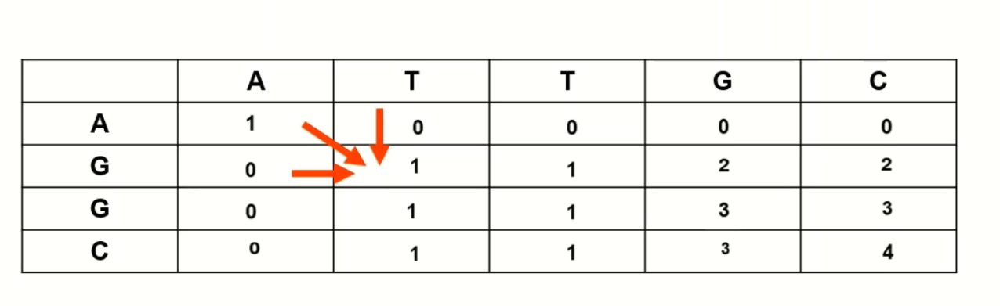

### 20. How to Transform Scoring Matrix to Alignment?
- "|" for matching, "." for substitute, "-" for deletion
  - As we compare 4 sequence with 3 sequence, diagonal is broken

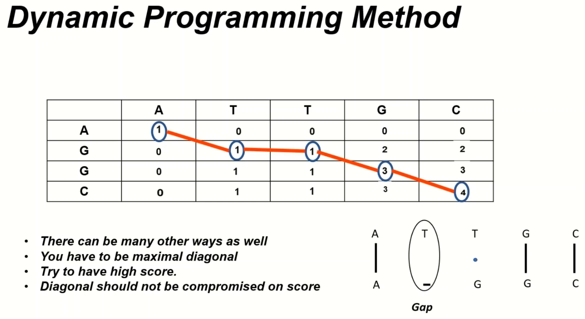

### 21. Dynamic Programming; Some Important Terms to Understand

1. Gaps are inserted in alignment when diagonal is broken, this is known as gap penalty
2. When diagonal is broken and penalty is assigned, this is know as gap opening
3. When diagonal line is resumed, this is known as gap closing
4. Each gap represents deletion or insertion
- Different scoring matrix methods are used for protein and nucleotide sequences like BLOSUM and PAM

### 22. Comparison Between DotMatrix and Dynamic Programming

| Dot-matrix | Dynamic Programming |
|---------------------|------------------------|
| Qualitative type of comparison | Quantitative type of comparison|
| There is only information about substitution| There is information about substitution, deletion and insertion|
| Related and unrelated sequences can be aligned using same protocol| Related and unrelated sequences are aligned using different type of protocols |
| Easy to visualize the relationship b/w two | No visual analysis |
| No idea about similarity and identity in case of amino acids |  Identity and similarity can be identified in protein sequences easily |
| Same sequence can be compared to identify repeat sequences | Same sequences can not be aligned to identify repeat |

### 23. Practical-4: Global Pairwise Sequence Alignment Using DNA Sequences
- Needle algorithm from EMBOSS: https://www.ebi.ac.uk/jdispatcher/psa/emboss_needle
- Menu:

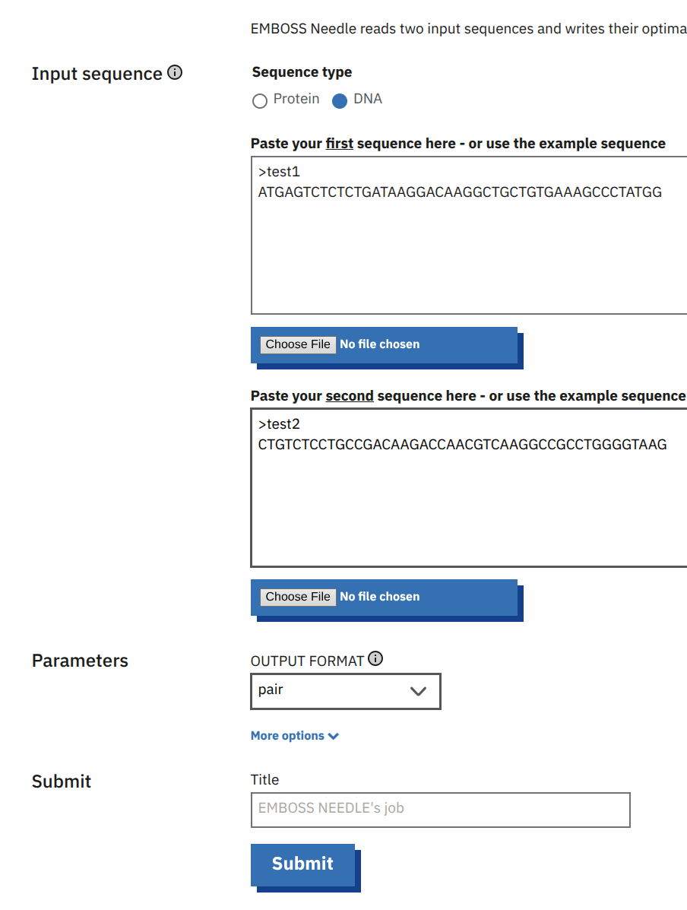

- Result:
  - "-" in the sequence is gap

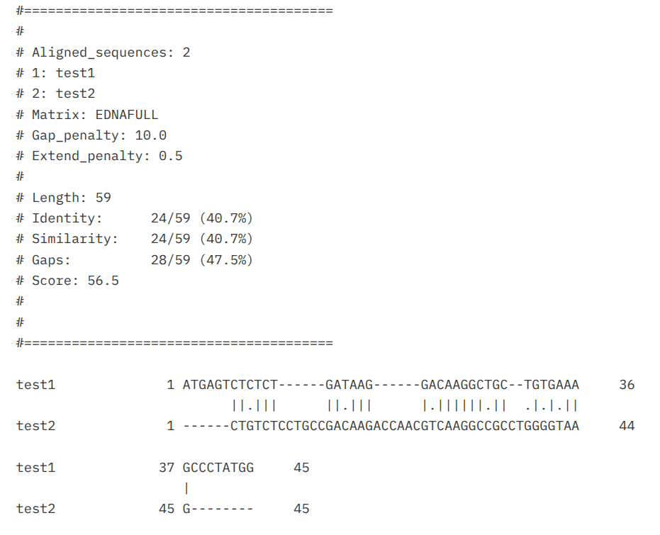

### 24. Practical-5: Pairwise Sequence Alignment Using Protein
- Select protein option in the menu
- Menu:

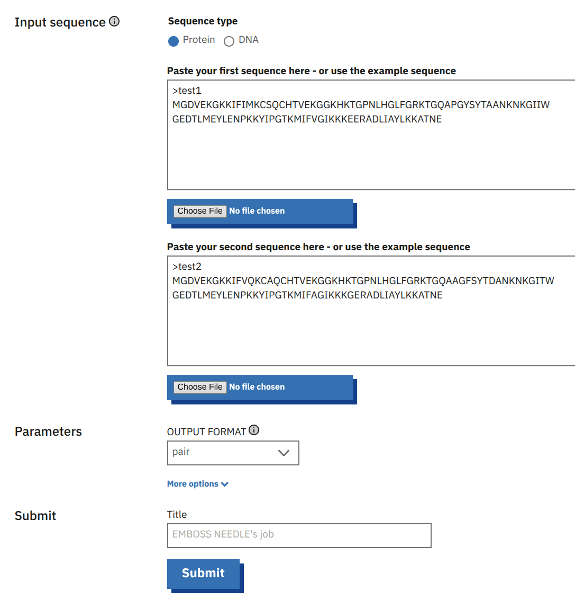

- Result:
  - ":" for when both matching is similar
  - As there is no insertion or deletion, gaps is 0%

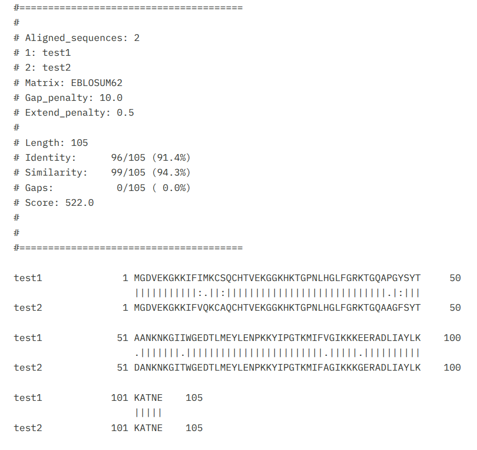

### 25. Practical-6: Local Pairwise Sequence
- Water method in EMBOSS: https://www.ebi.ac.uk/jdispatcher/psa/emboss_water
- When two proteins have different lengths

### Assignment 3: Assignment 3
- KT749721.1 vs KR711802.1 using EMBOSS NEEDLE
```bash
#=======================================
#
# Aligned_sequences: 2
# 1: KT749721.1
# 2: KR711802.1
# Matrix: EDNAFULL
# Gap_penalty: 10.0
# Extend_penalty: 0.5
#
# Length: 2407
# Identity:    1517/2407 (63.0%)
# Similarity:  1517/2407 (63.0%)
# Gaps:         410/2407 (17.0%)
# Score: 4864.5
# 
#
#=======================================
```
- Why Identity and Similarity are same?
  - In DNA, identity and similarity is the same thing

### 26. Introduction to Database Searching; BLAST
- Biological databases
  - NCBI nucleotide database contains million of sequences
  - Protein databank contain many thousand 3D structure of protein and other biological molecules
- How BLAST is designed
  - High sensitivity: ability of algorithm to include all TRUE POSITIVE values  
  - High specificity: ability of algorithm to exclude all FALSE POSITIVE vlaues
  - Less time

### 27. Type of Algorithms
- Exhaustive algorithm: high sensitivity and high specificity, high amount of time
- Heuristic algorithm: low sensitivity and low specificity, low amount of time
- Limited computational resources
  - Cannot turn on system for long time
  - Most of users have limited primary memory (RAM)
- Final choice?
  - Word Algorithm

### 28. How Does Word Algorithm Work? (Part-1)
- Compares query sequence with millions of sequences present in database in few minutes
  - Heuristic type of algorithm
  - Six step algorithm

### 29. How Does Word Algorithm Work? (Part-2)
1. Break down a query into pieces
    - Query: M R D P Y N K I L S
    - Make a word from them: [PYN]
2. Scan every word against all sequences present in the database
3. One of the word matches with the sequence in database
    - PYN vs PYN PFN PFQ, ...
4. For each match score will be calculated using appropriate scoring matrix
    - PYN=20, PFN=16, PFQ=10, ...
5. Sequence from best matching pair will be selected from database to extend the alignment in both direction
    - Extension to left or right
6. Alignment will be extended until the score up to certain threshold

### 30. A Important Term For Word Algorithm
- HSP: High Scoring Pair
  - When a fraction of query seq matches database seq, this decides HSP

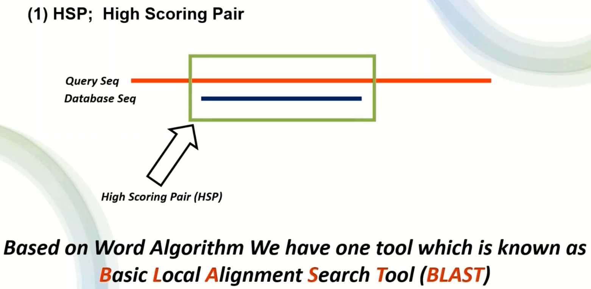

### 31. Important Statistical Values to Evaluate the BLAST Results
- Query coverage

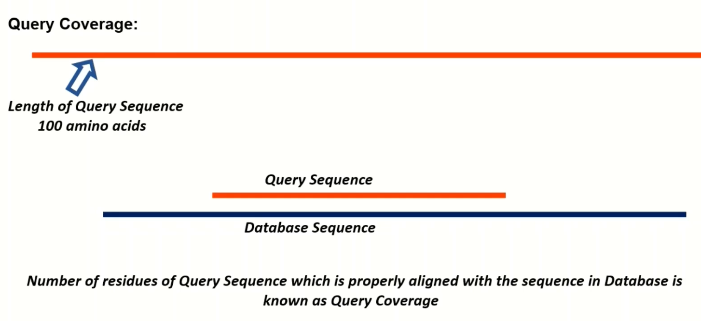

- E-value
  - When E-value is less than 1.E-6, good
  - When E-value is larger than 1.E-6, false-positive

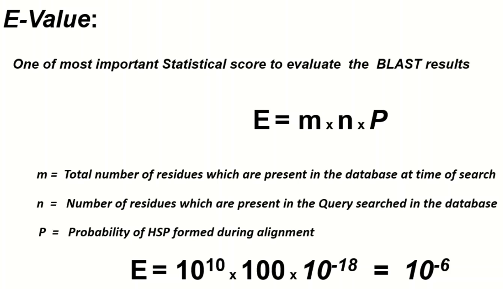

- Percentage Idenity or Maximum Identity
  - How many exact matches are found during alignment
  - In case of protein, this value is important
- There are always chances of FALSE POSITIVE results
- For ideal results:
  - High query coverage
  - Less than 1E-6 E-value
  - High maximum identity
- **Just considering E-value can be misleading**

### 32. Different Type of BLAST Associated with NCBI Databases
- Nucleotide BLAST: query is nucleotide and it is searched in nucleotide database
- Protein BLAST: query is protein and it is searched in protein database
- blastx: query is nucleotide and it is searched in protein database
- tblastn: query is protein and it is searched in nucleotide database

### 33. Practical -7: How to Use BLAST Program
- https://blast.ncbi.nlm.nih.gov/Blast.cgi?PROGRAM=blastp&PAGE_TYPE=BlastSearch&LINK_LOC=blasthome
  - Select blastp instead of Quick BLASTP in algorithm menu

### Assignment 4: Assignment 4
```fasta
>Protein_sequence_BLAST_Assignment 
MATVSTQRSYPALHRLSVRNNDEDLERIENGSSRTHSLCEDSSS
ELQAVTSAEPKDQHESRRSSFTGNGAFARLTNFIIVLRNWATQQIHDEDQRPDSFLER
FRGPDIKDVSSRESNTQSAAGDPEHQGRSKKILAKFNVNKCNNEENFCPLAQFNVNNN
NNTNNNKDGGKVEEKKDVKKEEKKDEKKKEEKKDIYIIDPADNLYYRWLSIIAMPVMY
NWCMLVCRACFEELQTKHLALWLVLDYVSDAIYIVDSIVRFRTGFLEQGLLVKDGKKL
RDNYMKMPQFKLDTLSLLPTDLAYLTMGMNYPEVRFNRLFRFSRMFEFFDRTETRTNY
PNVFRIGNLVLYILIIIHWNGCIYYAISKSIGFGVDTWVYPNISHPEYGRLSRKYIYC
LYWSTLTLTTIGETPPPVKDEEFLFVVIDFLVGVLIFATIVGNVGSMISNMNASRAEF
QSKIDAIKQYMQFRKVSKDLEVRIIKWFDYLWINKKSINEKEVLKSLPDKLKAEIAIN
VHLETLKKVRIFADCEAGLLIELVLKLQPQVYSPGDYICRKGDIGREMYIIKEGKLAV
VADDGVTQFVVLSDGSYFGEISILNIKGSKAGNRRTANIRSIGYSDLFCLSKVDLMEA
LTEYPDAKKILEEKGRQILMKDNLIDEEAAKEGADPKDLEEKVERMEASLDTLQTKFA
RLMAEYKSTQLKLKQRITKVENKVKNFGSGYLSDGFDSATDTEGGK
```
- Menu:

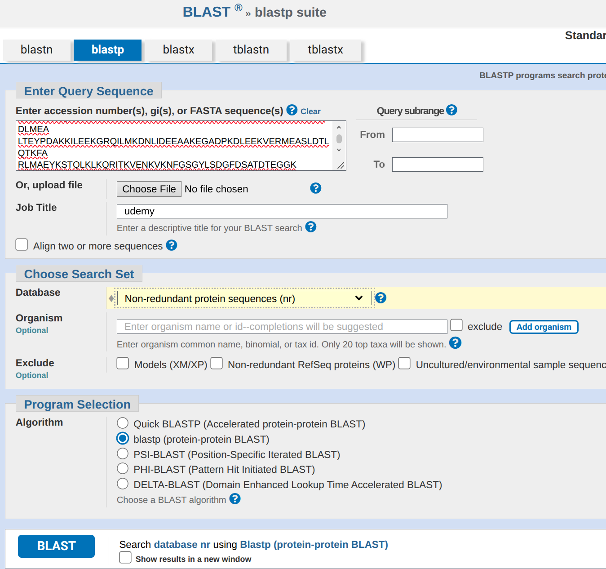

- Result:

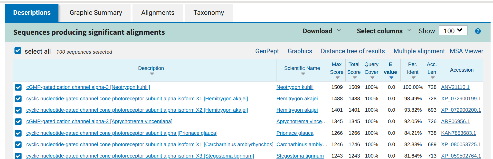

- From Aligments menu, manual inspection is available
  - Bit-score provides a normalized measure of alignment quality that is independent of database size
  
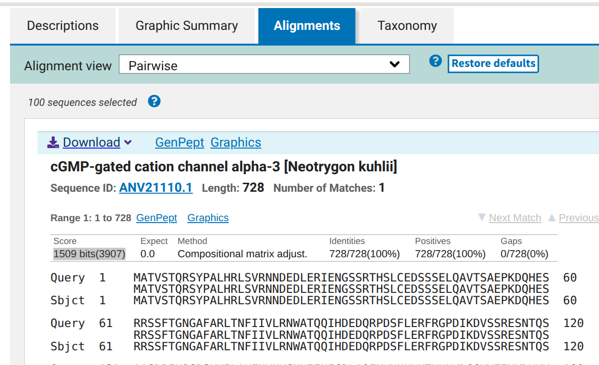

### 34. Optional: How to Use PSI-BLAST
- Sensitivity means inclusion of all positive values
- Performs multiple repetitions of search
  - PSSM (Position Specific Score Matrix) or profile

### 35. Multiple Sequence Alignment; An Introduction

### 36. Algorithms for Multiple Sequence Alignment
- Exhaustive algorithm
  - Dynamic programming: costs too much time
- Heuristic algorithm
  - Local multiple sequence alignment
    - Block based method
  - Global multiple sequence alignment
    - Progressive sequence alignment
    - Iteractive sequence alignment

### 37. Progressive Sequence Alignment Algorithm

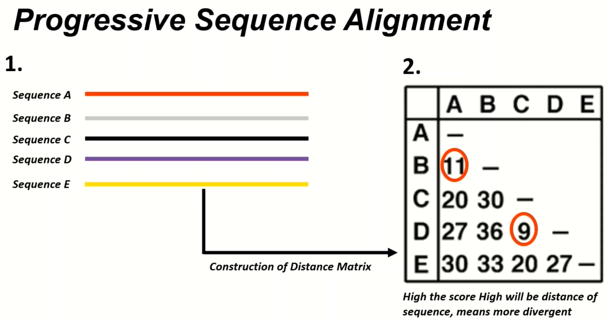

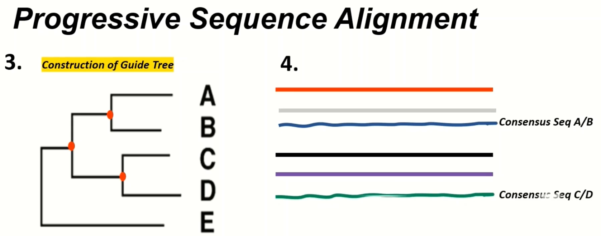

- From the distance matrix, A/B and C/D are closer each other
- Consensus sequence: a sequence representing sampled sequences
  - By looking at the most frequent nucleotide or amino acid at each column position (e.g., using a 50% rule or threshold)
  - Gaps introduced during this alignment become part of the profile structure

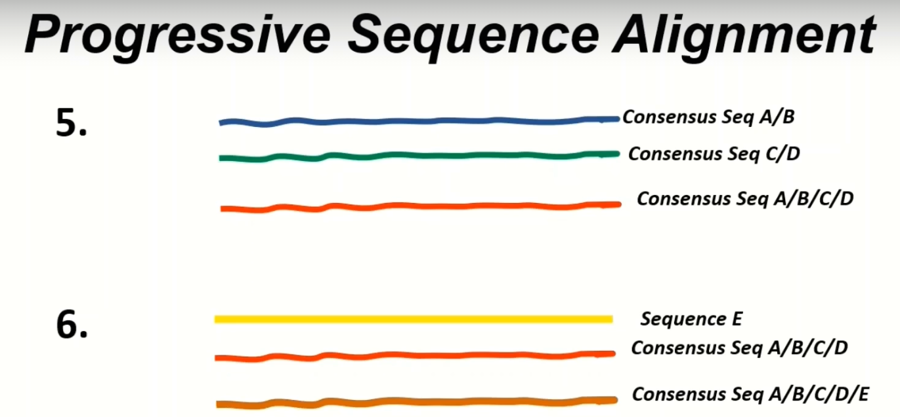

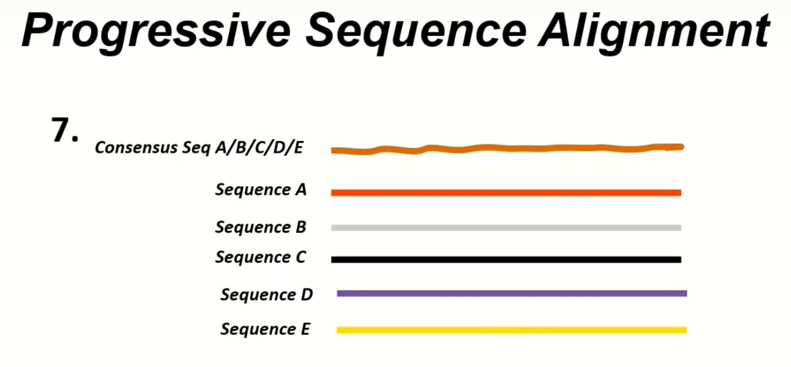

- Final consensus sequence is determined

### 38. Tools for Multiple Sequence Alignment
- Some famous MSA tools
  - ClustalW
  - T-COFFEE
- Greedy nature of algorithm
  - Once there is an error, there is always an error
- ClustalW can only bu used for highly related sequences
  - Global alignment only
- T-COFFEE can handle global or local alignment

### 39. Practical -9: How to Use T-COFFEE
- https://www.ebi.ac.uk/jdispatcher/msa/tcoffee
- Use output format as "HTML", not ClustalW
- Conserved position (or conserved site/region) refers to a column or residue in a Multiple Sequence Alignment (MSA) where the amino acid or nucleotide is identical or chemically similar across multiple evolutionarily related sequences

### 40. Practical -8: How to Use CLUSTAL-W
- BioEdit: https://thalljiscience.github.io/page2.html

### Assignment 5: Assignment 5
```fasta
>ANV21110.1 cGMP-gated cation channel alpha-3 [Neotrygon kuhlii]
MATVSTQRSYPALHRLSVRNNDEDLERIENGSSRTHSLCEDSSSELQAVTSAEPKDQHESRRSSFTGNGAFARLTNFIIV
LRNWATQQIHDEDQRPDSFLERFRGPDIKDVSSRESNTQSAAGDPEHQGRSKKILAKFNVNKCNNEENFCPLAQFNVNNN
NNTNNNKDGGKVEEKKDVKKEEKKDEKKKEEKKDIYIIDPADNLYYRWLSIIAMPVMYNWCMLVCRACFEELQTKHLALW
LVLDYVSDAIYIVDSIVRFRTGFLEQGLLVKDGKKLRDNYMKMPQFKLDTLSLLPTDLAYLTMGMNYPEVRFNRLFRFSR
MFEFFDRTETRTNYPNVFRIGNLVLYILIIIHWNGCIYYAISKSIGFGVDTWVYPNISHPEYGRLSRKYIYCLYWSTLTL
TTIGETPPPVKDEEFLFVVIDFLVGVLIFATIVGNVGSMISNMNASRAEFQSKIDAIKQYMQFRKVSKDLEVRIIKWFDY
LWINKKSINEKEVLKSLPDKLKAEIAINVHLETLKKVRIFADCEAGLLIELVLKLQPQVYSPGDYICRKGDIGREMYIIK
EGKLAVVADDGVTQFVVLSDGSYFGEISILNIKGSKAGNRRTANIRSIGYSDLFCLSKVDLMEALTEYPDAKKILEEKGR
QILMKDNLIDEEAAKEGADPKDLEEKVERMEASLDTLQTKFARLMAEYKSTQLKLKQRITKVENKVKNFGSGYLSDGFDS
ATDTEGGK
>XP_041054593.1 cyclic nucleotide-gated channel cone photoreceptor subunit alpha [Carcharodon carcharias]
MATISTQHSYPPVHRLSVRNNDDELERIENGNSRTHSLCEDTSSELQGVISMETKGQPESRRSSFAGRGALARFTQFILM
LRNWTTQQTRSEDQRPDSFLERFRGPEMKDVSSRESNTQSAIGNLEHPVRSKNQWSLAHFNVNNCNNKDEGKEKLEANDK
EAENKETGKVEEKKDENKEGKKDEKKEGKKDEKKKEEKKEVYVIDPAENLYYRWLSIIAVPVMYNWCMLVSRACFDELQV
KNLALWLVLDYISDTIYIMDSAVRFRTGFLEQGLLVKDAKKLRENYMRMPQFKLDMLSLLPTDLSYIWLGSNYPEVRFNR
LFRFGRMFEYFDRTETRTNYPNIFRIGNLVLYILIIIHWNGCVYYAISKSIGFGIDTWVYPNISHPEYGRLSRKYIYCLY
WSTLTLTTIGETPPPVKDVEYLFVVIDFLVGVLIFATIVGNVGAMISNMNASRAEFQSKIDSIKQYMQFRKVSKDLEARI
IKWFDYLWINKKSVDEKEVLKNLPDKLKAEIAINVHLDTLKKVRIFSDCEAGLLIELVLKLQPQVYSPGDYICRKGDIGR
EMYIIKEGKLAVVADDGVTQFVVLSDGSYFGEISILNIKGSKAGNRRTANIRSIGYSDLFCLSKVDLMEALTEYPDAKKI
LEEKGRQILMKDNLIDEEVAKVGADPKDLEEKVERMESSLDSLQTRFARLMAEYKSSQMKLKQRLTKVENRVRGYGSGYL
SDELDSLTDTELEKQ
>XP_026506077.1 cyclic nucleotide-gated channel cone photoreceptor subunit alpha-like isoform X1 [Terrapene carolina triunguis]
MAKINTQHSYPAMHRLSVRTTDEEIERIENGFSRTHSLCEDTSSELQRVISMETRGLSESRRSSFTGTGAMARLSRFILS
MRSWATRHLHHEDQRPDSFLERIRGPELKEVSSRESNTHSNLSNNEQPGKVKNHWSLARFNVNNSNNTNEDKNKEKNEAK
EEKKEEKKEEKKEEKKDDKKDDKKKEEKKKEIFVIDPSSNLYYRWLTIIATPVFYNWCLLVCRACFDELQTKHIILWVVL
DYSSDIIYILDTFVRFRTGFLEQGLLVQDEKKLRQHYTTTVQFRLDMLSLLPTDLAYLKLGLNYPELRFNRLLRFARLFE
FFDRTETRTNYPNMFRIGNLVLYILIIIHWNACIYFAISKLIGFGTDSWVYPNVSHPEYGRLSRKYIYCLYWSTLTLTTI
GETPPPVKDEEYLFVVIDFLVGVLIFATIVGNVGSMISNMNASRADFQAKIDSIKQYMHFRKVTKDLEARIIKWFDYLWT
NKKTVDEQEVLKNLPDKLKAEIAINVHLDTLKKVRIFQDCEAGLLIELVLKLRPTVFSPGDYICKKGDIGREMYIIKEGK
LAVVADDGITQFVVLSDGSYFGEISILNIKGSKSGNRRTANIRSIGYSDLFCLSKDDLMEALTEYPDAKKALEEKGRQIL
MKDNLIDEEAAKAGADPKDLEEKVERLESTLDNLQTRFARLMAEYNSTQLKVKQRLTKVENKMKKYGSGFLSDGGEESVK
TEEVEKKN
>TFK05491.1 sodium/hydrogen exchanger 4 [Platysternon megacephalum]
MAKINTQHSYPAMHRLSVRSTDEEIERIENGFSRTHSLCEDTSSELQRVISMETRGQSESRRSSFTGTGAMARLSRFILS
LRSWVTRHLHHEDQRPDSFLERIRGPELKEVSSRESNTHSNLSNYEQPGKVKNHWSLARFNVNNSNNTNEDKNKEKKEAE
EKKEEKKEEKKEEKKDDKKDDKKKEEKKKEIFVIDPSSNLYYRWLTIIATPVFYNWCMLVCRACFDELQTEHIILWLVLD
YSSDTIYILDTFVRFRTGFLEQGLLVQDEKKLRQHYTTTVQFRLDMLSLLPTDLAYLKFGLNYPELRFNRLLRFARLFEF
FDRTETRTNYPNMFRIGNLVLYILIIIHWNACIYFAISKLIGFGTDSWVYPNVTHPEYGRLSRKYIYSLYWSTLTLTTIG
ETPPPVKDEEYLFVVIDFLVGVLIFATIVGNVGSMISNMNASRADFQTKIDSIKQYMHFRKVTKDLEARVIKWFDYLWTN
KKTVDEQEVLKNLPDKLKAEIAINVHLDTLKKVRIFQDCEAGLLIELVLKLRPTVFSPGDYICKKGDIGREMYIIKEGKL
AVVADDGITQFVVLSDGSYFGEISILNIKGSKSGNRRTANIRSIGYSDLFCLSKDDLMEALTEYPDAKKALEEKGRQILM
KDNLIDEEAAKAGADPKDLEEKVERLESTLDNLQTRFARLMAEYNSTQLRVKQRLTKVENKMKKYGSGFLSDGGEESVKT
EEVEKKN
>XP_037754602.1 cyclic nucleotide-gated cation channel alpha-3 isoform X2 [Chelonia mydas]
MAKINTQHSCPAMHRLSVRTIDEEIERIENGFSRTHSLCEDTSSELQRDISMETRGLSESRRSSFTGTGAMARLSRFVLS
LRSWVTRHLHHEDQRPDSFLERIRGPELKEVSSRESNTHSNLSNYEQPGKVKSHWSLARFNVNNSNNTNEDKNKEKKEAK
EEKKEEKKEEKKEEKKDDKKDDKKKEEKKKEIFVVDPSSNLYYRWLTIIATPVFYNWCMLVCRACFDELQTKHIILWLVL
DYSSDILYILDTLVRFRTGFLEQGLLVQDEKKLRQHYTTTAQFRLDMLSLLPTDLAYLKLGFNYPELRFNRLLRFARLFE
FFDRTETRTNYPNMFRIGNLVLYILIIIHWNACIYFAISKLIGFGTDSWVYPNVTYPEYGRLSRKYIYCLYWSTLTLTTI
GETPPPVKDEEYLFVVIDFLVGVLIFATIVGNVGSMISNMNASRAEFQAKVDSIKQYMHFRKVTKDLEARVIKWFDYLWT
NKKTVDEKEVLKSLPDKLKAEIAINVHLDTLKKVRIFQDCEAGLLIELVLKLRPTVFSPGDYICKKGDIGREMYIIKEGK
LAVVADDGITQFVVLSDGSYFGEISILNIKGSKSGNRRTANIRSIGYSDLFCLSKDDLMEALTEYPDAKKALEEKGRQIL
MKDNLIDEEAAKAGADPKDLEEKVERLESALDNLQTRFARLMAEYNSTQLRVKQRLTRVENKVKKYGSDSLSDGGEEPVK
TEEVEKKN
>XP_006137448.1 cyclic nucleotide-gated cation channel alpha-3 [Pelodiscus sinensis]
MAKINTQNSYPAMHRVSVRTTDEDIERIENGFSRTNSLCEDTSSELQRVISMETRGLSESRRSSFTGTGAMARLSRFILS
MRSWARGHLHDEDQRPDSFLDRIRGPDLKEAPNRESNTHSNLSNYEQPGKVKSHWSLARFNVNNSNNNEDKNKEKKEVKE
EKKEEKKEEKKEEKKDDKKDDKKKEEKKKEIFVVDPSSNLYYRWLTIIATPVFYNWCLLVCRACFDELQSNHIILWVVLD
YCSDIIYVLDIFVRFRTGFLEQGLLVQDEKKLRKHYTTTVQFRLDVLSLLPTDLAYLKLGLNYPELRFNRLLRFARLFEF
FDRTETRTNYPNMFRIGNLVLYILIIIHWNACIYYAISKLIGFGTDSWVYPNVTHPEYGRLSRKYIYCLYWSTLTLTTIG
ETPPPVKDEEYLFVVIDFLVGVLIFATIVGNVGSMISNMNASRAEFQAKVDSIKQYMHFRKVTKDLEARVIKWFDYLWTN
KKTVDEKEVLKNLPDKLKAEIAINVHLDTLKKVRIFQDCEAGLLIELVLKLRPTVFSPGDYICKKGDIGREMYIIKEGKL
AVVADDGITQFVVLSDGSYFGEISILNIKGSKSGNRRTANIRSIGYSDLFCLSKDDLMEALTEYPDAKKALEEKGRQILL
KDNLIDEEAAKAGADPKDLEEKVERLESALDSLQTRFARLMAEYNSAQLKVKQRLTKVENKVKKYGSGFLSDGGEESIKP
EEVEKKN
>NXS41187.1 CNG1 protein [Balaeniceps rex]
MAKINTQHSYPGMHRLSVRTTDEDIERIENGCIRTHSPCEDASSELQRVISAEGRHLSESQTSSFTGRGAMARLSRFVIS
VRSWATRHLHHEDQRPDSFLERIRGPELIEVSSRQSNIRSFLGIRERPGGVNSHWPLARFNVNYSNNTNEDKKEEKKEVK
EEKKEEKKEEKKEEKKEEKKDDKKDDKKKEEKKKEIFVIDPSSNIYYHWLTIIAVPVFYNWCMLVCRACFDELQVDHIKL
WLVLDYSSDIIYVLDVFVRFRTGFLEQGLLVQDEKKLRDHYTKTVQFKLDVLSLLPTDLAYLKLGLNYPELRFNRLLRIS
RLFEFFDRTETRTNYPNMFRIGNLVLYILIIIHWNACIYFAISKLIGFGTDSWVYPNVSVPEYGRLSRKYIYSLYWSTLT
LTTIGETPPPVKDEEYLFVVIDFLVGVLIFATIVGNVGSMISNMNASRAEFQAKVDSIKQYMHFRKVTKDLEARVIKWFD
YLWTNKKTVDEKEVLKNLPDKLKAEIAINVHLDTLKKVRIFQDCEAGLLIELVLKLKPTVFSPGDYICKKGDIGREMYII
KEGKLAVVADDGITQFVVLSDGSYFGEISILNIKGSKSGNRRTANIRSIGYSDLFCLSKDDLMEALTEYPEAKKALEEKG
RQILMKDNLIDEEAAKAGADPKDLEEKVERLETALDTLQTRFARLLAEYTSSQQKVKQRLARVETRVKKYGSGTLSVGEE
ESEQPEEEKK
>NXE50928.1 CNG1 protein [Casuarius casuarius]
MAKINTQHSYPATHRLSVRNTDEDIERIENGFIRTHSLCEDTSSELQRVISVEGRGLPESQTSSFTGRGAMARLSQFLVS
LRSWATRHLHHEDQRPDSFLERIRGPELIEVSSRQNKIHASLGVDEQPGRLNSHWPLASFNVNYSNNTNEDKKEEKKEVK
EEKKEEKKEEKKEEKKDDKKDDKKDDKKKEEKKREIFVIDPSSNMYYNWLTIIAAPVFYNWCMIVCRACFDELQTDHVRL
WLVLDYCSDIIYVFDMFFRFRTGFLEQGLLVRDEKKLRHHYTKTIQFKLDVLSLLPTDLAYLKLGLNYPELRFNRLLRIS
RLFEFFDRTETRTNYPNMFRIGNLVLYILIIIHWNACIYFAISKLIGFGTDSWVYPNVSIPEYGRLSRKYIYSLYWSTLT
LTTIGETPPPVKDEEYLFVVIDFLVGVLIFATIVGNVGSMISNMNASRAEFQAKIDSIKQYMHFRKVTKDLEARVIKWFD
YLWTNKKTVDEKEVLKNLPDKLKAEIAINVHLDTLKKVRIFQDCEAGLLIELVLKLKPTVFSPGDYICKKGDIGREMYII
KEGKLAVVADDGITQFVVLSDGSYFGEISILNIKGSKSGNRRTANIRSIGYSDLFCLSKDDLMEALTEYPDAKKALEEKG
RQILMKDNLIDEEAAKAGADPKDLEEKIERLETALDTLQTRFARLLAEYTSSQQKVKQRLAKVENRVKKYGSGTVSEAEA
PKPEEEKK
>NXI97872.1 CNG1 protein [Psophia crepitans]
MAKINTQHSYPGMQRLSVRTTDEDIERLENGRIRTHSLCEDASSELQRVISVEGRHLPESQTSSFTGRGAMARLSRFVVS
VRSWATRHLHHEDQRPDSFLERFRGPELIEVSSRQSNIRSFLGIRQRPGGVNSHWPLARFNVNYSNNTNEDKKEEKKEVK
EEKKEEKKEEKKDDKKDDKKKEEKKKEIFVIDPSSNIYYNWLTIIAAPVFYNWCMLVCRACFDELQVDHIKLWLFLDYGS
DIVYVLDMFVRFRTGFLEQGLLVKDEKKLRDHYTETMQFKLDVLSLLPTDLAYLKLGLNYPELRFNRLLRISRLFEFFDR
TETRTNYPNMFRIGNLVLYILIIIHWNACIYFAISKVIGFGTDSWVYPNVSIPEYGRLSRKYIYSLYWSTLTLTTIGETP
PPVKDEEYLFVVIDFLVGVLIFATIVGNVGSMISNMNASRAEFQAKVDSIKQYMHFRKVTKDLEARVIKWFDYLWTNKKT
VDEKEVLKNLPDKLKAEIAINVHLDTLKKVRIFQDCEAGLLIELVLKLKPTVFSPGDYICKKGDIGREMYIIKEGKLAVV
ADDGITQFVVLSDGSYFGEISILNIKGSKSGNRRTANIRSIGYSDLFCLSKDDLMEALTEYPEAKKALEEKGRQILMKDN
LIDEEAAKAGADPKDLEEKIEKLETALDTLQTRFARLLAEYTSSQQKVKQRLARVETRVKKYGSGTLSVGESEAGKPEEE
KK
```
- Sequences are conserved considering the amounts of "*" signs
- "---" dashes are INDELS (insertion and deletion)
- The strick (*) signs indicate the identical amino acids.
- The colon (:) indicates a high level of similarity while dot signs (.) show moderately similar amino acids.

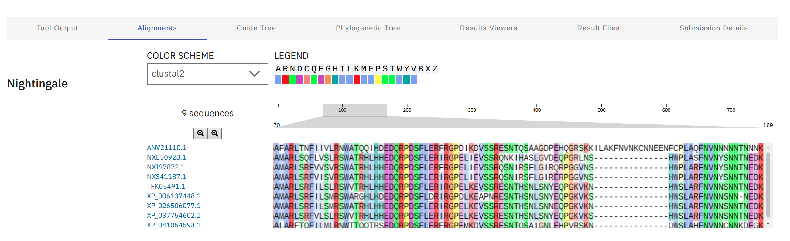

### Quiz 2: Quiz 2

### Role Play 2: Explain Your Junior What you have Learned of Sequence Alignment

## Section 3: Module 3: Genomic Bioinformatics

### 41. Introduction of Module 3
- We will learn:
  - Deoxyribo nucleotide (DNA)
  - Features of Gene
  - Regulatory Elements of Gene
  - Difference b/w Eukaryotic and Prokayrotic Genes
  - Difference b/w Eukaryotic and Prokayrotic Regulatory Element
  - Algorithms for Predictions of Prokaryotic Genes
  - Algorithms for Predictions of Prokaryotic Genes Regulatory elements
  - Algorithms for Predictions of Eukaryotic Genes
  - Algorithms for Predictions of Eukaryotic Genes Regulatory Elements
  - Microarray studies and its data analysis

### 42. What is DNA?
- Double stranded long helical molecule
- Its polymer and monomers are nucleotides
- In nucleotide there can be four different nitrogenous bases
  - Adenine (A) – A double-ringed purine that pairs with thymine via two hydrogen bonds.
  - Thymine (T) – A single-ringed pyrimidine that pairs with adenine via two hydrogen bonds.
  - Guanine (G) – A double-ringed purine that pairs with cytosine via three hydrogen bonds.
  - Cytosine (C) – A single-ringed pyrimidine that pairs with guanine via three hydrogen bonds.

### 43. Where Is Our DNA is Located?
- In nucelus of a cell

### 44. What Is Role of DNA?
- Controls of physical features
- How does DNA control phenotype?
  - Non-coding DNA
  - Coding DNA (Gene)
    - Makes protein: structural and functional unit of a body
- Processes of making protein (gene expression)
  - Transcription: DNA to mRNA
  - Translation: mRNA to protein

### 45. What Does Gene Have?
- What does coding DNA have?
  - ORF (Open Reading Frame)
  - Genetic code is specific combination of three nucleotides
  - Degeneracy
  - Exons and Introns
- What else coding DNA have?
  - Promoter sequences + Coding sequences + Terminatin sequences  
  - Some more features:
    - Start code: always A U G
    - Stop code: U A A
    - Transcription start site

### 46. Algorithms for Gene Prediction-1
- Difference b/w Eukaryotes & Prokaryotes genes
  - Prokaryotic gene structure is very different from Eukaryotic one
    - Tandem arrangement of genes and no introns in Prokaryotes
    - Disperse arrangements of genes and lot of introns in Eukaryotes
- Difference b/w Eukaryotes & Prokaryotes
  - Ribosomal binding site
    - In Prokaryotic genes, this sequence is known as Shine-Delgarno sequence (AGGAGGT)
    - In Eukaryotic genes, this sequence is known as Kozak Sequence (CCGCCATGG)
    - In Eukaryotic genes, CpG island may also be present especially with Housekeeping Genes (CGCGCGCG)


### 47. Algorithms for Gene Prediction-2

### 48. GC-Bias and Test Code; An Ab-initio Type of Algorithm
### 49. Introduction of Markov Model (Part-1)
### 50. Introduction of Markov Model (Part-2)
### 51. Machine Learning and Gene Prediction
### 52. Practical-10: Prediction of Prokaryotic Gene
### Assignment 6: Assignment 6
### 53. Practical-11: Prediction of Eukaryotic Genes
### Assignment 7: Assignment 7
### 54. What is Sanger Sequencing to Sequence the DNA?
### 55. Sanger Sequencing Data and Issues
### 56. Practical-12: How Check Quality of Sanger Sequencing Data?
### Quiz 3: Quiz 3


## Section 4: Module 4: Structural Bioinformatics

### 57. Introduction of Module 4
### 58. What is Protein? (Part-1)
### 59. What is Protein? (Part-2)
### 60. Some Important Points
### 61. Role of Amino Acids in 3D Structure
### 62. Peptide Bond; A link between Amino Acids
### 63. Double Bond like Character in Peptide Bond & Ramachandran Plot
### 64. Forces Stabilizing The Protein Structure
### 65. Secondary Structures of Proteins
### 66. Practical 13: Visualization of Protein Structure in Pymol
### 67. Practical 13(A): Visulization of Protein Structure in Chimera (Part-1)
### 68. Practical 13(B): Visulization of Protein Structure in Chimera (Part-2)
### 69. Why Protein Structure Prediction is So Important?
### 70. Protein Secondary Structure Prediction Algorithms (Part-1)
### 71. Protein Secondary Structure Prediction Algorithms (Part-2)
### 72. Practical-15: Prediction of Globular Protein Secondary Structure
### Assignment 8: Assignment 8
### 73. Algorithm for Secondary Structure Prediction of Transmembrane Proteins
### 74. Practical-16: Prediction of Transmembrane Helix Secondary Structure
### Assignment 9: Assignment 9
### 75. 3D Structure Prediction Algorithms
### 76. Homology Based Algorithm (Part-1)
### 77. Homology Based Algorithm (Part-2)
### 78. Homology Based Algorithm (Part-3)
### 79. Homology Based Algorithm (Part-4)
### 80. Model Validation & Draw back of Homology Based Algorithm
### 81. Practical-17: Prediction of 3D structure Using Homology Modeling (Mdeller)
### Assignment 10: Assignment 10
### 82. Threading Algorithm for 3D Structure Prediction
### 83. Practical-18: Prediction of 3D structure Using Threading Technique (I-TASSER)
### Assignment 11: Assignment 11
### 84. (Very Important) Practical Learn How to Use Alpha-Fold 2
### 85. Practical Learn How to Use Alpha-Fold3
### Assignment 12: Assignment 12
### 86. How to Make Publication Quality Images In Pymol? (Very Important)
### Quiz 4: Quiz 4
### 87. (Optional) Practical-18.1: Use of InterPro
### 88. (Optional) Practical-20: How to Perform Docking Easily Using Vina
### 89. (Optional) Practical-21: How to Analyze the Docking Data
### 90. (Optional) Practical 3: ZINC Database for Drug Searching
### 91. Update Another GOR-IV Server for Secondary Structure Predictions
3min

### 92. What is Evolution and Phylogenetics
### 93. Some Important Terms To Understand Phylogenetic Tree
### 94. Different Type of Phylogenetic Trees
### 95. Steps To Construct Phylogenetic Tree
### 96. Selection of Molecular Marker for Tree Construction
### 97. Alignment for Tree Construction
### 98. Evolutionary Model Selection
### 99. Methods To Construct Tree
### 100. Validation of Tree By Bootstrapping
### 101. Practical -19: Building Phylogenetic Tree
### Assignment 13: Assignment 12
### 102. Practical-19.1: Building Beautiful Circular Phylogenetic Tree
### Quiz 5: Quiz 5

### 103. Practical-22: How to install Linux in Windows for Bioinformatics Analysis
### 104. Practical-24: How to Download Chemsketch
### 105. Practical-25: Ligand Drawing and Making of Ligand 3D Structure
### 106. How to Use AI to Do Literature Review Smartly
11min


# Learn Bioinformatics - Beginner to Master Through Projects
- Instructor: Rafiq Ur Rehman

## Section 1: Introduction to Bioinformatics and Subfields

### 1. Introduction to Bioinformatics
- The interdisciplinary field that combines biology, computer science, and information technology to analyze and interpret biological data
- Key Aspects of bioinformatics
  - Computing
  - Big data
  - Collaboration
  - Diagnostic tools
  - Problem-solving

### 2. Genomics
- Studying the structure, function, evolution, and mapping of genomes
  - Focuses on sequencing, assembling and analyzing genome
  
### 3. Proteomics
- Large scale study of proteins, their structures, functions and interactions. It aims to understand the roles of proteins in biological processes and how they relate to health and disease
  - Focuses on the study of protein structures, functions, and interactions

### 4. Transcriptomics
- Examines RNA transcripts produced by the genome, capturing gene expression patterns and dynamics. It helps understand gene regulation, cellular functions, and how genes respond to various conditions
  - Focuses on the study of RNA transcripts produced by the genome

### 5. Metabolomics
- The study of metabolites and metabolic pathways within cells, tissues, or organisms. It helps understand metabolism and the biochemical processes that occur in cells
  - Focuses on the study of metabolites and metabolic processes

### 6. Structural Bioinformatics
- The 3D structure of biological macromolecules like proteins and nucleic acids. It helps predict molecular interactions and understand the relationship b/w structure and function
  - Focuses on the analysis of 3D structures of biological molecules
  - Applications: protein folding analysis, drug design, enzyme mechanism studies

### 7. Pharmacogenomics
- Explores how an individual's genetic makeup influences their response to drugs. It aims to optimize drug therapy, minimize adverse effects, and facilitate personalized medicine
  - Focuses on the study of drug-gene interactions
  - Applications: tayloring drug prescriptions, improving therapeutic efficacy, reducing side effects

### 8. Computational Biology
- Uses algorithms, mathematical models, and software tools to simulate biological processes. It includes data analysis, modeling, and visualization of biogical data
  - Focuses on the simulation and modeling of biological systems
  - Applications: modeling biological networks, predicting protein interactions, simulating cellular processes

### 9. Other Subfields of Bioinformatics
- Systems biology: intergrative approach that examines the interactions within biological systems. It uses computational tools to model complex biological networks and predict system behavior
  - Focuses on the modeling of biological networks and systems
- Cheminformatics: Involves the application of bioinformatics techniques to chemistry
  - Focuses on the study of chemical data for biological applications
- Epigenomics: studies the chemical changes to DNA and histones that regulate gene expresssion without altering the genetic sequence
  - Focuses on the study of chemical modifications in gene expression
- Machine Learning  

### 10. Trends In Computational Biology

### 11. Skills Needed For Bioinformatics Field
- Biological knowledge
- Bioinformatics databases management
- Data retrieval
- Familiarity with bioinformatics tools
- Problem-solving and analytical skills
- Data analysis and statistics
- Programming and scripting

### Assignment 1: Project 1: Bioinformatics Fields
- What is bioinformatics, and why is it important in modern biology? Provide two examples of its applications.
  - General Concepts: Bioinformatics is the interdisciplinary field that develops and applies computational tools and techniques to analyze and interpret biological data. It is important for understanding complex biological systems and advancing fields like personalized medicine and drug discovery.
    - Example 1: Sequence alignment to identify gene functions.
    - Example 2: Protein structure prediction for drug design.
- Match the following descriptions to their respective subfields:
  - Genomics: The study of genomes and their structures.
  - Proteomics: The analysis of proteins, their structures, and interactions.
  - Transcriptomics: Investigating RNA expression levels in different conditions.
  - Metabolomics: Exploring metabolic pathways and biochemical reactions.
  - Pharmacogenomics: Predicting drug responses based on genetic information.
  - Computational Biology: Developing computational models to analyze biological data.
- Discuss one recent trend in computational biology that you find exciting and explain its potential impact on bioinformatics.
  - Example Trend: Machine learning and AI are increasingly used for predicting protein structures, which has a significant impact on drug discovery and understanding diseases.
- List three essential skills required for a career in bioinformatics and explain why each is important.
  - Programming: Essential for processing and analyzing large biological datasets.
  - Data Analysis: Required to interpret the results and draw meaningful conclusions from bioinformatics experiments.
  - Biological Knowledge: Necessary to understand the biological context and relevance of the computational analyses.
- Provide an example of how data from one subfield (e.g., genomics or proteomics) can be integrated with data from another subfield to answer a complex biological question.
  - Example: Genomics data can be used to identify genetic mutations, while proteomics data can analyze the resulting changes in protein expression. Combining these insights can help understand disease mechanisms at both the genetic and protein levels.

## Section 2: Bioinformatics Databases and Data Retrieval

### 12. Introduction To Bioinformatics Databases
- Primary
- Secondary
- Derived databases

### 13. Primary Databases Introduction And NCBI Practical
- Primary databases are repositories that contain original biological data submitted by researchers
- Examples
  - GenBank/NCBI: Stores nucleotide sequences and their protein translations
  - EMBL-EBI: European Molecular Biology Laboratory's European Bioinformatics Institute
  - DDBJ: Data bank of Japan
- Key features
  - Direct submissions of raw data by researchers
  - Frequently updated with new data
- Download data type: FASTA, CSV, JSON
- APIs or CLI tools are available - e.g., NCBI Entrez, UniProt API
- Practice
  - https://www.ncbi.nlm.nih.gov/?hl=ko
  
### 14. EMBL and DDBJ Database Practical
- https://www.ebi.ac.uk/
- https://www.ddbj.nig.ac.jp/index-e.html

### 15. Introduction to secondary databases
- Compile data from primary databases, adding curated, value-added information like annotations
- UniProt: comprehensive resource for protein sequencies and functional information
- Pfam: database of protein families based on sequence alignments and hidden Markov models
- RefSeq: Curated collection of DNA, RNA, and protein sequences

### 16. PDB database
- https://www.rcsb.org

### 17. Uniprot Database
- https://www.uniprot.org

### 18. GEO Database
- https://ncbiinsights.ncbi.nlm.nih.gov/tag/geo/

### 19. Derived Databases and Practical
- Derived from primary and secondary databases through computational analysis
- Ensembl: annotates genomic data, integrating information from various source
- Gene Ontology (GO): provides functional annotation of genes across species
- InterPro: integrates diverse informatin about protein families, domains, and functional sites 
- Taxonomy: the science of naming, describing and classifying organisms and includes all plants, animals, and microorganisms of the world
- Practice:
  - https://www.ncbi.nlm.nih.gov/datasets/genome/
  - https://reactome.org
  - https://www.genome.jp/kegg/

### 20. Conclusion and Project Insights
- Primary database: original data, direct submissions, raw sequences
- Secondary dtabase: curated data, annotations, enhanced information
- Derived database: computed data, integrates multiple sources, provides high-level analysis

### Assignment 2: Project 2: Bioinformatics Data Retrieval Using Databases
1. Differentiate between primary, secondary, and derived databases. Provide an example of each and describe their primary function.
    - Primary: NCBI GenBank (stores raw sequence data).
    - Secondary: PDB (focuses on structural information).
    - Derived: GEO (stores processed data from experiments).
2. Use NCBI’s nucleotide database to retrieve the sequence for the BRCA1 gene (Homo sapiens). Provide the following details:
    - NCBI Database
      - Accession number: NM_007294
      - Sequence length: 81,226 bp
      - Source organism: Homo sapiens
3. Retrieve the same BRCA1 gene sequence using either EMBL or DDBJ. Compare the retrieval process with NCBI. What similarities or differences did you notice?
    - EMBL/DDBJ Practical
      - Retrieval process was similar, but the interfaces differ slightly. EMBL provides a more European-focused data set, while NCBI integrates additional tools like BLAST.
4. Access the PDB database and find a structure for hemoglobin. Provide the following details:
    - Secondary Databases
      - PDB ID: 1A3N
      - Resolution: 2.1 Å
      - Number of chains: 4
5. Search for the protein information of BRCA1 in the Uniprot database. Provide the following:
    - Uniprot Database
      - Protein name: Breast cancer type 1 susceptibility protein
      - Organism: Homo sapiens
      - Functional description: Involved in DNA repair and maintaining genomic stability.
6. Access GEO and find a dataset related to breast cancer. Provide the following details:
    - GEO Database
      - Dataset accession number: GSE45827
      - Study title: Gene expression profiling of breast cancer tissues
      - Number of samples: 20
7. Explain how primary, secondary, and derived databases can be used together to investigate a disease mechanism (e.g., breast cancer). Provide a hypothetical workflow.
    - Use NCBI GenBank to retrieve raw sequence data for BRCA1.
    - Access PDB for structural information of proteins encoded by BRCA1.
    - Analyze experimental datasets from GEO to identify expression patterns in breast cancer.
    - Integrate findings to study how mutations in BRCA1 affect its structure and expression, contributing to breast cancer.

## Section 3: Bioinformatics Tools and Programming languages

### 21. Bioinformatics Tools and Programming languages
- SW applications that facilitate the analysis of biological data
- Used for tasks such as sequence alignment, genome annotation, and data visualization
- Why?
  - Efficiency
  - Accuracy
  - Scalability
  - Reproducibility
  - Visualization
- How ?
  - Problem identification
  - Algorithm development
  - Programming
  - Testing and validation
  - User interface design
  - Documentation and training
  - Maintenance and updates
- Bioinformatics tools  
    1. Sequence alignment tools
      - BLAST: Basic Local Alignment Search Tool for comparing sequences
      - Mega: Alignment tool for windows mac and Linux
    2. Sequence database
      - GenBank
      - EMBL
      - DDBJ
    3. Genome browsers
      - UCSC Genone Browser
      - Ensembl
    4. Variant calling tools
      - GATK
    5. Funcitonal annotation tools
      - InterProScan: identify protein domains and functional annotations
      - Pfam: database of protein families
    6. Pathway analysis tools
      - KEGG
    7. Data visualization tools
      - Ggplot2
      - Cytoscape: network visualization and analysis tool
    8. Transcriptomics tools
      - TopHat: splice-aware aligner for RNA-seq data
      - STAR: Fast RNA-Seq read aligner
      - Bowtie: Ultrafast, memory-efficient alignment tool
    9. Megagenomics tools
      - QIIME: Quantitative Insights Into Microbial Ecology for analyzing microbial communities
      - MetaPhlAn: Tool for profiling the compositionof microbial communities
    10. Statistical analysis tools
      - Bioconductor: R packages for high-throughput data analysis
      - DESeq2: Differential expression analysis for RNA-Seq data
- https://prostruct.streamlit.app
- Bioinformatics programming language
  - Python
  - R
  - Perl
  - C/C++
  - Java
  - Bash/shell scripting
- https://pypi.org/project/bio-wrangler/

### Assignment 3: Project 3: Bioinformatics Tools and Languages

## Section 4: Sequence Analysis

### 22. Sequence alignment and Pairwise sequence alignment
- Sequence alignment is the proces of arranging DNA, RNA, or protein sequences to identify similarities and differences. It plays a crucial role in genetics and moleuclar biology
- Application
  - Genetic Analysis 
  - Drug discovery
  - Disease research
- Pairwise sequence alignment: definition and purpose
  - Definition: a method to align two sequences to identify similarities and differences
  - Purpose: Allows for comparison of DNA, RNA, or protein sequences to infer evolutionary relationships
  - Significance: Essential for understanding genetic mutations and functional conservation in biological research.
- Methods for pair-wise sequence alignment
  - Needleman-Wunsch: An algorithm for global sequence alignment with affine gap penalties.
  - Smith-Waterman: Used for local sequence alignment to identify regions of similarity.
  - BLAST: A popular heuristic method for searching similar sequences in databases.
- Tools for pairwise sequence alignment
  - EMBOSS Needle: A tool from the EMBOSS suite, Needle performs global pairwise sequence alignments using the Needleman-Wunsch algorithm.
  - EMBOSS Water: Also part of the EMBOSS suite, Water performs local pairwise sequence alignments using the Smith-Waterman algorithm.
- Applications of Pairwise Sequence Alignment in Biological Research
  - Pairwise sequence alignment is extensively used in biological research for comparing DNA, RNA, or protein sequences.
  - It assists in identifying homologous sequences, exploring evolutionary relationships, and annotating new genes or proteins.
  - The alignment results aid in predicting protein structure and function, understanding mutations, and designing experiments for genetic studies.
- Limitations and challenges in pairwise sequence alignment
  - Algorithm comlexity
  - Scoring system selection
  - Gap penalties
  - Sequence length
- Future developments and trends in pairwise sequence alignment
  - Enhanced algorithms
  - Integration of ML
  - Automated alignment tools
  - Enhanced visualization techniques

### 23. Practical Pairwise sequence alignment
- Search bZIP transcription from NCBI for protein, using FASTA format:

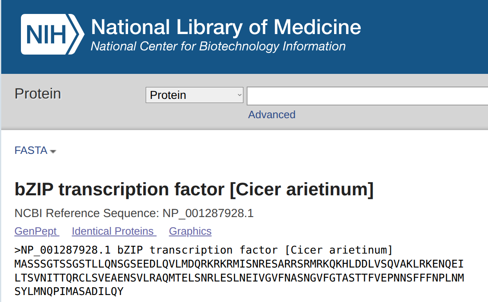

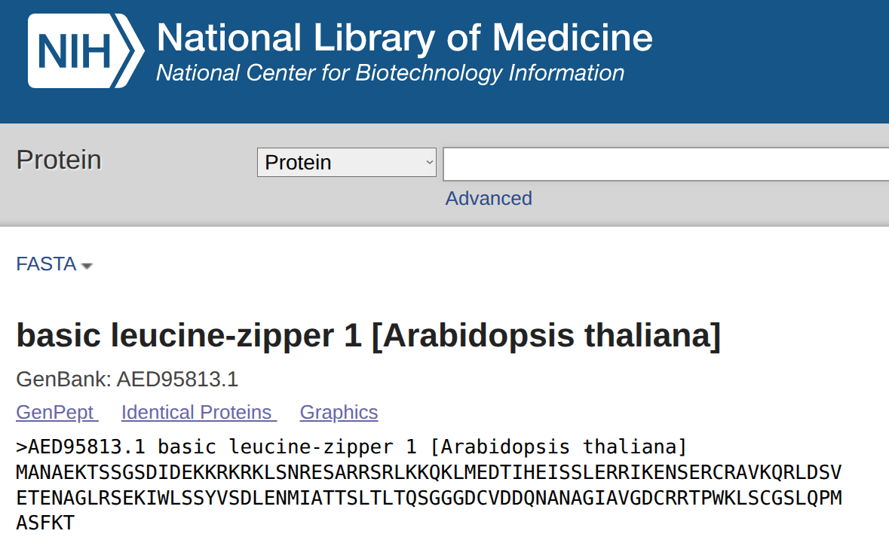

- Then copy/paste gene datat into https://www.ebi.ac.uk/jdispatcher/psa/emboss_needle

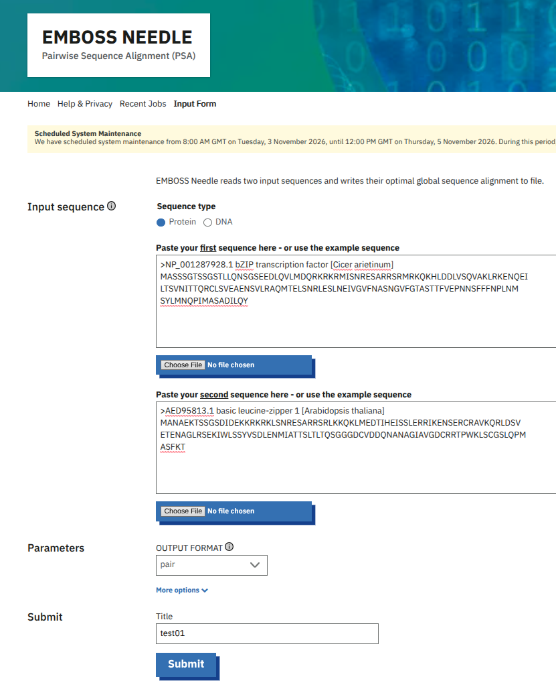

- After submission, following results are made:
```txt
########################################
# Program: needle
# Rundate: Sun 25 Oct 2026 15:36:42
# Commandline: needle
#    -auto
#    -stdout
#    -asequence emboss_needle-I20261025-153636-0626-37662896-p1m.asequence
#    -bsequence emboss_needle-I20261025-153636-0626-37662896-p1m.bsequence
#    -datafile EBLOSUM62
#    -gapopen 10.0
#    -gapextend 0.5
#    -endopen 10.0
#    -endextend 0.5
#    -aformat3 pair
#    -sprotein1
#    -sprotein2
# Align_format: pair
# Report_file: stdout
########################################

#=======================================
#
# Aligned_sequences: 2
# 1: NP_001287928.1
# 2: AED95813.1
# Matrix: EBLOSUM62
# Gap_penalty: 10.0
# Extend_penalty: 0.5
#
# Length: 177
# Identity:      56/177 (31.6%) # <-------- the most important results
# Similarity:    81/177 (45.8%)
# Gaps:          52/177 (29.4%)
# Score: 173.0
# 
#
#=======================================

NP_001287928.      1 MASSSGTSSGSTLLQNSGSEEDLQVLMDQRKRKRMISNRESARRSRMRKQ     50
                     ||::..|||||.:              |::||||.:||||||||||::||
AED95813.1         1 MANAEKTSSGSDI--------------DEKKRKRKLSNRESARRSRLKKQ     36

NP_001287928.     51 KHLDDLVSQVAKLR---KENQEILTSVNITTQRCLSVEAENSVLRAQMTE     97
                     |.::|.:.:::.|.   |||.|...:|.   ||..|||.||:.||::...
AED95813.1        37 KLMEDTIHEISSLERRIKENSERCRAVK---QRLDSVETENAGLRSEKIW     83

NP_001287928.     98 LSNRLESLNEIVGVF----------------NASNGV-FGTASTTFVEPN    130
                     ||:.:..|..::...                ||:.|: .|....|     
AED95813.1        84 LSSYVSDLENMIATTSLTLTQSGGGDCVDDQNANAGIAVGDCRRT-----    128

NP_001287928.    131 NSFFFNPLNMSYLMNQPIMASADILQY    157
                           |..:|....|| |||...   
AED95813.1       129 ------PWKLSCGSLQP-MASFKT---    145


#---------------------------------------
#---------------------------------------
```

- Same data into Emboss water at https://www.ebi.ac.uk/jdispatcher/psa/emboss_water
```txt
########################################
# Program: water
# Rundate: Sun 25 Oct 2026 15:43:09
# Commandline: water
#    -auto
#    -stdout
#    -asequence emboss_water-I20261025-154304-0683-94099720-p1m.asequence
#    -bsequence emboss_water-I20261025-154304-0683-94099720-p1m.bsequence
#    -datafile EBLOSUM62
#    -gapopen 10.0
#    -gapextend 0.5
#    -aformat3 pair
#    -sprotein1
#    -sprotein2
# Align_format: pair
# Report_file: stdout
########################################

#=======================================
#
# Aligned_sequences: 2
# 1: NP_001287928.1
# 2: AED95813.1
# Matrix: EBLOSUM62
# Gap_penalty: 10.0
# Extend_penalty: 0.5
#
# Length: 131
# Identity:      47/131 (35.9%) <------- different results to Emboss needle
# Similarity:    70/131 (53.4%)
# Gaps:          30/131 (22.9%)
# Score: 181.0
# 
#
#=======================================

NP_001287928.      1 MASSSGTSSGSTLLQNSGSEEDLQVLMDQRKRKRMISNRESARRSRMRKQ     50
                     ||::..|||||.:              |::||||.:||||||||||::||
AED95813.1         1 MANAEKTSSGSDI--------------DEKKRKRKLSNRESARRSRLKKQ     36

NP_001287928.     51 KHLDDLVSQVAKLR---KENQEILTSVNITTQRCLSVEAENSVLRAQMTE     97
                     |.::|.:.:::.|.   |||.|...:|.   ||..|||.||:.||::...
AED95813.1        37 KLMEDTIHEISSLERRIKENSERCRAVK---QRLDSVETENAGLRSEKIW     83

NP_001287928.     98 LSNRLESLNEIVGVFNASNGVFGTASTTFVE    128
                     ||:.:..|..::          .|.|.|..:
AED95813.1        84 LSSYVSDLENMI----------ATTSLTLTQ    104


#---------------------------------------
#---------------------------------------
```

### 24. Multiple sequence alignment
- Methods and algorithms for multiple sequence alignment
  - Progressive alignment: an iterative method that aligns sequences step by step, building the final alignment
  - Iterative methods: uses iterative refinement to optimize the alignment, such as the popular PST-BLAST
  - Multiple Alignment Comparison: comparing multiple alignments to identify conserved regions and variations across sequences.
- Tools for multiple sequence alignment
  - Clustal Omega
  - MAFFT
- Challenges and limitations of multiple sequence alignment
  - Scalability
  - Non-homologous sequences
  - Highly variable regions
- Applications of multiple sequence alignment in biological research
  - Phylogenetics
  - Functional analysis
  - Annotation of genomes
- Comparative analysis of multiple sequence alignment tools
  - Pairwise alignment: two sequences at a time
  - Multiple alignment
  - Structural alignment: based on 3D structure of biological molecules, critical for structural genomics
- Future trends in multiple sequence alignment
  - ML integration
  - Interactive visualization
  - Personalized genomics

### 25. Practical Multiple sequences alignment
- https://www.megasoftware.net
  - Download the suite
- https://mafft.cbrc.jp/alignment/software/

### 26. Homology searching and blast
- The goal is to identify sequences that are evolutionarily related, implying a common ancestry and often indicating similar functions
- The most common method for homology searching is using sequence alignment algorithms, such as BLAST (Basic Local Alignment Search Tool). These algorithms compare a query sequence against a database of known sequences to find regions of similarity
- Blast bioinformatics
  - Basic Local Alignment Search Tool
  - For comparing biological sequences
  - Applications: sequence alignment, database searching, identification of unknown sequences
- Types of BLAST searches
  - In blast bioinformatics, there are various types of searches including nucleotide-nucleotide, protein-protein, and translated nucleotide-protein searches
  - Blast searches also include specialized options such as PSI-BLAST for sensitive homology detection
- Understanding Blast results
  - Interpreting Match Scores
  - Evaluating E-Values
  - Filtering Out Non-Significant Hits
- Parameters and settings for Blast
  - Optimizing parameters
  - Database selection
  - Filtering options
  - Scoring matrix
- Limitations of blast
  - Database dependence
  - Sequence length limitations
  - Algorithm sensitivity
  - Computational intensity
- Improving blast performance
  - Optimizing database: indexed DB
  - Enhanced algorithms
  - Parallel processing
- Case studies using blast
  - Genetic disease research
  - Comparative genomics
  - Metagenomics analysis
  - Drug test identification

### 27. Practical Blast and homology searching
- https://blast.ncbi.nlm.nih.gov/Blast.cgi

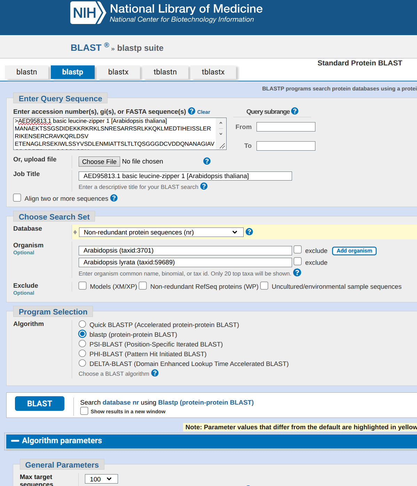

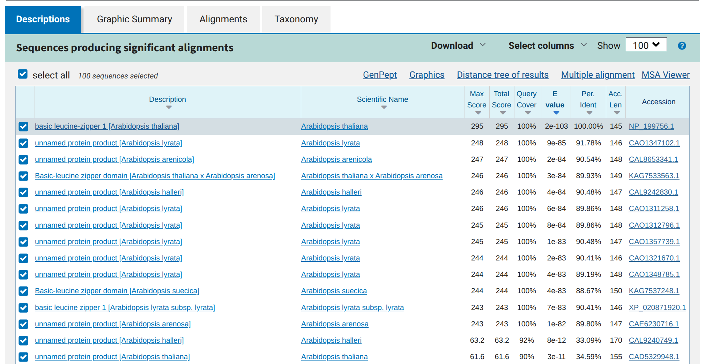

- After downloading those data, you may run megasoftware for multiple sequencing

### Assignment 4: Project 4: Sequence Analysis using Bioinformatics Tools

## Section 5: Functional Genomics

### 28. Introduction to Genomics
- Gemonics studies the entire genetic material of organisms
- Unlocks the secrets of life at molecular level
- Genome structure and organization
  - DNA structgure: nucleotides form double helix, genetic blue print
  - Chromosomes: prokaryotes: circular, Eukaryotes: linear, multiple
  - Genetic Elements: Genes, exons, introns, regulatory regions
- Sequencing technologies
  - Sanger sequencing: first-generation, chain termination
  - Next-generation: Massively parallel, high-throughput
  - Third-generation: long-read, real-time sequencing
- Data generation and processing
  - Raw data: FASTQ files, millions of short reads
  - Quality control: trimming adapters, fitlering low-quality reads
  - Preprocessing: alignment to reference, de novo assembly
  - Analysis: variant calling, annotation, interpretation
- Genome assembly and annotation
  - De Novo Assembly: reconstructing genome withotu refernce sequence
  - Reference-based assembly: aligning reads to known genomes
  - Assembly challenges: repetitive sequences, heterozygosity, sequencing errors
  - Functional annotation: identifying genes, regulatory elements, predicting functions
- Comparative Genomics
  - Evolutionary insights
  - Structural comparisons
  - Functional analysis
- Gene expression analysis
  - RNA sequencing: capturing snapshot of actively expressed genes
  - Expression analysis: quantifying gene activity under different conditions
  - Differential expression: identifying genes with altered expression levels
  - Pathway analysis: uncovering biological processes affected by gene expression changes
- Genomic variation and population genomics

| Variation Type | Description | Impact |
|-----------------|------------|--------|
| SNPs | Single nucleotide changes | Common, may affect protein function|
| Indels | Insertions or deletions | Can cause frameshifts|
|CNVs | Copy number variations | Affect gene dosage|

- Functional genomics
  - CPISPR: precise genome editing tool
  - RNA Interference: silencing specific genes post-transcriptionally
  - Knock-out studies: removing genes to study their function
  - Disease research: uncovering genetic basis of disorders
- Epigenomics
  - DNA methylation: adding methyl groups to DNA, regulating gene expression
  - Histone modifications: chemical changes to histone proteins, affecting chromatin structure
  - Chromatin remodeling: altering DNA accessibility, controlling gene activity
- Analysis list for genomics
  - Gene prediction analysis
  - Gene structure prediction
  - Genome annotation
  - Gene location on chromosome
  - Gene enrichment analysis

### 29. Gene prediction analysis
- softberry.com -> site is down
  - Use https://cello.life.nctu.edu.tw/

### 30. Gene structure prediction
- https://gsds.gao-lab.org
- Using:
  - https://www.ncbi.nlm.nih.gov/nuccore/NM_000518.5?report=fasta
  - https://www.ncbi.nlm.nih.gov/nuccore/NG_059281.1?report=fasta

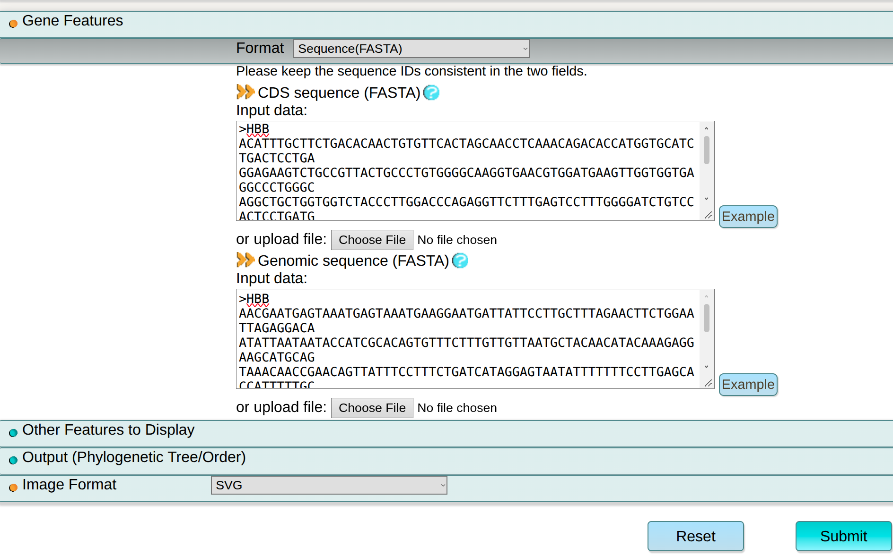

- The site failed to respond

### 31. Genome annotation and visualization

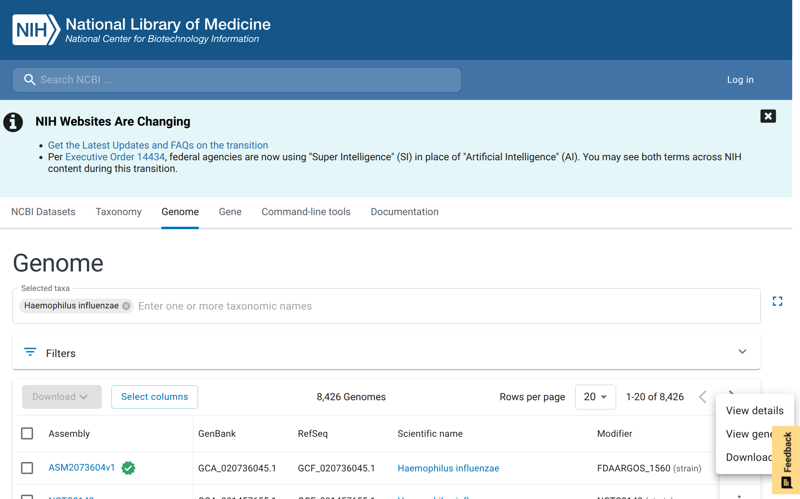

- https://proksee.ca

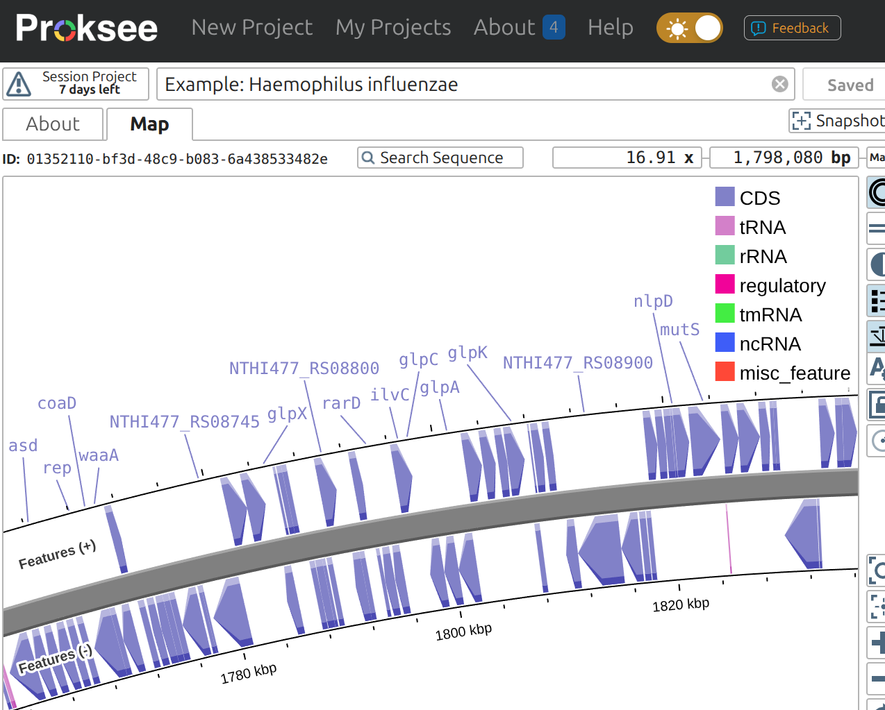

### 32. Gene location on chromosome
- http://mg2c.iask.in/mg2c_v2.1/

### 33. Gene functional enrichment analysis
- https://bioinformatics.sdstate.edu/go81/

### Assignment 5: Project 5: Genomics Analysis using Bioinformatics Tools

## Section 6: Proteomics

### 34. Introduction to Proteomics
- Studying protein's structures, functions, and interactions
- Protein structure and function
  - Primary structure: linear amino acid sequence
  - Secondary structure: local folding patterns - alpha-helices and beta-sheet
  - Tertiary structure: overall 3D shape of a single protein
  - Quaternary structure: multiple protein subunites forming a complex
- Techniques in proteomics
  - Mass spectrometry: identifies and quantifies proteins
  - X-ray crystallography
  - NMR spectroscopy
  - PPI Assays
- Protein identification and sequencing
  - Sample preparation: proteins extracted and digested into peptides
  - MS/MS Analysis
  - Database search
  - Protein identification
- Quantitative proteomics
  - Label-free techniques: direct comparison of peptide intensities b/w samples
  - Labeling techniques
    - SILAC: metabolic labeling
    - iTRAQ: chemical labeling
  - Differential expression: identify up/down-regulated proteins b/w conditions
- Protein function prediction
  - Sequence-based methods: 
    - BLAST: Compares sequences
    - HMMs: Detect remote homologs
  - Structure-based methods: 
    - Homology modeling: predicts 3D structure
    - Docking: simulates interactions
  - ML approaches
  - Integrative methods: combine multiple approaches for accurate predictions
- Protein-protein interaction networks
  - Network contruction: integrate experimental data and predictions
  - Database sources
    - STRING: known and predicted interactions
    - BioGRID: literature-curated
  - Network analysis: identify hubs, modules, and functional clusters
  - Biological insights: reveal protein complexes and cellular pathways
- Data integration and systems biology
  - Genomics
  - Transcriptomics
  - Proteomics
  - Metabolomics
- Bioinformatics tools for proteomics analysis
  - MaxQuant: MS data analysis, Qunatification, identification
  - Mascot: Database search, protein identification
  - Cytoscape: network visualization, PPI network analysis
  - DAVID: Functional annotation, Gene ontology enrichment
- Analysis list for proteomics
  - Motifs analysis
  - Domains analysis
  - Protein pathway
  - Protein physical parameters

### 35. Motifs analysis
- Motifs
  - Protein motifs are short, conserved sequences within proteins that have a specific function or structural role
  - These motifs are crucial for the protein's activity, stability, or interaction with other molecules
- https://meme-suite.org/meme/
- Sample Fast data from gemini:
```
>Motif_1_Zinc_Finger_C2H2
MTEKYVCQVCGKTFRQKSDLVKHQRTHTGEKPYKCPECGKSFSQKSNLTRHQRVHTG
>Motif_2_Leucine_Zipper
MKQLQSQLKELQSQLKELQSQLKELQSQLKELQSQLKELQSQLKELQSQLKELQSQLK
>Motif_3_SH2_Domain_Core
MRKGGWEEGEIPNYLPRNYVTPKYIIVQGPKQTKRSGRYVRYHSVRK
>Motif_4_EF_Hand_Calcium_Binding
MDKDGDGTITTKELGTVMRSLGQNPTEAELQDMINEVDADGNGTIDFPEFLTMMARK
>Motif_5_Walker_A_P_loop
MAENKLTQLLNIGPSGSGKSTLLKLLAGATEGEYEWTKDGTPV
```
- Input GUI

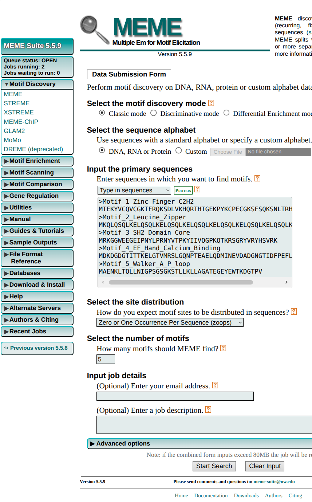

- Results summary

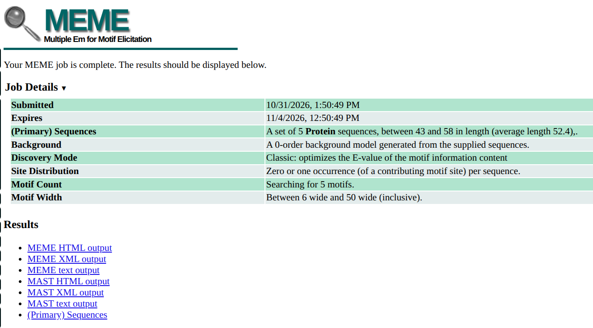

- HTML results

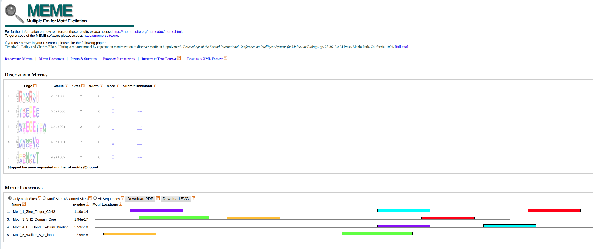

- SVG results

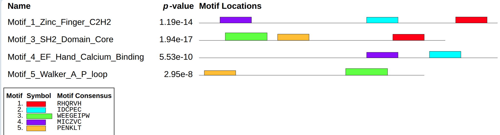


### 36. Domains Analysis
- Protein domains are distinct structural and functional unites within a protein. Each domain can evolve, function, and exist independently of the rest of the protein
- https://www.ncbi.nlm.nih.gov/cdd/
- Batch search at https://www.ncbi.nlm.nih.gov/Structure/bwrpsb/bwrpsb.cgi
- For visualization: https://github.com/CJ-Chen/TBtools-II

### 37. PPI Networks
- Protein-protein interactions (PPIs) refer to the physical contacts established b/w two or more protein molecules as a result of biochemical events and/or electrostatic forces
- https://string-db.org

### 38. Protein physical parameters
- https://web.expasy.org/protparam/

### Assignment 6: Project 6: Proteomics Analysis Using Tools

## Section 7: Evolutionary Bioinformatics

### 39. Introduction to evolutionary Bioinformatics
- The role of bioinformatics in phylogenetic analysis
  - Sequence alignment: aligning DNA or protein sequences to identify shared similarities and differences, providing clues about evolutionary relationship
  - Tree construction: building phylogenetic trees based on sequence alignments, represending evolutionary relationship b/w species and their divergence times
  - Data visualization
- Computational Methods for Sequence Alignment
  - Pairwise alignment: Aligns two sequences at a time, highlighting shared and divergent regions to estimate evolutionary distances.
  - Multiple sequence alignment: Aligns multiple sequences simultaneously, identifying conserved regions and providing insights into evolutionary relationships.
- Phylogenetic Tree Construction Algorithms
  - Distance-based: Calculate evolutionary distances between species based on their sequence differences and use these distances to construct trees.
  - Character-based: Analyze shared characteristics or mutations between species and use these data points to reconstruct evolutionary relationships.
  - Bayesian methods: Utilize statistical models to estimate the probability of different evolutionary trees, providing a more robust analysis of relationships.
- Comparative Genomics and Evolutionary Relationships
  - Genome-Wide Comparisons: Analyzing entire genomes to identify regions of similarity and difference, revealing evolutionary relationships and shared ancestry.
  - Gene Family Evolution: Studying the evolution of gene families across different species, providing insights into gene function and the adaptation of organisms.
- Applications of evolutionary bioinformatics
  - Drug discovery
  - Disease research
  - Conservation efforts: for endangered species
- Challenges and limitations in the field
  - Data quality
  - Computational power
  - Interpretation

### 40. Practical building Phylogenetic trees

### Assignment 7: Project 7: Phylogenic Analysis using Iqtree and Itol

## Section 8: Command Line Bioinformatics

### 41. Introduction to Linux
- Bio-Linux: https://en.wikipedia.org/wiki/BioLinux
  - Not linux distribution
- Bioinformatics tools on Linux
  - BLAST
  - SAMtools
  - HISAT2
  - MaxQuant

### 42. Environment setup on Windows

### 43. Navigating the Linux file system

### 44. Basic Linux commands for bioinformatics

### 45. Installing bioinformatics tools
- conda install -c bioconda fastqc
- conda create -n bioinfo_env python=3.9
- conda activate bioinfo_env

### 46. Bash scripting for bioinformatics

### Assignment 8: Project 8: Scripting for Bioinformatics

## Section 9: Transcriptomics

### 47. Introduction to Transcriptomics
1. RNA transcript study: explore full set of RNA from genome
2. Gene exrepssion insights: analyze regulation and activity patterns
3. Biomedical applications: identify disease markers and drug targets
- Central dogma and RNA's role
  - DNA: genetic blueprint storage
  - RNA: Transcriptomics focus: gene activity messenger
  - Protein: Functional molecules in cells
- Transcriptomics techniques
  - RNA-seq: high accuracy RNA quantification
  - Microarrays: simultaneous analysis of thousands of genes
  - Single-cell RNA-Seq: Gene expression at individual cell level
- RNA sequencing workflow
  - Sample collection: extract RNA from biological samples
  - Library preparation: convert RNA to cDNA for sequencing
  - Sequencing: high-throughput reading of cDNA fragments
  - Data analysis: map, quantify, and analyze expression levels
- Data analysis in transcriptomics
  - Alignment: map reads to reference genome
  - Quantification: calculate transcript abundance levels
  - Differential expression: identify gene changes across conditions
- Bioinformatics tools  
  - Alignment: STAR, HISAT2
  - Quantification: RSEM, Cufflinks
  - Expression Analysis: DESeq2, edgeR
  - Visualization: IGV, heatmaps, PCA  
- Challenges in transcriptomics
  - Data complexity: requires significant computational resources
  - Technical variability: platform differences impact results
  - Interpretation: translating RNA data to biological insights
- Future directions
  - Gene expression insights
  - Single-cell advancements
  - Omics integration
- Analysis list for the transcriptomics
  - Microarray data analysis (GUI on GEO2R)
  - RNA-seq data analysis using Linux CLI
    - Quality control and preprocessing
    - Alignment to reference genome
    - Quantification

### 48. Microarray Data analysis
- https://www.ncbi.nlm.nih.gov/geo/
- GEO2R

### Assignment 9: Project 9: Microarray Analysis on Transcriptomics Data

## Section 10 : RNA-Seq Data Analysis

### 49. Introduction to RNA-Seq Data Analysis
- Defnition: RNA-seq is a high-throughput sequence method used to capture a snapshot of RNA presence and quantify in a genome at a give moment
- Main function: it measures gene expression levels, discovers new transcripts, and detects variants and gene fusions
- Capturing RNA landscape
  - Gene expression
  - Transcript discovery
  - Variant detection
  - Fusion detection
- Single-end vs Paired-end reads
  - Single-end reads: sequenced from one end of the DNA fragment
  - Paired-end reads: sequenced from both ends of the DNA fragment
- SRA database: a repository of sequencing data
  - https://www.ncbi.nlm.nih.gov/sra
- RNA sequencing data: insights into gene expression
  - FASTQ format
  - Gene expression
- Data preprocessing: ensuring data quality
  - Quality control: Access data quality with FastQC
  - Quality trimming: remove a low-quality bases with Fastp
- Reads alignment: matching reads to the genome
  - Reference genome
  - Genome indexing
- Popular alignment tools
  - BWA: fast and efficient. Large genomes/RNA-seq
  - HISAT2: high-performance. RNA-seq data
  - STAR: rapid and sensitive. Large RNA-seq datasets
- Quantification: measuring gene expression levels
  - FeatureCounts
  - Gene expression

### 50. Retrieving RNA-Seq Data
- Sample data: SRA GSM461177

### 51. Preprocessing of RNA-Seq Data
```bash
#!/bin/bash

#Install FastQC and Fastp installed
#sudo apt install fastqc
#sudo apt install fastp

# Create directories for output
mkdir -p FastQC_Results Preprocessed_FASTQ

# Loop through all FASTQ files in the input directory
for file in ./Input_FASTQ/*.fastq; do
    # Extract the file name without the path and extension
    filename=$(basename $file .fastq)
    
    # Run FastQC
    fastqc $file --outdir=FastQC_Results
    
    # Run Fastp
    fastp \
    -i $file \
    -o Preprocessed_FASTQ/${filename}_trimmed.fastq \
    -h Preprocessed_FASTQ/${filename}_fastp.html \
    -j Preprocessed_FASTQ/${filename}_fastp.json

done

echo "Preprocessing complete. Results are in FastQC_Results and Preprocessed_FASTQ directories."
```

### 52. Indexing And Alignment To Reference Genome
```bash
#!/bin/bash

# Activate your conda environment with BWA installed (if applicable)
#sudo apt install bwa

# Path to the reference genome FASTA file
REFERENCE_GENOME=./ReferenceData/genome.fa

# Directory to store the BWA genome index
GENOME_INDEX_DIR=./GenomeIndex

# Create the directory if it does not exist
mkdir -p $GENOME_INDEX_DIR

# Change to the genome index directory
cd $GENOME_INDEX_DIR

# Run BWA to generate the genome index
bwa index $REFERENCE_GENOME

echo "Genome indexing complete. The index files are stored in the GenomeIndex directory."
```
- `bwa index genome.fs`
```bash
#!/bin/bash

# Activate your conda environment with BWA and SAMtools installed
#sudo apt install bwa
#sudo apt install samtools

# Paths to the reference genome and directories
GENOME_INDEX_PATH=./GenomeIndex/genome.fa
INPUT_FASTQ_DIR=./Input_FASTQ
OUTPUT_DIR=./Aligned_Results

# Create output directory if it does not exist
mkdir -p $OUTPUT_DIR

# Loop through all paired-end FASTQ files and run BWA-MEM for alignment
for R1_FILE in $INPUT_FASTQ_DIR/*_1_subsampled_trimmed.fastq; do
    base_name=$(basename $R1_FILE _1_subsampled_trimmed.fastq)
    R2_FILE=$INPUT_FASTQ_DIR/${base_name}_2_subsampled_trimmed.fastq
    
    if [[ -f $R1_FILE && -f $R2_FILE ]]; then
        # Align reads to the reference genome using BWA-MEM
        bwa mem -t 24 $GENOME_INDEX_PATH $R1_FILE $R2_FILE > $OUTPUT_DIR/${base_name}.sam
        
        # Convert SAM to BAM, sort and index using SAMtools
        samtools view -bS $OUTPUT_DIR/${base_name}.sam > $OUTPUT_DIR/${base_name}.bam
        samtools sort -o $OUTPUT_DIR/${base_name}_sorted.bam $OUTPUT_DIR/${base_name}.bam
        samtools index $OUTPUT_DIR/${base_name}_sorted.bam
        
        # Remove the intermediate SAM file to save space
        rm $OUTPUT_DIR/${base_name}.sam
    else
        echo "Paired file for $R1_FILE not found. Skipping..."
    fi
done

echo "Alignment complete. Results are in the Aligned_Results directory."
```
- BWA and samtools tutorial: https://dibsi-rnaseq.readthedocs.io/en/latest/variant-calling.html

### 53. Quantifications Of BAM Files
```bash
#!/bin/bash

# Activate your conda environment with featureCounts installed
#sudo apt install subread

# Paths to the input BAM files, annotation file, and output directory
BAM_DIR=./Aligned_Results
ANNOTATION_FILE=./ReferenceData/genes.gtf
OUTPUT_DIR=./Results/Counts

# Create output directory if it does not exist
mkdir -p $OUTPUT_DIR

# Run featureCounts for paired-end reads
featureCounts -T 4 -s 2 -p -a $ANNOTATION_FILE -o $OUTPUT_DIR/FeatureCounts.txt $BAM_DIR/*_sorted.bam

# Process the FeatureCounts Matrix to keep only the columns needed in downstream analysis
cut -f1,7-12 $OUTPUT_DIR/FeatureCounts.txt > $OUTPUT_DIR/FeatureCounts_Mod.txt

# Additional processing to clean up the column names (optional)
# Example: Remove the first line, path, and _sorted.bam from the file to make simple column names
# You can edit the file manually using a text editor or further automate the process if needed

echo "Read counting complete. Results are in the Counts directory."
```

### Assignment 10: Final Project 10: RNA-Seq Data Analysis using Linux

