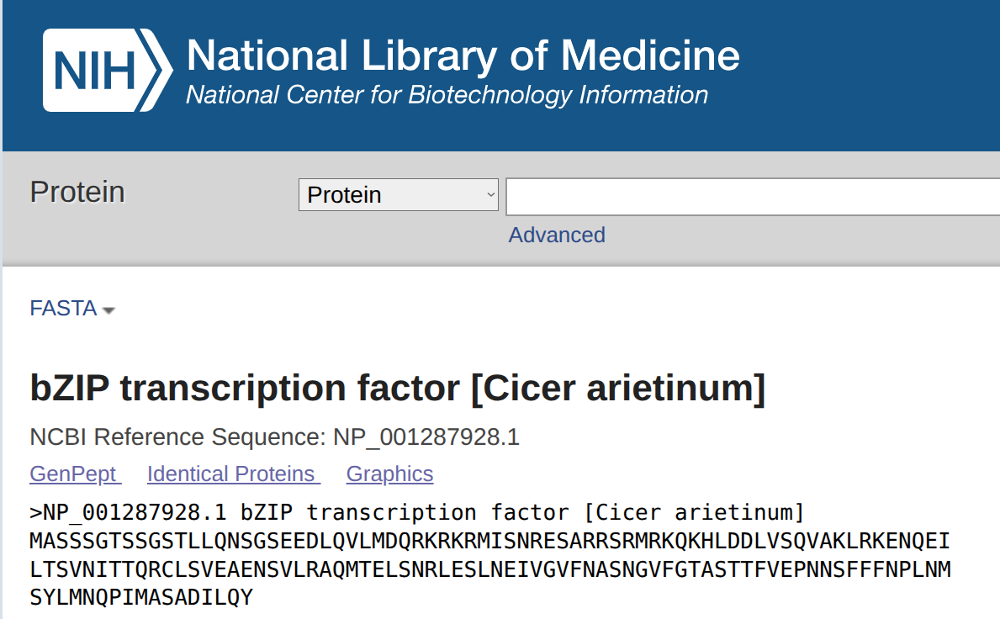
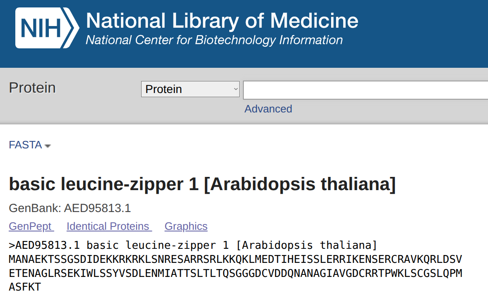
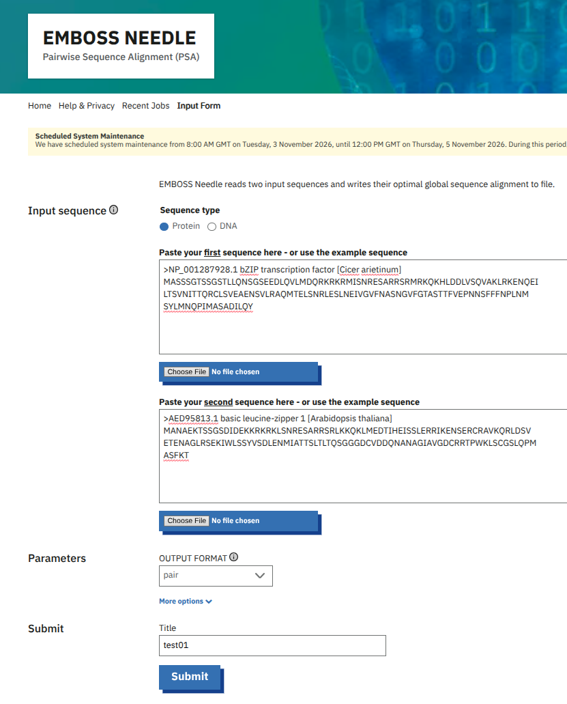
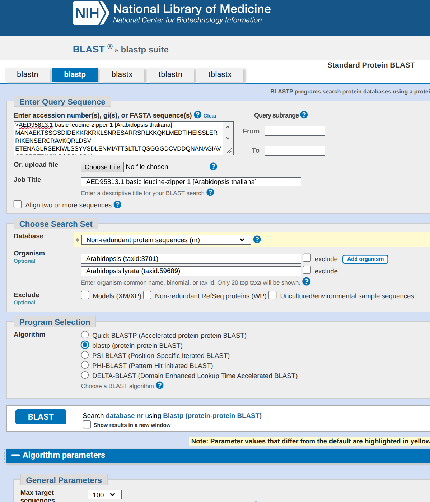
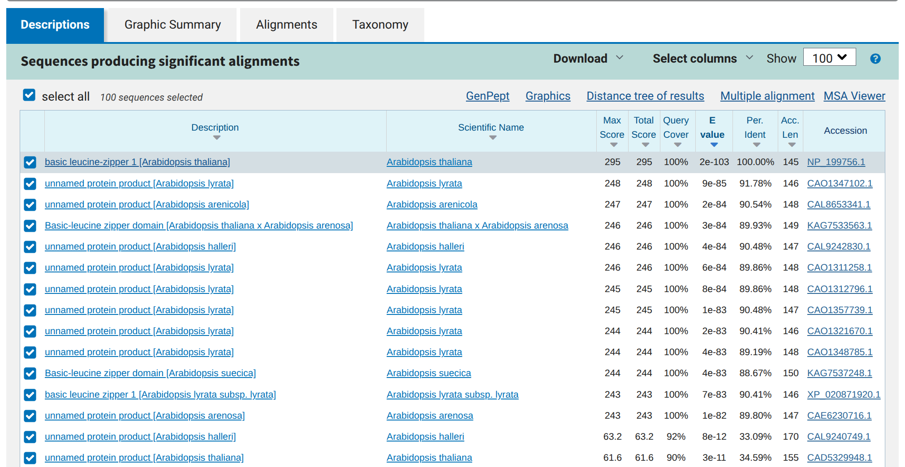

# Learn Bioinformatics - Beginner to Master Through Projects
- Instructor: Rafiq Ur Rehman

## Section 1: Introduction to Bioinformatics and Subfields

### 1. Introduction to Bioinformatics
- The interdisciplinary field that combines biology, computer science, and information technology to analyze and interpret biological data
- Key Aspects of bioinformatics
  - Computing
  - Big data
  - Collaboration
  - Diagnostic tools
  - Problem-solving

### 2. Genomics
- Studying the structure, function, evolution, and mapping of genomes
  - Focuses on sequencing, assembling and analyzing genome
  
### 3. Proteomics
- Large scale study of proteins, their structures, functions and interactions. It aims to understand the roles of proteins in biological processes and how they relate to health and disease
  - Focuses on the study of protein structures, functions, and interactions

### 4. Transcriptomics
- Examines RNA transcripts produced by the genome, capturing gene expression patterns and dynamics. It helps understand gene regulation, cellular functions, and how genes respond to various conditions
  - Focuses on the study of RNA transcripts produced by the genome

### 5. Metabolomics
- The study of metabolites and metabolic pathways within cells, tissues, or organisms. It helps understand metabolism and the biochemical processes that occur in cells
  - Focuses on the study of metabolites and metabolic processes

### 6. Structural Bioinformatics
- The 3D structure of biological macromolecules like proteins and nucleic acids. It helps predict molecular interactions and understand the relationship b/w structure and function
  - Focuses on the analysis of 3D structures of biological molecules
  - Applications: protein folding analysis, drug design, enzyme mechanism studies

### 7. Pharmacogenomics
- Explores how an individual's genetic makeup influences their response to drugs. It aims to optimize drug therapy, minimize adverse effects, and facilitate personalized medicine
  - Focuses on the study of drug-gene interactions
  - Applications: tayloring drug prescriptions, improving therapeutic efficacy, reducing side effects

### 8. Computational Biology
- Uses algorithms, mathematical models, and software tools to simulate biological processes. It includes data analysis, modeling, and visualization of biogical data
  - Focuses on the simulation and modeling of biological systems
  - Applications: modeling biological networks, predicting protein interactions, simulating cellular processes

### 9. Other Subfields of Bioinformatics
- Systems biology: intergrative approach that examines the interactions within biological systems. It uses computational tools to model complex biological networks and predict system behavior
  - Focuses on the modeling of biological networks and systems
- Cheminformatics: Involves the application of bioinformatics techniques to chemistry
  - Focuses on the study of chemical data for biological applications
- Epigenomics: studies the chemical changes to DNA and histones that regulate gene expresssion without altering the genetic sequence
  - Focuses on the study of chemical modifications in gene expression
- Machine Learning  

### 10. Trends In Computational Biology

### 11. Skills Needed For Bioinformatics Field
- Biological knowledge
- Bioinformatics databases management
- Data retrieval
- Familiarity with bioinformatics tools
- Problem-solving and analytical skills
- Data analysis and statistics
- Programming and scripting

### Assignment 1: Project 1: Bioinformatics Fields
- What is bioinformatics, and why is it important in modern biology? Provide two examples of its applications.
  - General Concepts: Bioinformatics is the interdisciplinary field that develops and applies computational tools and techniques to analyze and interpret biological data. It is important for understanding complex biological systems and advancing fields like personalized medicine and drug discovery.
    - Example 1: Sequence alignment to identify gene functions.
    - Example 2: Protein structure prediction for drug design.
- Match the following descriptions to their respective subfields:
  - Genomics: The study of genomes and their structures.
  - Proteomics: The analysis of proteins, their structures, and interactions.
  - Transcriptomics: Investigating RNA expression levels in different conditions.
  - Metabolomics: Exploring metabolic pathways and biochemical reactions.
  - Pharmacogenomics: Predicting drug responses based on genetic information.
  - Computational Biology: Developing computational models to analyze biological data.
- Discuss one recent trend in computational biology that you find exciting and explain its potential impact on bioinformatics.
  - Example Trend: Machine learning and AI are increasingly used for predicting protein structures, which has a significant impact on drug discovery and understanding diseases.
- List three essential skills required for a career in bioinformatics and explain why each is important.
  - Programming: Essential for processing and analyzing large biological datasets.
  - Data Analysis: Required to interpret the results and draw meaningful conclusions from bioinformatics experiments.
  - Biological Knowledge: Necessary to understand the biological context and relevance of the computational analyses.
- Provide an example of how data from one subfield (e.g., genomics or proteomics) can be integrated with data from another subfield to answer a complex biological question.
  - Example: Genomics data can be used to identify genetic mutations, while proteomics data can analyze the resulting changes in protein expression. Combining these insights can help understand disease mechanisms at both the genetic and protein levels.

## Section 2: Bioinformatics Databases and Data Retrieval

### 12. Introduction To Bioinformatics Databases
- Primary
- Secondary
- Derived databases

### 13. Primary Databases Introduction And NCBI Practical
- Primary databases are repositories that contain original biological data submitted by researchers
- Examples
  - GenBank/NCBI: Stores nucleotide sequences and their protein translations
  - EMBL-EBI: European Molecular Biology Laboratory's European Bioinformatics Institute
  - DDBJ: Data bank of Japan
- Key features
  - Direct submissions of raw data by researchers
  - Frequently updated with new data
- Download data type: FASTA, CSV, JSON
- APIs or CLI tools are available - e.g., NCBI Entrez, UniProt API
- Practice
  - https://www.ncbi.nlm.nih.gov/?hl=ko
  
### 14. EMBL and DDBJ Database Practical
- https://www.ebi.ac.uk/
- https://www.ddbj.nig.ac.jp/index-e.html

### 15. Introduction to secondary databases
- Compile data from primary databases, adding curated, value-added information like annotations
- UniProt: comprehensive resource for protein sequencies and functional information
- Pfam: database of protein families based on sequence alignments and hidden Markov models
- RefSeq: Curated collection of DNA, RNA, and protein sequences

### 16. PDB database
- https://www.rcsb.org

### 17. Uniprot Database
- https://www.uniprot.org

### 18. GEO Database
- https://ncbiinsights.ncbi.nlm.nih.gov/tag/geo/

### 19. Derived Databases and Practical
- Derived from primary and secondary databases through computational analysis
- Ensembl: annotates genomic data, integrating information from various source
- Gene Ontology (GO): provides functional annotation of genes across species
- InterPro: integrates diverse informatin about protein families, domains, and functional sites 
- Taxonomy: the science of naming, describing and classifying organisms and includes all plants, animals, and microorganisms of the world
- Practice:
  - https://www.ncbi.nlm.nih.gov/datasets/genome/
  - https://reactome.org
  - https://www.genome.jp/kegg/

### 20. Conclusion and Project Insights
- Primary database: original data, direct submissions, raw sequences
- Secondary dtabase: curated data, annotations, enhanced information
- Derived database: computed data, integrates multiple sources, provides high-level analysis

### Assignment 2: Project 2: Bioinformatics Data Retrieval Using Databases
1. Differentiate between primary, secondary, and derived databases. Provide an example of each and describe their primary function.
    - Primary: NCBI GenBank (stores raw sequence data).
    - Secondary: PDB (focuses on structural information).
    - Derived: GEO (stores processed data from experiments).
2. Use NCBI’s nucleotide database to retrieve the sequence for the BRCA1 gene (Homo sapiens). Provide the following details:
    - NCBI Database
      - Accession number: NM_007294
      - Sequence length: 81,226 bp
      - Source organism: Homo sapiens
3. Retrieve the same BRCA1 gene sequence using either EMBL or DDBJ. Compare the retrieval process with NCBI. What similarities or differences did you notice?
    - EMBL/DDBJ Practical
      - Retrieval process was similar, but the interfaces differ slightly. EMBL provides a more European-focused data set, while NCBI integrates additional tools like BLAST.
4. Access the PDB database and find a structure for hemoglobin. Provide the following details:
    - Secondary Databases
      - PDB ID: 1A3N
      - Resolution: 2.1 Å
      - Number of chains: 4
5. Search for the protein information of BRCA1 in the Uniprot database. Provide the following:
    - Uniprot Database
      - Protein name: Breast cancer type 1 susceptibility protein
      - Organism: Homo sapiens
      - Functional description: Involved in DNA repair and maintaining genomic stability.
6. Access GEO and find a dataset related to breast cancer. Provide the following details:
    - GEO Database
      - Dataset accession number: GSE45827
      - Study title: Gene expression profiling of breast cancer tissues
      - Number of samples: 20
7. Explain how primary, secondary, and derived databases can be used together to investigate a disease mechanism (e.g., breast cancer). Provide a hypothetical workflow.
    - Use NCBI GenBank to retrieve raw sequence data for BRCA1.
    - Access PDB for structural information of proteins encoded by BRCA1.
    - Analyze experimental datasets from GEO to identify expression patterns in breast cancer.
    - Integrate findings to study how mutations in BRCA1 affect its structure and expression, contributing to breast cancer.

## Section 3: Bioinformatics Tools and Programming languages

### 21. Bioinformatics Tools and Programming languages
- SW applications that facilitate the analysis of biological data
- Used for tasks such as sequence alignment, genome annotation, and data visualization
- Why?
  - Efficiency
  - Accuracy
  - Scalability
  - Reproducibility
  - Visualization
- How ?
  - Problem identification
  - Algorithm development
  - Programming
  - Testing and validation
  - User interface design
  - Documentation and training
  - Maintenance and updates
- Bioinformatics tools  
    1. Sequence alignment tools
      - BLAST: Basic Local Alignment Search Tool for comparing sequences
      - Mega: Alignment tool for windows mac and Linux
    2. Sequence database
      - GenBank
      - EMBL
      - DDBJ
    3. Genome browsers
      - UCSC Genone Browser
      - Ensembl
    4. Variant calling tools
      - GATK
    5. Funcitonal annotation tools
      - InterProScan: identify protein domains and functional annotations
      - Pfam: database of protein families
    6. Pathway analysis tools
      - KEGG
    7. Data visualization tools
      - Ggplot2
      - Cytoscape: network visualization and analysis tool
    8. Transcriptomics tools
      - TopHat: splice-aware aligner for RNA-seq data
      - STAR: Fast RNA-Seq read aligner
      - Bowtie: Ultrafast, memory-efficient alignment tool
    9. Megagenomics tools
      - QIIME: Quantitative Insights Into Microbial Ecology for analyzing microbial communities
      - MetaPhlAn: Tool for profiling the compositionof microbial communities
    10. Statistical analysis tools
      - Bioconductor: R packages for high-throughput data analysis
      - DESeq2: Differential expression analysis for RNA-Seq data
- https://prostruct.streamlit.app
- Bioinformatics programming language
  - Python
  - R
  - Perl
  - C/C++
  - Java
  - Bash/shell scripting
- https://pypi.org/project/bio-wrangler/

### Assignment 3: Project 3: Bioinformatics Tools and Languages

## Section 4: Sequence Analysis

### 22. Sequence alignment and Pairwise sequence alignment
- Sequence alignment is the proces of arranging DNA, RNA, or protein sequences to identify similarities and differences. It plays a crucial role in genetics and moleuclar biology
- Application
  - Genetic Analysis 
  - Drug discovery
  - Disease research
- Pairwise sequence alignment: definition and purpose
  - Definition: a method to align two sequences to identify similarities and differences
  - Purpose: Allows for comparison of DNA, RNA, or protein sequences to infer evolutionary relationships
  - Significance: Essential for understanding genetic mutations and functional conservation in biological research.
- Methods for pair-wise sequence alignment
  - Needleman-Wunsch: An algorithm for global sequence alignment with affine gap penalties.
  - Smith-Waterman: Used for local sequence alignment to identify regions of similarity.
  - BLAST: A popular heuristic method for searching similar sequences in databases.
- Tools for pairwise sequence alignment
  - EMBOSS Needle: A tool from the EMBOSS suite, Needle performs global pairwise sequence alignments using the Needleman-Wunsch algorithm.
  - EMBOSS Water: Also part of the EMBOSS suite, Water performs local pairwise sequence alignments using the Smith-Waterman algorithm.
- Applications of Pairwise Sequence Alignment in Biological Research
  - Pairwise sequence alignment is extensively used in biological research for comparing DNA, RNA, or protein sequences.
  - It assists in identifying homologous sequences, exploring evolutionary relationships, and annotating new genes or proteins.
  - The alignment results aid in predicting protein structure and function, understanding mutations, and designing experiments for genetic studies.
- Limitations and challenges in pairwise sequence alignment
  - Algorithm comlexity
  - Scoring system selection
  - Gap penalties
  - Sequence length
- Future developments and trends in pairwise sequence alignment
  - Enhanced algorithms
  - Integration of ML
  - Automated alignment tools
  - Enhanced visualization techniques

### 23. Practical Pairwise sequence alignment
- Search bZIP transcription from NCBI for protein, using FASTA format:





- Then copy/paste gene datat into https://www.ebi.ac.uk/jdispatcher/psa/emboss_needle



- After submission, following results are made:
```txt
########################################
# Program: needle
# Rundate: Sun 25 Oct 2026 15:36:42
# Commandline: needle
#    -auto
#    -stdout
#    -asequence emboss_needle-I20261025-153636-0626-37662896-p1m.asequence
#    -bsequence emboss_needle-I20261025-153636-0626-37662896-p1m.bsequence
#    -datafile EBLOSUM62
#    -gapopen 10.0
#    -gapextend 0.5
#    -endopen 10.0
#    -endextend 0.5
#    -aformat3 pair
#    -sprotein1
#    -sprotein2
# Align_format: pair
# Report_file: stdout
########################################

#=======================================
#
# Aligned_sequences: 2
# 1: NP_001287928.1
# 2: AED95813.1
# Matrix: EBLOSUM62
# Gap_penalty: 10.0
# Extend_penalty: 0.5
#
# Length: 177
# Identity:      56/177 (31.6%) # <-------- the most important results
# Similarity:    81/177 (45.8%)
# Gaps:          52/177 (29.4%)
# Score: 173.0
# 
#
#=======================================

NP_001287928.      1 MASSSGTSSGSTLLQNSGSEEDLQVLMDQRKRKRMISNRESARRSRMRKQ     50
                     ||::..|||||.:              |::||||.:||||||||||::||
AED95813.1         1 MANAEKTSSGSDI--------------DEKKRKRKLSNRESARRSRLKKQ     36

NP_001287928.     51 KHLDDLVSQVAKLR---KENQEILTSVNITTQRCLSVEAENSVLRAQMTE     97
                     |.::|.:.:::.|.   |||.|...:|.   ||..|||.||:.||::...
AED95813.1        37 KLMEDTIHEISSLERRIKENSERCRAVK---QRLDSVETENAGLRSEKIW     83

NP_001287928.     98 LSNRLESLNEIVGVF----------------NASNGV-FGTASTTFVEPN    130
                     ||:.:..|..::...                ||:.|: .|....|     
AED95813.1        84 LSSYVSDLENMIATTSLTLTQSGGGDCVDDQNANAGIAVGDCRRT-----    128

NP_001287928.    131 NSFFFNPLNMSYLMNQPIMASADILQY    157
                           |..:|....|| |||...   
AED95813.1       129 ------PWKLSCGSLQP-MASFKT---    145


#---------------------------------------
#---------------------------------------
```

- Same data into Emboss water at https://www.ebi.ac.uk/jdispatcher/psa/emboss_water
```txt
########################################
# Program: water
# Rundate: Sun 25 Oct 2026 15:43:09
# Commandline: water
#    -auto
#    -stdout
#    -asequence emboss_water-I20261025-154304-0683-94099720-p1m.asequence
#    -bsequence emboss_water-I20261025-154304-0683-94099720-p1m.bsequence
#    -datafile EBLOSUM62
#    -gapopen 10.0
#    -gapextend 0.5
#    -aformat3 pair
#    -sprotein1
#    -sprotein2
# Align_format: pair
# Report_file: stdout
########################################

#=======================================
#
# Aligned_sequences: 2
# 1: NP_001287928.1
# 2: AED95813.1
# Matrix: EBLOSUM62
# Gap_penalty: 10.0
# Extend_penalty: 0.5
#
# Length: 131
# Identity:      47/131 (35.9%) <------- different results to Emboss needle
# Similarity:    70/131 (53.4%)
# Gaps:          30/131 (22.9%)
# Score: 181.0
# 
#
#=======================================

NP_001287928.      1 MASSSGTSSGSTLLQNSGSEEDLQVLMDQRKRKRMISNRESARRSRMRKQ     50
                     ||::..|||||.:              |::||||.:||||||||||::||
AED95813.1         1 MANAEKTSSGSDI--------------DEKKRKRKLSNRESARRSRLKKQ     36

NP_001287928.     51 KHLDDLVSQVAKLR---KENQEILTSVNITTQRCLSVEAENSVLRAQMTE     97
                     |.::|.:.:::.|.   |||.|...:|.   ||..|||.||:.||::...
AED95813.1        37 KLMEDTIHEISSLERRIKENSERCRAVK---QRLDSVETENAGLRSEKIW     83

NP_001287928.     98 LSNRLESLNEIVGVFNASNGVFGTASTTFVE    128
                     ||:.:..|..::          .|.|.|..:
AED95813.1        84 LSSYVSDLENMI----------ATTSLTLTQ    104


#---------------------------------------
#---------------------------------------
```

### 24. Multiple sequence alignment
- Methods and algorithms for multiple sequence alignment
  - Progressive alignment: an iterative method that aligns sequences step by step, building the final alignment
  - Iterative methods: uses iterative refinement to optimize the alignment, such as the popular PST-BLAST
  - Multiple Alignment Comparison: comparing multiple alignments to identify conserved regions and variations across sequences.
- Tools for multiple sequence alignment
  - Clustal Omega
  - MAFFT
- Challenges and limitations of multiple sequence alignment
  - Scalability
  - Non-homologous sequences
  - Highly variable regions
- Applications of multiple sequence alignment in biological research
  - Phylogenetics
  - Functional analysis
  - Annotation of genomes
- Comparative analysis of multiple sequence alignment tools
  - Pairwise alignment: two sequences at a time
  - Multiple alignment
  - Structural alignment: based on 3D structure of biological molecules, critical for structural genomics
- Future trends in multiple sequence alignment
  - ML integration
  - Interactive visualization
  - Personalized genomics

### 25. Practical Multiple sequences alignment
- https://www.megasoftware.net
  - Download the suite
- https://mafft.cbrc.jp/alignment/software/

### 26. Homology searching and blast
- The goal is to identify sequences that are evolutionarily related, implying a common ancestry and often indicating similar functions
- The most common method for homology searching is using sequence alignment algorithms, such as BLAST (Basic Local Alignment Search Tool). These algorithms compare a query sequence against a database of known sequences to find regions of similarity
- Blast bioinformatics
  - Basic Local Alignment Search Tool
  - For comparing biological sequences
  - Applications: sequence alignment, database searching, identification of unknown sequences
- Types of BLAST searches
  - In blast bioinformatics, there are various types of searches including nucleotide-nucleotide, protein-protein, and translated nucleotide-protein searches
  - Blast searches also include specialized options such as PSI-BLAST for sensitive homology detection
- Understanding Blast results
  - Interpreting Match Scores
  - Evaluating E-Values
  - Filtering Out Non-Significant Hits
- Parameters and settings for Blast
  - Optimizing parameters
  - Database selection
  - Filtering options
  - Scoring matrix
- Limitations of blast
  - Database dependence
  - Sequence length limitations
  - Algorithm sensitivity
  - Computational intensity
- Improving blast performance
  - Optimizing database: indexed DB
  - Enhanced algorithms
  - Parallel processing
- Case studies using blast
  - Genetic disease research
  - Comparative genomics
  - Metagenomics analysis
  - Drug test identification

### 27. Practical Blast and homology searching
- https://blast.ncbi.nlm.nih.gov/Blast.cgi





- After downloading those data, you may run megasoftware for multiple sequencing

### Assignment 4: Project 4: Sequence Analysis using Bioinformatics Tools

## Section 5: Functional Genomics

### 28. Introduction to Genomics
- Gemonics studies the entire genetic material of organisms
- Unlocks the secrets of life at molecular level
- Genome structure and organization
  - DNA structgure: nucleotides form double helix, genetic blue print
  - Chromosomes: prokaryotes: circular, Eukaryotes: linear, multiple
  - Genetic Elements: Genes, exons, introns, regulatory regions
- Sequencing technologies
  - Sanger sequencing: first-generation, chain termination
  - Next-generation: Massively parallel, high-throughput
  - Third-generation: long-read, real-time sequencing
- Data generation and processing
  - Raw data: FASTQ files, millions of short reads
  - Quality control: trimming adapters, fitlering low-quality reads
  - Preprocessing: alignment to reference, de novo assembly
  - Analysis: variant calling, annotation, interpretation
- Genome assembly and annotation
  - De Novo Assembly: reconstructing genome withotu refernce sequence
  - Reference-based assembly: aligning reads to known genomes
  - Assembly challenges: repetitive sequences, heterozygosity, sequencing errors
  - Functional annotation: identifying genes, regulatory elements, predicting functions
- Comparative Genomics
  - Evolutionary insights
  - Structural comparisons
  - Functional analysis
- Gene expression analysis
  - RNA sequencing: capturing snapshot of actively expressed genes
  - Expression analysis: quantifying gene activity under different conditions
  - Differential expression: identifying genes with altered expression levels
  - Pathway analysis: uncovering biological processes affected by gene expression changes
- Genomic variation and population genomics

| Variation Type | Description | Impact |
|-----------------|------------|--------|
| SNPs | Single nucleotide changes | Common, may affect protein function|
| Indels | Insertions or deletions | Can cause frameshifts|
|CNVs | Copy number variations | Affect gene dosage|

- Functional genomics
  - CPISPR: precise genome editing tool
  - RNA Interference: silencing specific genes post-transcriptionally
  - Knock-out studies: removing genes to study their function
  - Disease research: uncovering genetic basis of disorders
- Epigenomics
  - DNA methylation: adding methyl groups to DNA, regulating gene expression
  - Histone modifications: chemical changes to histone proteins, affecting chromatin structure
  - Chromatin remodeling: altering DNA accessibility, controlling gene activity
- Analysis list for genomics
  - Gene prediction analysis
  - Gene structure prediction
  - Genome annotation
  - Gene location on chromosome
  - Gene enrichment analysis

### 29. Gene prediction analysis

### 30. Gene structure prediction

### 31. Genome annotation and visualization

### 32. Gene location on chromosome

### 33. Gene functional enrichment analysis

### Assignment 5: Project 5: Genomics Analysis using Bioinformatics Tools


## Section 6: Proteomics

### 34. Introduction to Proteomics
### 35. Motifs analysis
### 36. Domains Analysis
### 37. PPI Networks
### 38. Protein physical parameters
### Assignment 6: Project 6: Proteomics Analysis Using Tools

## Section 7: 
### 39. Introduction to evolutionary Bioinformatics
### 40. Practical building Phylogenetic trees
### Assignment 7: Project 7: Phylogenic Analysis using Iqtree and Itol

## Section 8: 

### 41. Introduction to Linux
### 42. Environment setup on Windows
### 43. Navigating the Linux file system
### 44. Basic Linux commands for bioinformatics
### 45. Installing bioinformatics tools
### 46. Bash scripting for bioinformatics
### Assignment 8: Project 8: Scripting for Bioinformatics

## Section 9: 

### 47. Introduction to Transcriptomics
### 48. Microarray Data analysis
### Assignment 9: Project 9: Microarray Analysis on Transcriptomics Data

## Section 10 : 

### 49. Introduction to RNA-Seq Data Analysis
### 50. Retrieving RNA-Seq Data
### 51. Preprocessing of RNA-Seq Data
### 52. Indexing And Alignment To Reference Genome
### 53. Quantifications Of BAM Files
### Assignment 10: Final Project 10: RNA-Seq Data Analysis using Linux
