# Bioinformatic; Learn Bulk RNA-Seq Data Analysis From Scratch
- Instructor: Naeem Mahmood Ashraf

## Section 1: Course Introduction & Disclaimer

### 1. Course Introduction, Disclaimer & Important Message to Our Learners

## Section 2: Module-1: Basics of Molecular Biology (Optional)

### 2. What is DNA?
- A long polymer with 3 components

### 3. Where is DNA Located in Our Cells?
- In the nucleus of a cell

### 4. What is Role of DNA?
- Control of physical features
- How does DNA control phenotype?
  - DNA
    - Non-coding DNA
    - Coding DNA (Gene)
      - Protein: is structural and functional unit of our body

### 5. Difference Between Eukaryotic and Prokaryotic Genes
- Algorithms used for prokaryotic genes can not be used for eukaryotic genes
- Tandem arrangement of genes and no introns in Prokayotes
- Disperse arrangements of genes and lots of introns in Eukaryotes

### 6. What is Inside of Gene (Coding Regions of DNA)?
- What does coding DNA have?
  - ORF (Open Reading Frame)
  - Genetic code is specific combination of three necleotide
  - Degeneracy
  - Exons and introns
    - DNA: Exon+Intron+Exon+Intron+Exon+Intron...
- What else coding DNA have?
  - Promoter Sequences + Coding Sequences + Termination Sequences
  - Pseudo Gene + Termination Sequences
- Some more features
  - Start code: AUG
  - Stop code: UAA
  - Transcription start site
  - Transcription stop site

### 7. Post Transcriptional Modifications
- Nascent mRNA: EXON1+INTRON1+EXON2+INTRON2+EXON3

## Section 3: Introduction of RNA-Seq

### 8. Why There is Need of RNA-Seq Analysis
- Differential expression of genes
  - We perform RNA-Seq to Study Differential Expression of Genes
  - Ex: Why normal cells become cancer cells?

### 9. Basic Workflow of RNA-Seq Analysis
- Differential expression of genes
  - Normal cell vs cancer cell
  - Total RNA -> Reverse transcriptaes -> cDNA

### 10. Next Generation Sequencing Workflow
- Sanger Sequencing
  - One DNA sequence at a time
- Basic overview of next generation sequencing workflow
    1. DNA extraction
    2. Library preparation
    3. Sequencing: millions of sequence at a time
    4. Analysis: FastQ format -> Align reads -> BAM -> Idnetify variants -> VCF

### 11. Basic File Obtained During RNA-Seq Analysis
- FASTQ file -> SAM/BAM files -> Feature count matrix -> DEGs
- FASTQ format
  - Header
  - Sequence
  - Quality score: 0-40 Q score map to symbols
- SAM/BAM file format
  - Header section
  - Alignment section
    - QNAME
    - FLAG
    - RNAME
    - POS
    - MAPQ
    - CIGAR
    - RNEXT
    - PNEXT
    - TLEN
    - SEQ
    - QUAL
    - Optional fields
- Reads: each sequence fragment in FASTQ file 

## Section 4: Practical Demonstration of RNA-Seq Reads to Feature Count Matrix in Linux

### 12. Basic Workflow of RNA-Seq Data Analysis
- RNA-Seq Data analysis
  - FASTQ files (containing Reads) -> Feature count matrix (containing counts of Reads) -> Rstudio

### 13. Installation of Linux Part-1

### 14. Installation of Linux Part-2

### 15. Fundamentals of Linux Operating System

### 16. Installation of Necessary Programs In Linux Environment (Part-1)
- fastQC: for quality check of the raw reads
- Trimmomatic: for trimming of the reads
  - http://www.usadellab.org/cms/?page=trimmomatic
  - https://github.com/usadellab/Trimmomatic
  - Download a binary for quick use - this is a java app
- HISAT2: for the alignment of the reads with reference genome
- Subread: for building of count matrix for DEG analysis
- sudo apt-get -y install fastqc hisat2 subread

### 17. Installation of Necessary Programs In Linux Environment (Part-2)

### 18. Installation of SAM Tools in Linux (Part-3)
- sudo apt install samtools

### 19. Downloading of Timmomatic Tool

### 20. Quality Check of the Reads with FASTQC (Part-1)
```bash
$ fastqc test_udemy.fastq 
null
Started analysis of test_udemy.fastq
Analysis complete for test_udemy.fastq
```
- The above command produces test_udemy_fastqc.html

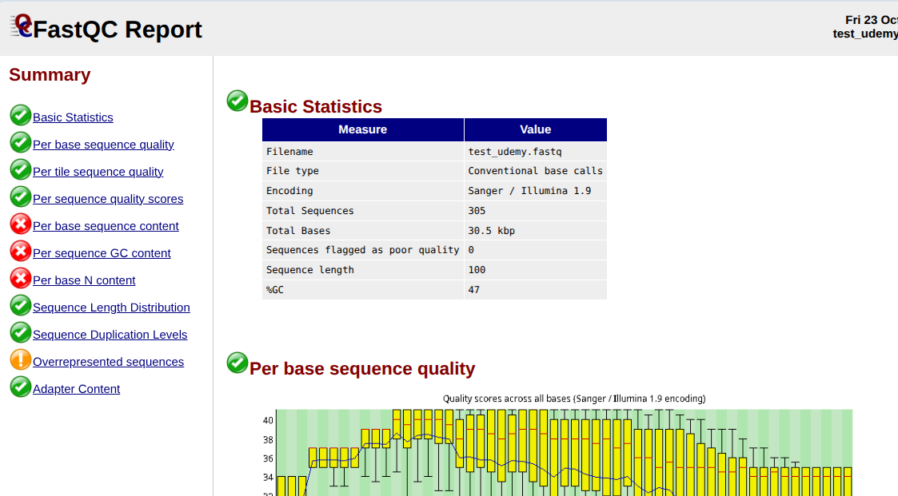

### 21. Quality Check of the Reads with FASTQC (Part-2)
- Basic statistics
- Per base sequence quality
  - Green: good quality
  - Yellow: intermediate
  - Red: Poor quality
- Per tile sequence quality
- Per sequence quality scores
  - Histogram view
  - For average quality score, the reads is the value in the X-axis (37 in the test_dumy.fastq)
- Per base sequence content
- Per sequence GC content
- Per base N content: high N number may imply bad quality
- Sequence length distribution
  - Histogram of sequence length
- Sequence duplication levels
- Overrepresented sequences
- Adapter content

### 22. Use of Timmomatic Tool to Remove Poor Quality Reads
- Unzip Trimmomatic-0.41.zip
- May need the latest java runtime
```bash
$ java -jar trimmomatic-0.41.jar SE -threads 4 test_udemy.fastq test_trimmed.fastq TRAILING:10 -phred33
TrimmomaticSE: Started with arguments:
 -threads 4 test_udemy.fastq test_trimmed.fastq TRAILING:10 -phred33
Input Reads: 305 Surviving: 305 (100.00%) Dropped: 0 (0.00%)
TrimmomaticSE: Completed successfully
```
  - SE for Single-End sequencing
  - PE for Paired-End sequencing (more expensive)
  - -phred33: quality score of 33
  - In this test, 0 Reads dropped
- Now run fastqc to generate html
  - Confirm that the quality has been improved

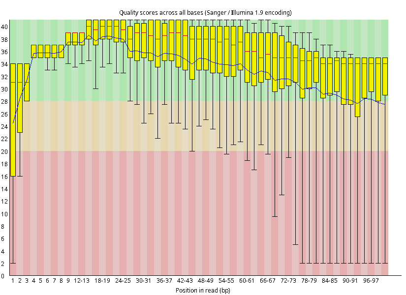

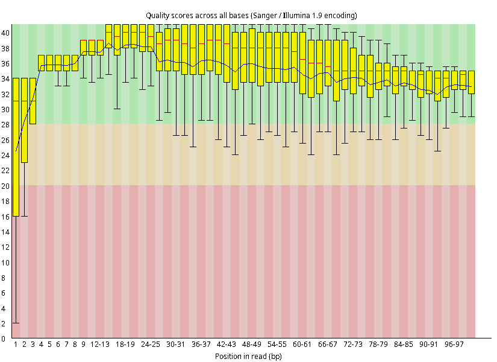

### 23. Use of HISAT2 for Alignment of Reads with Reference Genome
- Reference genome from hisat2 site: 
  - https://daehwankimlab.github.io/hisat2/download/
  - Download https://genome-idx.s3.amazonaws.com/hisat/grch38_genome.tar.gz
    - 3GB
```bash
$ hisat2 -q --rna-strandness R -x grch38/genome -U test_trimmed.fastq | samtools sort -o test_trimmed.bam
305 reads; of these:
  305 (100.00%) were unpaired; of these:
    14 (4.59%) aligned 0 times
    269 (88.20%) aligned exactly 1 time
    22 (7.21%) aligned >1 times
95.41% overall alignment rate
```

### 24. If Hisat2 Gives You Error Then Try This
- When memory size is not large enough
  - Increase swap memory size
  - sudo fallocate -l 8G /swapfile # will create a swap file
  - sudo chmod 600 /swapfile
  - sudo mkswap /swapfile
  - sudo swapon /swapfile
  - free -h

### 25. Building the Hisat2 Compatible Genome From FASTA
- https://www.ensembl.org
- Search Atlantic Salmon then click FASTA
  - Select GCA_021399835.1 and then click Get Files -> FASTA in Download
  - In the FTP menu, download unmasked.fa.bgz
  - Unzip using bgzip (sudo apt install tabix)
  - hisat2-build XXX.fa genome_index

### 26. Downloading of GTF File to Build the Feature Count Matrix
- Gene Transfer Format (GTF)
  - Col 1-9
- From ensemble.org, find homo sapiens and download gtf file

### 27. Building of Feature Count Matrix With Subread Tool
- featureCounts -S 1 -a Homo_sapiens.gtf -o test_featurecounts.txt test_trimmed.bam
```bash
$ featureCounts -S 1 -a genes.gtf -o test_featurecounts.txt test_trimmed.bam 
The "-S" option has been depreciated.

        ==========     _____ _    _ ____  _____  ______          _____  
        =====         / ____| |  | |  _ \|  __ \|  ____|   /\   |  __ \ 
          =====      | (___ | |  | | |_) | |__) | |__     /  \  | |  | |
            ====      \___ \| |  | |  _ <|  _  /|  __|   / /\ \ | |  | |
              ====    ____) | |__| | |_) | | \ \| |____ / ____ \| |__| |
        ==========   |_____/ \____/|____/|_|  \_\______/_/    \_\_____/
	  v2.0.6

//========================== featureCounts setting ===========================\\
||                                                                            ||
||             Input files : 1 BAM file                                       ||
||                                                                            ||
||                           test_trimmed.bam                                 ||
||                                                                            ||
||             Output file : test_featurecounts.txt                           ||
||                 Summary : test_featurecounts.txt.summary                   ||
||              Paired-end : no                                               ||
||        Count read pairs : no                                               ||
||              Annotation : genes.gtf (GTF)                                  ||
||      Dir for temp files : ./                                               ||
||                                                                            ||
||                 Threads : 1                                                ||
||                   Level : meta-feature level                               ||
||      Multimapping reads : not counted                                      ||
|| Multi-overlapping reads : not counted                                      ||
||   Min overlapping bases : 1                                                ||
||                                                                            ||
\\============================================================================//

//================================= Running ==================================\\
||                                                                            ||
|| Load annotation file genes.gtf ...                                         ||
||    Features : 5087789                                                      ||
||    Meta-features : 78941                                                   ||
||    Chromosomes/contigs : 70                                                ||
||                                                                            ||
|| Process BAM file test_trimmed.bam...                                       ||
||    Single-end reads are included.                                          ||
||    Total alignments : 357                                                  ||
||    Successfully assigned alignments : 211 (59.1%)                          ||
||    Running time : 0.00 minutes                                             ||
||                                                                            ||
|| Write the final count table.                                               ||
|| Write the read assignment summary.                                         ||
||                                                                            ||
|| Summary of counting results can be found in file "test_featurecounts.txt.  ||
|| summary"                                                                   ||
||                                                                            ||
\\============================================================================//
```
- Load featurecounts.txt in a spreadsheet
  - Delimited by space
  - Libre office failed to load due to the limit of characters in a cell

### 28. How to Process Multipipe FastQ Files Using Bash Scripts
- fastqc *.fastq
- script1.sh
```sh
#!/bin/bash
# Set the path to the input directory as the current directory
input_dir=$(pwd)
# Loop over all fq.gz files in the input directory
for file in "$input_dir"/*.fastq; do
    # Extract the filename without the extension
    filename=$(basename "$file" .fastq)
    # Run the trimmomatic command on the file
    java -jar trimmomatic-0.39.jar SE -threads 32 "$file" "$input_dir/$filename"_trimmed.fastq TRAILING:10 -phred33 
done
```

### 29. Experimental Design of Airway Cell Line Study That will Use In DEG Analysis
- Ref: https://doi.org/10.1371/journal.pone.0099625
  - Title: RNA-Seq Transcriptome Profiling Identifies CRISPLD2 as a Glucocorticoid Responsive Gene that Modulates Cytokine Function in Airway Smooth Muscle Cells

## Section 5: Basic Concepts of R and R-STudio

### 30. Introduction of the Section

### 31. Installation of R and R-Studio
- When installing R from a source code, use `--enable-R-shlib` for R-studio
  - If libR.so is not found, R-studio will not work
- Other pre-requisites:  
  - sudo apt install libssl-dev
  - sudo apt install libpng-dev
    - When PNG coupling is not available, plotPCA() will not work

### 32. Setting Working Directory in R-Studio
- In Rstudio:

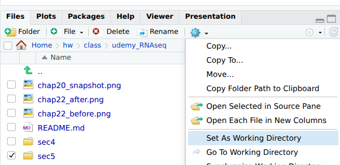

- Or `setwd("~/XXX/ZZZ/YYY")`

### 33. Basic Data Types Used in R
- Vector
- Matrix
- DataFRame
- List

### 34. Creating a Variable
- Variable provides a named storage that our program can manipulate

### 35. What is Package & Function in R?
- A function is a block of code which only runs when it is called
- Package contains many related functions
  - ggplot
  - Tidyverse
  - DESeq
  - `install.packages("ggplot")`

### 36. Brief Introduction of Bioconductor
- 
```R
if (!require("BiocManager", quietly = TRUE))
  install.packages("BiocManager")
BiocManager::install()
BiocManager::install(c("GenomicFeatures")
#Installation of DESeq2                     
BiocManager::install("DESeq2")
```

## Section 6: Differential Expression of Gene Analysis in R Using DESeq2 Package

### 37. Installation of DESeq2 in R-Studio For DEGs Analysis

### 38. What is CSV format & Saving MetaData File in CSV format

### 39. Uploading of Feature Count Matrix and Meta Data in R-Studio
- counts.csv and metadata2.csv # files are from Assignment 6
```R
> cnt <- read.csv("counts.csv")
> str(cnt) # shows the content of the dataframe
'data.frame':	64102 obs. of  8 variables:
 $ SRR1039508: int  679 0 467 260 60 0 3251 1433 519 394 ...
 $ SRR1039509: int  448 0 515 211 55 0 3679 1062 380 236 ...
 $ SRR1039512: int  873 0 621 263 40 2 6177 1733 595 464 ...
 $ SRR1039513: int  408 0 365 164 35 0 4252 881 493 175 ...
 $ SRR1039516: int  1138 0 587 245 78 1 6721 1424 820 658 ...
 $ SRR1039517: int  1047 0 799 331 63 0 11027 1439 714 584 ...
 $ SRR1039520: int  770 0 417 233 76 0 5176 1359 696 360 ...
 $ SRR1039521: int  572 0 508 229 60 0 7995 1109 704 269 ...
> met <- read.csv("metadata2.csv")
> str(met)
'data.frame':	8 obs. of  2 variables:
 $ cellLine     : chr  "N61311" "N61311" "N052611" "N052611" ...
 $ dexamethasone: chr  "untreated" "treated" "untreated" "treated" ...
```

### 40. Basic Quality Check of Feature Count Matrix and Meta Data
- Make sure the row name sin colData of cnt matches the row names of met
  - `all(colnames(cnt)%in% rownames(met))` must be TRUE
- Check the order of row names and column names
  - `all(colnames(cnt) == rownames(met))` must be TRUE

### 41. Use of DESeq2 for DEG Analysis (Part-1)
- Building DESeq data set
- Differential Analysis of Gene
```R
> library(DESeq2)
> dds <- DESeqDataSetFromMatrix(countData = cnt, 
                              colData = met,
                              design = ~dexamethasone)
> dds
class: DESeqDataSet 
dim: 64102 8 
metadata(1): version
assays(1): counts
rownames(64102): ENSG00000000003 ENSG00000000005 ... LRG_98 LRG_99
rowData names(0):
colnames(8): SRR1039508 SRR1039509 ... SRR1039520 SRR1039521
colData names(2): cellLine dexamethasone
```

### 42. DESeq2: Concept of Leaky Expression (Part-2)
- Differential expression of Genes
- Leaky expression of genes

### 43. DESEq2: Removing Low Counts Reads Genes (Part-3)
```R
> keep <- rowSums(counts(dds)) >= 10
> dds <- dds[keep,]
> dds
class: DESeqDataSet 
dim: 22369 8 
metadata(1): version
assays(1): counts
rownames(22369): ENSG00000000003 ENSG00000000419 ...
  ENSG00000273487 ENSG00000273488
rowData names(0):
colnames(8): SRR1039508 SRR1039509 ... SRR1039520
  SRR1039521
colData names(2): cellLine dexamethasone
```

### 44. DESeq2: Use of DESeq2 Function for DEG Analysis (Part-3)
```R
dds$dexamethasone <- relevel(dds$dexamethasone,ref="untreated")
> t0 <- Sys.time()
> deg <- DESeq(dds)
estimating size factors
estimating dispersions
gene-wise dispersion estimates
mean-dispersion relationship
final dispersion estimates
fitting model and testing
> t1 <- Sys.time()
> cat("Took", t1-t0, "sec\n")
Took 5.129387 sec
> res <- results(deg)
> write.csv(res,"test_udemy.csv")
> summary(res)

out of 22369 with nonzero total read count
adjusted p-value < 0.1
LFC > 0 (up)       : 1884, 8.4%
LFC < 0 (down)     : 1502, 6.7%
outliers [1]       : 51, 0.23%
low counts [2]     : 3903, 17%
(mean count < 4)
[1] see 'cooksCutoff' argument of ?results
[2] see 'independentFiltering' argument of ?results
```

### 45. What is Size Factor Estimation in DESEq2 ?
- What runs in DESeq()?
    1. Size factor estimation
    2. Dispersion estimation
    3. GLM model fitting
    4. Statistical value calculation
- Count matrix
    1. Gene length
    2. Sequencing bias
    3. Sequencing depth
    4. Library composition

### 46. What is dispersion Estimation in DESeq2?

### 47. Hypothesis testing in DESeq2 for DEG Analysis
- Hypothesis testing
  - Null hypothesis: there is no difference of gene expression b/w samples
  - Alternative hypothesis: there is difference of gene expression in b/w samples
- 95% leven of significance - p-value of 0.05
- In principle, if p-value is small (below a certain cutoff) the null hypothesis is rejected

### 48. Concept of P-value and P-Adjusted values
- Columns of DESeq() results: 
  - baseMean: normalization of data
  - log2FoldChange
  - lfcSE
  - stat
  - pvalue
  - padj: is used to find false-positive case
    - If this is less than a criterion (like 0.05), then the result might be false-positive

### 49. Getting Differentially Expressed Gene at Different Alpha Value
```R
> res0.05 <- results(deg,alpha=0.05)
> summary(res0.05)

out of 22369 with nonzero total read count
adjusted p-value < 0.05
LFC > 0 (up)       : 1555, 7%
LFC < 0 (down)     : 1158, 5.2%
outliers [1]       : 51, 0.23%
low counts [2]     : 4336, 19%
(mean count < 5)
[1] see 'cooksCutoff' argument of ?results
[2] see 'independentFiltering' argument of ?results
```
- The number of up/down regulated reads decreased compared to when alpha = 0.1

### 50. Converting Gene IDs to Gene Name
- `BiocManager::install("org.Hs.eg.db")` requires: 
  - `sudo apt install libssl-dev`
  - `sudo apt install libpng-dev`
```R
#
> BiocManager::install("org.Hs.eg.db") # homosapiens eg db
> library(org.Hs.eg.db)
> res0.05.df <- as.data.frame(res0.05)
> str(res0.05.df)
'data.frame':	22369 obs. of  6 variables:
 $ baseMean      : num  708.6 520.3 237.2 57.9 5817.3 ...
 $ log2FoldChange: num  -0.3788 0.2038 0.0341 -0.1172 0.441 ...
 $ lfcSE         : num  0.173 0.101 0.126 0.302 0.259 ...
 $ stat          : num  -2.188 2.023 0.269 -0.388 1.704 ...
 $ pvalue        : num  0.0287 0.0431 0.7877 0.6977 0.0884 ...
 $ padj          : num  0.136 0.179 0.928 0.891 0.292 ...
> res0.05.df$Symbol <- mapIds(org.Hs.eg.db,rownames(res0.05.df), keytype= "ENSEMBL", column="SYMBOL")
'select()' returned 1:many mapping between keys and columns
> str(res0.05.df)
'data.frame':	22369 obs. of  7 variables:
 $ baseMean      : num  708.6 520.3 237.2 57.9 5817.3 ...
 $ log2FoldChange: num  -0.3788 0.2038 0.0341 -0.1172 0.441 ...
 $ lfcSE         : num  0.173 0.101 0.126 0.302 0.259 ...
 $ stat          : num  -2.188 2.023 0.269 -0.388 1.704 ...
 $ pvalue        : num  0.0287 0.0431 0.7877 0.6977 0.0884 ...
 $ padj          : num  0.136 0.179 0.928 0.891 0.292 ...
 $ Symbol        : chr  "TSPAN6" "DPM1" "SCYL3" "FIRRM" ...
> write.csv(res0.05.df,"final_test_udemy.csv")
```

## Section 7: Quality Checking of RNA-Seq Data

### 51. Basic Quality Check Parameters
- Quality check of RNA-Seq data
  - PCA plot
  - Inspecting size factor
  - Dispersion plot

### 52. Basic Concepts of PCA Plot
- Principle Component Analysis

### 53. Building PCA Plot of RNA-Seq Data
```R
## Building of PCA plot
vsd <- vst(deg,blind=FALSE)
plotPCA(vsd,intgroup="dexamethasone")
```

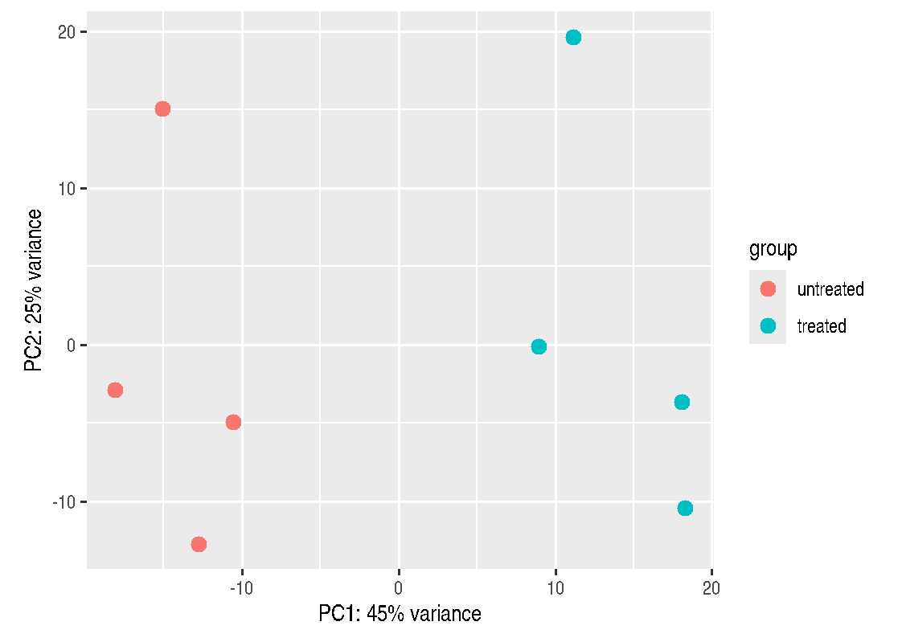

- From the plot, PC1 variance is 45% and PC2 variance is 25%

### 54. Size Factor Estimation and Its Calculation
- Investigate any systematic bias in the sequencing data
- Usually these size factor should vary around 1, indicating comparable sequencing depth
```R
> # Size factor estimation
> sizeFactors(deg)
SRR1039508 SRR1039509 SRR1039512 SRR1039513 SRR1039516 
 1.0236476  0.8961327  1.1795171  0.6700291  1.1776714 
SRR1039517 SRR1039520 SRR1039521 
 1.3990527  0.9208046  0.9445520 
```
- Note that SRR1039513 has a very low size factor

### 55. Dispersion Estimates and Building of Dispresion Plot
```R
> # Estimating the dispersion
> plotDispEsts(deg)
```

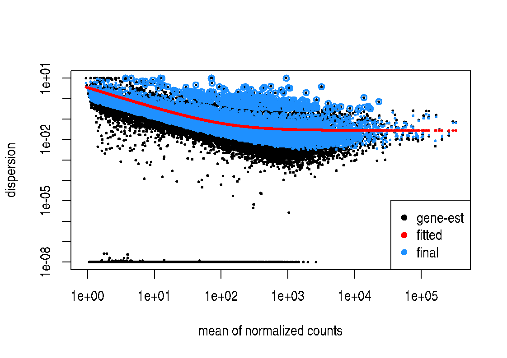

- Dispersion curve must be downward direction
- The entire R script so far:
```R
if (!require("BiocManager", quietly = TRUE))
  install.packages("BiocManager")
BiocManager::install()
BiocManager::install(c("GenomicFeatures")
#Installation of DESeq2                     
BiocManager::install("DESeq2")
setwd("~/hw/class/udemy_RNAseq/sec5")
cnt <- read.csv("counts.csv")
str(cnt) # shows the content of the dataframe
met <- read.csv("metadata2.csv")
str(met)
# make sure the row name sin colData of cnt matches the row names of met
all(colnames(cnt)%in% rownames(met))

# checking order of row names and column names
all(colnames(cnt) == rownames(met))

library(DESeq2)
dds <- DESeqDataSetFromMatrix(countData = cnt, 
                              colData = met,
                              design = ~dexamethasone)
dds
# removes low count Reads (optional step)
keep <- rowSums(counts(dds)) >= 10
dds <- dds[keep,]
dds
# Setting reference for DEG analysis
dds$dexamethasone <- relevel(dds$dexamethasone,ref="untreated")
t0 <- Sys.time()
deg <- DESeq(dds)
t1 <- Sys.time()
cat("Took", t1-t0, "sec\n")
res <- results(deg)
write.csv(res,"test_udemy.csv")
summary(res)
res0.05 <- results(deg,alpha=0.05)
summary(res0.05)
#
BiocManager::install("org.Hs.eg.db") # homosapiens eg db
library(org.Hs.eg.db)
res0.05.df <- as.data.frame(res0.05)
str(res0.05.df)
res0.05.df$Symbol <- mapIds(org.Hs.eg.db,rownames(res0.05.df), keytype= "ENSEMBL", column="SYMBOL")
str(res0.05.df)
write.csv(res0.05.df,"final_test_udemy.csv")
## Building of PCA plot
vsd <- vst(deg,blind=FALSE)
plotPCA(vsd,intgroup="dexamethasone")
# Size factor estimation
sizeFactors(deg)
# Estimating the dispersion
plotDispEsts(deg)
```

## Section 8: Analysis of Gene Expression Data

### 56. Basic Understanding of Tidyverse & ggplot2
- Tidyverse package contains functions of
  - Filte
  - Sort
  - Arrange
  - Edit
  - And many others

### 57. Installation of Tidyverse & ggplot2 and Sample Dataset
```R
> install.packages("gapminder")
> library(gapminder)
> countries <- gapminder
> str(countries)
tibble [1,704 × 6] (S3: tbl_df/tbl/data.frame)
 $ country  : Factor w/ 142 levels "Afghanistan",..: 1 1 1 1 1 1 1 1 1 1 ...
 $ continent: Factor w/ 5 levels "Africa","Americas",..: 3 3 3 3 3 3 3 3 3 3 ...
 $ year     : int [1:1704] 1952 1957 1962 1967 1972 1977 1982 1987 1992 1997 ...
 $ lifeExp  : num [1:1704] 28.8 30.3 32 34 36.1 ...
 $ pop      : int [1:1704] 8425333 9240934 10267083 11537966 13079460 14880372 12881816 13867957 16317921 22227415 ...
 $ gdpPercap: num [1:1704] 779 821 853 836 740 ...
> install.packages("dplyr")
> install.packages("ggplot2")
> library(dplyr)
> library(ggplot2)
```

### 58. Basic Functionality of Tidyverse Functions; Filter, Arrange, and Mutate
```R
> countries %>%
+   filter(year==1952)
# A tibble: 142 × 6
   country     continent  year lifeExp      pop gdpPercap
   <fct>       <fct>     <int>   <dbl>    <int>     <dbl>
 1 Afghanistan Asia       1952    28.8  8425333      779.
 2 Albania     Europe     1952    55.2  1282697     1601.
 3 Algeria     Africa     1952    43.1  9279525     2449.
 4 Angola      Africa     1952    30.0  4232095     3521.
 5 Argentina   Americas   1952    62.5 17876956     5911.
 6 Australia   Oceania    1952    69.1  8691212    10040.
 7 Austria     Europe     1952    66.8  6927772     6137.
 8 Bahrain     Asia       1952    50.9   120447     9867.
 9 Bangladesh  Asia       1952    37.5 46886859      684.
10 Belgium     Europe     1952    68    8730405     8343.
# ℹ 132 more rows
# ℹ Use `print(n = ...)` to see more rows
> countries %>%
+   filter(country == "Pakistan")
# A tibble: 12 × 6
   country  continent  year lifeExp       pop gdpPercap
   <fct>    <fct>     <int>   <dbl>     <int>     <dbl>
 1 Pakistan Asia       1952    43.4  41346560      685.
 2 Pakistan Asia       1957    45.6  46679944      747.
 3 Pakistan Asia       1962    47.7  53100671      803.
 4 Pakistan Asia       1967    49.8  60641899      942.
 5 Pakistan Asia       1972    51.9  69325921     1050.
 6 Pakistan Asia       1977    54.0  78152686     1176.
 7 Pakistan Asia       1982    56.2  91462088     1443.
 8 Pakistan Asia       1987    58.2 105186881     1705.
 9 Pakistan Asia       1992    60.8 120065004     1972.
10 Pakistan Asia       1997    61.8 135564834     2049.
11 Pakistan Asia       2002    63.6 153403524     2093.
12 Pakistan Asia       2007    65.5 169270617     2606.
> countries %>%
+   arrange(lifeExp)  # sorting 
# A tibble: 1,704 × 6
   country      continent  year lifeExp     pop gdpPercap
   <fct>        <fct>     <int>   <dbl>   <int>     <dbl>
 1 Rwanda       Africa     1992    23.6 7290203      737.
 2 Afghanistan  Asia       1952    28.8 8425333      779.
 3 Gambia       Africa     1952    30    284320      485.
 4 Angola       Africa     1952    30.0 4232095     3521.
 5 Sierra Leone Africa     1952    30.3 2143249      880.
 6 Afghanistan  Asia       1957    30.3 9240934      821.
 7 Cambodia     Asia       1977    31.2 6978607      525.
 8 Mozambique   Africa     1952    31.3 6446316      469.
 9 Sierra Leone Africa     1957    31.6 2295678     1004.
10 Burkina Faso Africa     1952    32.0 4469979      543.
# ℹ 1,694 more rows
# ℹ Use `print(n = ...)` to see more rows
> countries %>%
+   arrange(desc(lifeExp)) # sorting inversely
# A tibble: 1,704 × 6
   country          continent  year lifeExp       pop gdpPercap
   <fct>            <fct>     <int>   <dbl>     <int>     <dbl>
 1 Japan            Asia       2007    82.6 127467972    31656.
 2 Hong Kong, China Asia       2007    82.2   6980412    39725.
 3 Japan            Asia       2002    82   127065841    28605.
 4 Iceland          Europe     2007    81.8    301931    36181.
 5 Switzerland      Europe     2007    81.7   7554661    37506.
 6 Hong Kong, China Asia       2002    81.5   6762476    30209.
 7 Australia        Oceania    2007    81.2  20434176    34435.
 8 Spain            Europe     2007    80.9  40448191    28821.
 9 Sweden           Europe     2007    80.9   9031088    33860.
10 Israel           Asia       2007    80.7   6426679    25523.
# ℹ 1,694 more rows
# ℹ Use `print(n = ...)` to see more rows
> countries %>%
+   mutate(pop = pop/1000000)
# A tibble: 1,704 × 6
   country     continent  year lifeExp   pop gdpPercap
   <fct>       <fct>     <int>   <dbl> <dbl>     <dbl>
 1 Afghanistan Asia       1952    28.8  8.43      779.
 2 Afghanistan Asia       1957    30.3  9.24      821.
 3 Afghanistan Asia       1962    32.0 10.3       853.
 4 Afghanistan Asia       1967    34.0 11.5       836.
 5 Afghanistan Asia       1972    36.1 13.1       740.
 6 Afghanistan Asia       1977    38.4 14.9       786.
 7 Afghanistan Asia       1982    39.9 12.9       978.
 8 Afghanistan Asia       1987    40.8 13.9       852.
 9 Afghanistan Asia       1992    41.7 16.3       649.
10 Afghanistan Asia       1997    41.8 22.2       635.
# ℹ 1,694 more rows
# ℹ Use `print(n = ...)` to see more rows
> countries %>%
+   filter(country == "Pakistan") %>%
+   arrange(desc(lifeExp)) %>%
+   mutate(pop = pop/1000000)
# A tibble: 12 × 6
   country  continent  year lifeExp   pop gdpPercap
   <fct>    <fct>     <int>   <dbl> <dbl>     <dbl>
 1 Pakistan Asia       2007    65.5 169.      2606.
 2 Pakistan Asia       2002    63.6 153.      2093.
 3 Pakistan Asia       1997    61.8 136.      2049.
 4 Pakistan Asia       1992    60.8 120.      1972.
 5 Pakistan Asia       1987    58.2 105.      1705.
 6 Pakistan Asia       1982    56.2  91.5     1443.
 7 Pakistan Asia       1977    54.0  78.2     1176.
 8 Pakistan Asia       1972    51.9  69.3     1050.
 9 Pakistan Asia       1967    49.8  60.6      942.
10 Pakistan Asia       1962    47.7  53.1      803.
11 Pakistan Asia       1957    45.6  46.7      747.
12 Pakistan Asia       1952    43.4  41.3      685.
```

### 59. Basic Functionality of ggplot2 to Build the Plots
```R
ggplot(countries,aes(x=gdpPercap, y=lifeExp)) + geom_point()
```

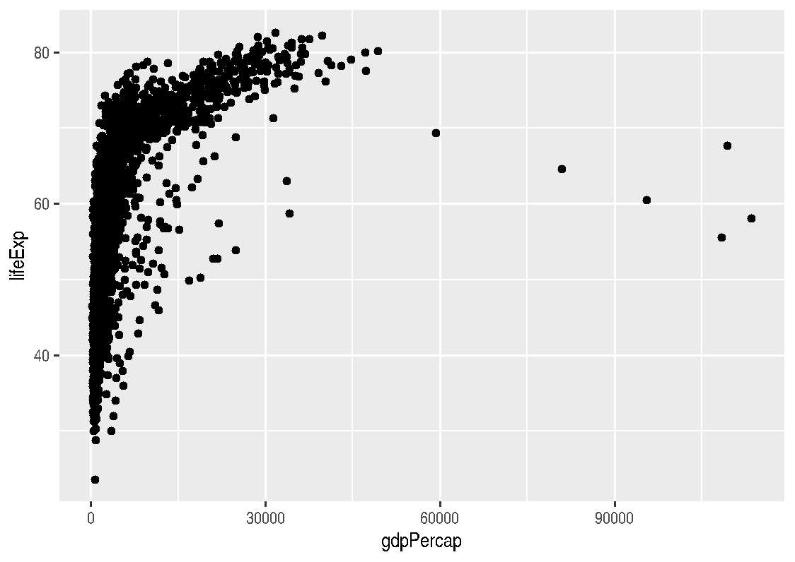

### 60. Building MA Plot
- Mean-Average Plot
```R
## Building MA plot
plotMA(res0.05)
```

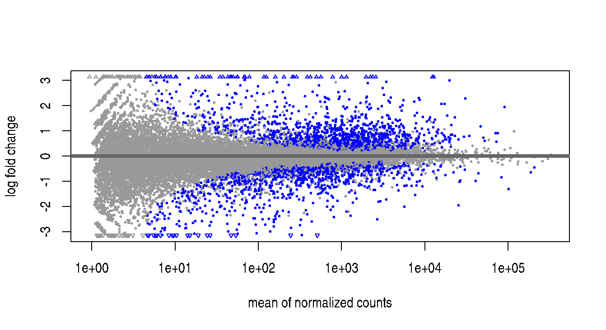

- Note that X-axis is Mean normalized count and Y-axis is Log2FoldChange

### 61. Getting Idea About Best Genes
```R
> ## Getting Idea about Best genes
> library(dplyr)
> best_genes <- res0.05.df %>% 
+   arrange(padj) %>%
+   head(10)
> best_genes
                  baseMean log2FoldChange      lfcSE      stat
ENSG00000152583   997.4447       4.602555 0.21174194  21.73662
ENSG00000148175 11193.7232       1.451494 0.08489578  17.09736
ENSG00000179094   776.6002       3.183883 0.20150941  15.80017
ENSG00000134686  2737.9816       1.387168 0.09165870  15.13406
ENSG00000125148  3656.2674       2.203468 0.14741913  14.94696
ENSG00000120129  3409.0384       2.949013 0.20154644  14.63193
ENSG00000189221  2341.7807       3.305227 0.22803072  14.49466
ENSG00000109906   385.0713       7.176149 0.49635930  14.45757
ENSG00000178695  2649.8225      -2.499883 0.17890348 -13.97336
ENSG00000101347 12703.4128       3.857750 0.27932477  13.81099
                       pvalue          padj  Symbol
ENSG00000152583 9.245855e-105 1.662590e-100 SPARCL1
ENSG00000148175  1.552860e-65  1.396176e-61    STOM
ENSG00000179094  3.102848e-56  1.859847e-52    PER1
ENSG00000134686  9.655331e-52  4.340554e-48    PHC2
ENSG00000125148  1.630150e-50  5.862672e-47    MT2A
ENSG00000120129  1.757388e-48  5.266891e-45   DUSP1
ENSG00000189221  1.309529e-47  3.363993e-44    MAOA
ENSG00000109906  2.245873e-47  5.048161e-44  ZBTB16
ENSG00000178695  2.266696e-44  4.528859e-41  KCTD12
ENSG00000101347  2.188188e-43  3.934800e-40  SAMHD1
```

### 62. Building Volcano Plot-Part1
- A kind of scatter plot
  - Upregulated and downregulated in Red/Blue

### 63. Building Volcano Plot -Part2
```R
# Generating volcano plot
vol <- res0.05.df %>% 
  filter(!is.na(padj))
library(ggplot2)
ggplot(vol, aes(x=log2FoldChange, y=-log10(padj), 
                color=padj <0.05 & abs(log2FoldChange)>1)) + 
  geom_point() + geom_text(data = best_genes, aes(label=Symbol), 
                           hjust=-0.2, vjust=0.5)
```

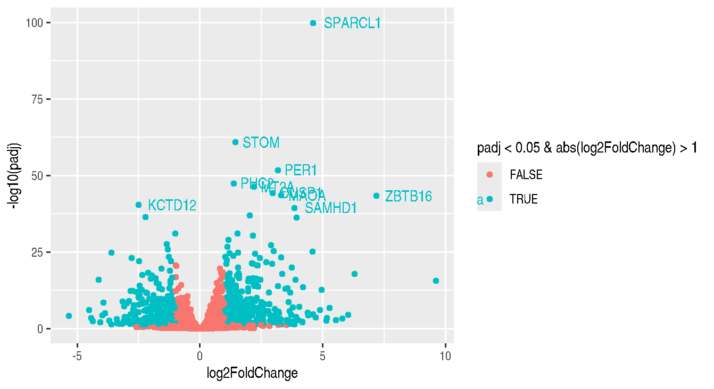

- From the plot:
  - VCAM1 gene is down-regulated
  - ZBTB16 is up-regulated
  - Orange color dots are False positive results. The genes having p-values less then 0.05. 

### 64. Building HeatMap of DEGs
- Sample heatmap plot:

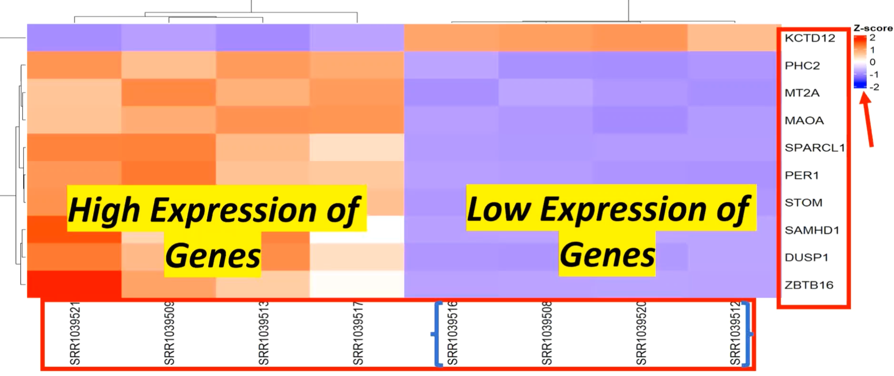

```R
> #building Heatmap
> BiocManager::install("ComplexHeatmap")
> library(ComplexHeatmap)
> top_genes <- res0.05.df %>%
+   arrange(padj) %>%
+   head(30)
> mat <- counts(deg, normalized=T)[rownames(top_genes),]
> head(mat,5)
                SRR1039508 SRR1039509 SRR1039512 SRR1039513 SRR1039516
ENSG00000152583   60.56772   2276.449   83.93265   1749.178   84.91333
ENSG00000148175 5965.92002  17576.638 5986.34792  15436.644 6027.99752
ENSG00000179094  173.88796   1678.323  117.84483   1225.320  194.45153
ENSG00000134686 1456.55588   3655.709 1512.48331   4099.822 1656.65913
ENSG00000125148 1615.79036   6698.785 1161.49223   5772.884 1150.57566
                SRR1039517 SRR1039520 SRR1039521
ENSG00000152583   1375.216   85.79454   2263.507
ENSG00000148175  15075.915 5995.84343  17484.479
ENSG00000179094   1185.088  129.23481   1508.652
ENSG00000134686   3908.359 1430.27093   4183.994
ENSG00000125148   6307.125 1291.26206   5252.225
> mat.z <-t(apply(mat,1,scale))
> head(mat.z,5)
                      [,1]      [,2]       [,3]      [,4]       [,5]
ENSG00000152583 -0.9160048 1.2505095 -0.8931604 0.7349856 -0.8922015
ENSG00000148175 -0.9292740 1.1346021 -0.9256428 0.7542051 -0.9182393
ENSG00000179094 -0.8815052 1.3188272 -0.9634718 0.6562815 -0.8514296
ENSG00000134686 -0.9714132 0.6957033 -0.9290162 1.0323735 -0.8197205
ENSG00000125148 -0.7997234 1.1924527 -0.9777763 0.8295648 -0.9820548
                     [,6]       [,7]      [,8]
ENSG00000152583 0.3693553 -0.8913400 1.2378562
ENSG00000148175 0.6900834 -0.9239549 1.1182204
ENSG00000179094 0.5974390 -0.9468133 1.0706723
ENSG00000134686 0.8872304 -0.9913391 1.0961818
ENSG00000125148 1.0389496 -0.9269157 0.6255032
> colnames(mat.z) <-rownames(met) # metadata above
> head(mat.z,1)
                SRR1039508 SRR1039509 SRR1039512 SRR1039513 SRR1039516
ENSG00000152583 -0.9160048    1.25051 -0.8931604  0.7349856 -0.8922015
                SRR1039517 SRR1039520 SRR1039521
ENSG00000152583  0.3693553   -0.89134   1.237856
> Heatmap(mat.z, cluster_rows=T, cluster_columns = T, 
+         column_labels = colnames(mat.z), row_labels = top_genes$Symbol)
```

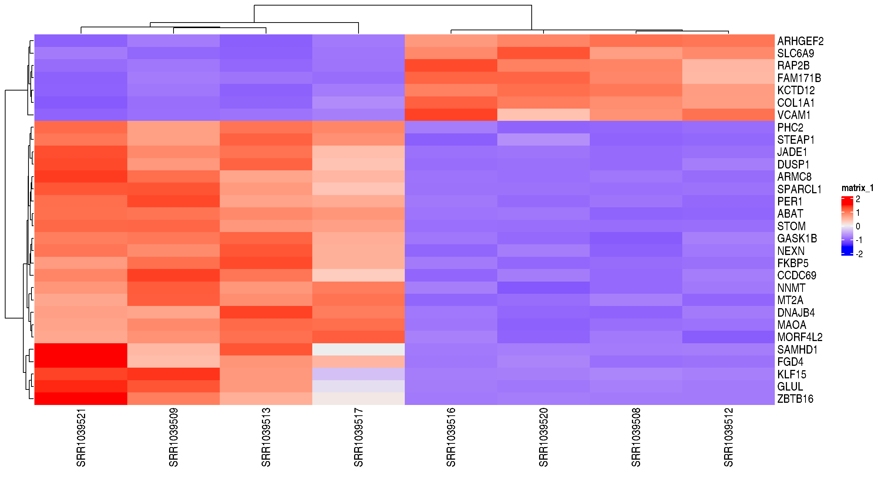

- From the plots, SRR1039512 has high expression genes at ARHGEF2, SLC6A9, RAP2B, FAM171B, KCTD12, CCL1A1, VCAM1

### 65. Simple Gene Ontology and Pathway Analysis of Genes
- Gene Ontology (GO) describes knowledge of biological domain
  - Molecular function
  - Cellular compartment
  - Biological processes
- https://davidbioinformatics.nih.gov
  - Use List Manager to submit gene/protein list
  - SPARCL1, STOM, PER1, PHC2, MT2A, DUSP1, MAOA, ZBTB16, KCTD12, SAMHD1
  - The lecture material is out-dated and
